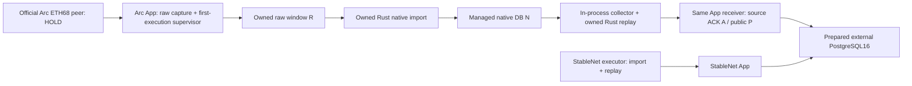

# Native runtime composition draft

Review process ownership and mounts without starting services. This is separate
from the [diagnostic profile](../README.md) and four-testnet [legacy stack](../../testnets/README.md).
**Docker build/pull/start, App/node/DB/peer execution, provisioning/format, operational
GC/restore, deployment and additional performance measurements remain HOLD.**

The [Compose declaration](compose.draft.yaml) version2 has three services:
`arc-app`, `stablenet-app`, `stablenet-executor`. Arc App owns the implemented
[ingress](../../../docs/EXECUTION_ARC_INGRESS.md), Rust first-execution child,
in-process collector and Rust second-execution child. There is no external Arc
collector or full-node service. Version1 declarations with a separate Arc
collector are rejected by the updated checker. Upstream clients and two EVM
passes are unchanged.

Compose profiles, required variables, `x-` metadata and the offline checker are
**not a startup interlock**. A direct Compose invocation with filled variables can
bypass documented HOLD. No activation wrapper or runtime image recipe is provided.
The legacy host guard does not certify this different composition.

## Offline checks and their limits

Use Python3.9+ with the [pinned YAML parser](../../testnets/requirements.txt):

```sh
python3 -B deployments/native/runtime/check.py
# Valid declaration: HOLD / exit2, never startup authorization.
python3 -B -m unittest discover -s deployments/native/runtime -p test_runtime.py -v
# Owned host binaries for existing legacy file preflight/diagnostic fixtures:
bash deployments/native/test-cli.sh
```

The checker reads only this declaration or an explicit `--file FILE`, using the
existing bounded strict decoder: one regular non-symlink leaf, nonblocking,
maximum1MiB/32 nesting/8192 events. It expands no environment and follows no
bind/config/secret/raw/native path. It starts no process or network connection.
Unknown fields, repeated mappings, aliases, merge input, unsafe mounts, stale topology and
limit drift fail closed. Output has at most128 fixed-code findings/64KiB;
raw values, paths, credentials and parser errors are not emitted.

`declared_contract: valid` remains separate from `status: HOLD`, exit2,
`operational_readiness: not_authorized`, `live_freshness: not_checked` and
`actuation: none`. Even fully resolved synthetic paths/images never become READY.
The checker certifies neither actual APFS identity/aliases/permissions nor image
contents, private App YAML, network, schema, key, checkpoint or live readiness.

The owned host CLI fixture preserves existing **legacy collector/executor** file
preflight and read-only diagnostic contracts. Its Arc `/scratch` is a standalone
synthetic legacy declaration, not this managed App mount layout. Those checks do
not validate the App-owned ingress configuration or its raw/SQL/coordinator-journal
state. Managed App file-preflight/diagnostics #257 and [N6 owned SDK/App/SQL
acceptance](../../../docs/EXECUTION_ARC_ACCEPTANCE.md) are separately qualified;
no legacy PASS substitutes for them. See [preflight](../../../docs/NATIVE_EXECUTION_PREFLIGHT.md) and
[diagnostic coverage](../../../docs/NATIVE_EXECUTION_DIAGNOSTICS.md).

## Process ownership and networks



Arc's first-import implementation is present; its actual peer, authenticated
checkpoint and managed runtime acceptance remain HOLD. Receiver readiness gates
owned child startup. Capture R, native completion N, source seal/ACK and SQL
public P are separate observations. Only final publication performs NEW uncached
canonical fresh → post-response generation fence → COMMIT → exact ACK. Neither
raw fsync, native Ready nor a child reply is public completion/deletion authority.

Apps borrow the existing pool4/part2/API1 and physical RPC5 budget. Seven logical
writers are not seven connections. Retries/failover/batch fallback share RPC5.
Two native Apps use8 nominal DB connections; four chain Apps use16. Do not run
legacy/native writers together against the same schema or add a maintenance pool.
See the [whole-server budget](../../../docs/OPERATIONS_READINESS.md).

Arc App needs database/RPC/static-peer egress. StableNet App needs database/RPC;
its separate executor needs static-peer egress and no DB secret. No peer port,
HTTP/WS/Engine service, Docker socket or health probe is published. Actual peer
reachability and fork/history support remain untested. The separate diagnostic
profile remains network-none/no-DSN/read-only.

## Images, credentials and paths

All images require reviewed digest references and `pull_policy: never`.
`INDEXER_NATIVE_APP_IMAGE` must contain both Go product binaries, `/bin/sh`/`cat`
for the existing [DSN wrapper](../../testnets/indexer-entrypoint.sh), plus the
pinned `/app/arc-native-import`, `/app/indexer-arc-executor` and explicit
`/app/arc-native-maintenance` binaries. `INDEXER_STABLENET_EXECUTOR_IMAGE` supplies
its separate executor. No Arc collector image variable is used. Actual contents,
pins, ABI and availability remain HOLD; the diagnostic image is insufficient.

Services use an explicit same non-root UID:GID, private host inputs/directories,
read-only root, init, dropped capabilities, no-new-privileges, restart:no and
SIGTERM/120s grace. Grace is a proposal, not measured queue-flush evidence.
Every bind has `create_host_path: false`; no anonymous/named data volume is added.

| Host variable suffix | Container target | Owner / access |
| --- | --- | --- |
| `APP_CONFIG` (each chain) | `/etc/indexer/config.yaml` | App RO; actual single-chain YAML, Arc includes `source.execution.ingress` |
| `IPC` (each chain) | `/ipc`, socket `/ipc/execution.sock` | Selected App; StableNet executor also RW;0700 same UID/0600 socket |
| `NATIVE_PARENT` (each chain) | `/native`, DB `/native/node` | Arc App or StableNet executor RW; private parent holds locks/COW siblings |
| `SOURCE_PARENT` (each chain) | `/source`, spool `/source/spool` | Arc App or StableNet executor RW |
| `RAW_VOLUME` (Arc) | `/raw`, window `/raw/arc-raw` | Arc App RW; exact prepared volume marker/identity/reservation, independent quota |
| `PEER_KEY_FILE` (Arc) | `/run/private/arc-peer-key` | Arc App RO; private0600 key, never a diagnostic input |
| `NATIVE_CONFIG` (StableNet only) | `/etc/indexer/native.json` | Executor RO |
| `GENESIS_FILE` (StableNet only) | `/etc/indexer/genesis.json` | Executor RO |
| `DSN_FILE` (each chain) | `/run/secrets/postgres_dsn` | Selected App only, private file outside repo/data |

Use the `INDEXER_<ARC|STABLENET>_RUNTIME_` prefix. Arc has no external NATIVE_CONFIG
or SCRATCH mount. Its App config names `arc.native`, the two child executables,
`/native/node`, `/source/spool`, `/raw/arc-raw` through `window_storage`, and the
private peer key. `initialize_volume` and `create_window` remain false in this
prepared-storage draft. Initial bootstrap/volume preparation is a separate held
procedure; no placeholder is a valid typed runtime value.

The managed collector currently derives scratch as `dirname(collector.spool_dir)`:
`/source`. It creates owned temporary children there, outside `/source/spool`.
Spool quota does not include all scratch/COW bytes. Do not delete that parent to
free space. A separately configurable scratch directory is not implemented.

The native **parent** is RW and there is no nested `/native/node` bind: child
replacement during COW must be visible through the same parent. The run lock
`/native/.node.execution-retention-lock`, journal
`/native/.node.arc-execution-maintenance` and its `.lock` remain outside the
native COW child. Mounting the child separately could pin an old inode. Actual
Docker Desktop bind/flock/identity behavior is still unverified; replacing the
parent or detaching the disk requires stopped owners and fresh host validation.

Native/source/raw/IPC/config/key/DSN host bindings must be lexically disjoint,
except each chain's shared IPC. The checker rejects overlaps, but certifies no
filesystem aliases, case folding or APFS UUID. The unchanged DSN wrapper refuses
direct DSN overrides and passes the file value only to its App environment,
without echo/source/argv. Owned Arc Rust children receive the existing filtered
environment, not DSN/API credentials. No producer or diagnostic bundle gets a DSN.

## Capacity, restart and maintenance remain held

Budget raw bytes/indices/forks, native steady growth plus COW candidate/old copy,
source plus COW, collector scratch, PostgreSQL rows/indices/WAL, checkpoints,
backup staging and filesystem reserve separately. Root/native/source quota is
not total free space.172800 blocks assumes2blocks/s for24h; it is neither a RAM
queue nor proof that a byte quota lasts24h. Current source defaults256MiB/4096
records are bounds, not operating sizing. See [capacity](../../../docs/OPERATIONS_CAPACITY_DRAFT.md).

Arc App owns normal startup/stop of capture, importer, collector and receiver;
there is no second Arc service to start or stop. StableNet retains App-first,
executor-second readiness and executor-first shutdown. PostgreSQL is an already
prepared external dependency, never created/stopped by this declaration.
Normal restart preserves original I/bootstrap/anchor and raw/native/source/SQL
identities; it never rewrites generation from Hello/latest/zero.

[Explicit App/E3 maintenance](../../../docs/EXECUTION_MAINTENANCE_COORDINATOR.md)
drains and joins both workers, independently authorizes E3, records raw completion
including zero candidates, completes native/source COW under live leases, uses
fresh SQL completion, releases exact files and verifies resume. Unfinished or
corrupt journals block normal startup/resume; offline recovery starts no App.
There is no automatic GC/timer/maintenance service or CLI activation in Compose.
The same Store/RPC budget and pending fences remain mandatory; no TTL repair.

N5 declaration alignment and [managed file inspection](../../../docs/EXECUTION_MANAGED_INSPECTION.md)
are implemented. [N6 combined App/mock ETH68/actual SDK/SQL/GC acceptance](../../../docs/EXECUTION_ARC_ACCEPTANCE.md) is qualified with owned fixtures.
Metadata inspection cannot certify SDK state, part coverage, live freshness or resume. Actual APFS, peers/fork,
authenticated checkpoint, private config/image, prepared DB and matched backup/
restore evidence all remain HOLD. Other projects/resources/config are unchanged.

See the [current inspection plan/checklist](../../../docs/codemine/runs/20261031-managed-inspection/plan.md),
[readiness](../../../docs/OPERATIONS_READINESS.md) and [remaining work](../../../docs/analysis/open-items.md).
