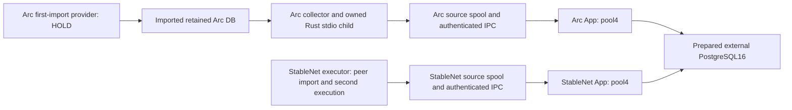

# Native runtime composition draft

Review the future process topology without starting it. This is separate from
the [diagnostic-only profile](../README.md) and the four-testnet
[legacy stack](../../testnets/README.md). **Image build/pull, Docker/App/node/DB/
peer execution, disk provisioning/formatting, GC/restore and additional
performance measurements remain HOLD.** No operating file, secret or data
directory is created, opened or changed by this draft's offline checker.

The [Compose declaration](compose.draft.yaml) is a design artifact, not a tested
operating stack. Its required-variable placeholders block ordinary unresolved
Compose interpolation, but **profiles, `x-` notes and the offline checker are
not a startup interlock**. A direct Compose invocation after filling variables
can bypass the documented HOLD. No start command, activation wrapper, image
recipe or automatic recovery is provided. The legacy host guard does not
authorize or validate this different native composition.

## Offline review

Use Python3.9+ and the repository's [pinned YAML parser](../../testnets/requirements.txt):

```sh
python3 -B deployments/native/runtime/check.py
# HOLD / exit2, declared_contract valid, operation not authorized.
python3 -B -m unittest discover -s deployments/native/runtime -p test_runtime.py -v
# Full owned fixture, builds four read-only Go diagnostic commands only:
bash deployments/native/test-cli.sh
```

The full fixture reuses those owned binaries, copies only public synthetic
inputs, rewrites declared container paths and runs both real product file
preflights. It checks input bytes/inodes/files remain unchanged. It opens no
declared native/spool/checkpoint/DB/socket path and proves no Docker mount,
actual lease, image, network or operating readiness.

The checker accepts no flags (this public draft) or `--file FILE` (one explicit
complete declaration). It imports the existing bounded strict YAML decoder;
reads only that selected regular non-symlink leaf, at most1MiB, nonblocking;
and follows no bind, secret, config or native path. It does not expand environment
variables or inspect Docker, APFS, images, schema, socket, credentials or peers.
Input ancestor paths and actual bind identity are not certified.

Duplicate keys, aliases, merge keys, unknown schemas, multiple documents,
nesting over32, over8192 parser events, unsafe bindings and CLI/I/O/output
failures return FAIL/1. Known conflicts dominate other unresolved inputs.
Fixed-code output has at most128 findings and stays below64KiB, with no raw
values, paths, secrets or parser errors. Short/broken output returns1.

`declared_contract: valid` is separate from `status: HOLD`, exit2. Even fully
filled synthetic image/path/UID declarations remain HOLD because external
evidence is unperformed. `operational_readiness: not_authorized`,
`live_freshness: not_checked`, `actuation: none` never grant startup, ACK,
generation, deletion or recovery authority. `x-indexer-native-plan` records fixed
design boundaries; editing its HOLD notes to READY is rejected by the checker,
not enforced by Docker. Actual application file validation still belongs to
[execution-preflight](../../../docs/NATIVE_EXECUTION_PREFLIGHT.md).

## Processes and missing first import

The [first-import design](../../../docs/ARC_NATIVE_IMPORT_DESIGN.md) now selects
an opt-in Go supervisor inside Arc App and an owned Rust native writer sharing
the App RPC budget; the existing collector keeps the second EVM pass. N0 now
provides bounded inputs/fences and actual SDK qualification. N1 adds the [offline native bootstrap](../../../docs/EXECUTION_ARC_BOOTSTRAP.md); N2-N6 implementation
is pending. This draft still has no importer or App native-RW/
ingress mounts. The design does not activate or change this composition.



| Service / dependency | Contract |
| --- | --- |
| `arc-app`, `stablenet-app` | Product App binaries via the existing mounted DSN wrapper; one writer owner per chain/schema; canonical RPC and external DB access |
| `arc-collector` | `/app/arc-execution-collector --config /etc/indexer/native.json`; owns `/app/arc-executor` as its stdio child in this same container, no network or DSN |
| `stablenet-executor` | `/app/stablenet-executor --config /etc/indexer/native.json`; owns official peer import, replay and source transport; no DB secret, HTTP/WS/Engine service or published peer port |
| PostgreSQL16 | Already prepared external server/schema/network, fsync and synchronous durability. Not initialized or started by this composition |
| Arc first-import provider | **HOLD.** The [collector](../../../x/arc/collector/run.go) reads already imported blocks and starts no peer importer. A reviewed provider must maintain compatible native data and complete import stages; an enode or a copied checkpoint alone cannot supply continuing import |

Arc's current adapter is a read-only second execution, not a standalone socket
sidecar or P2P synchronizer. The first-import integration remains an explicit
unfinished dependency. No full-node service is silently added to satisfy it.
StableNet uses its own existing owned importer; it cannot read Arc's native
format. Both preserve two EVM executions and unchanged upstream clients.

These two Apps replace the same chains' legacy writers; they must never run
alongside them against the same schema. BSC/Sepolia are unchanged. Two native
Apps use8 nominal DB connections; with the other two chain Apps the baseline
is16. Extra API/maintenance Store pools are separate additions; see the
[whole-server budget](../../../docs/OPERATIONS_READINESS.md).

## Images, identity, secrets and mounts

All image inputs must be reviewed digest references, not mutable tags. The
shared `INDEXER_NATIVE_APP_IMAGE` must contain both Go product binaries and
`/bin/sh`/`cat` for the existing [DSN wrapper](../../testnets/indexer-entrypoint.sh).
`INDEXER_ARC_COLLECTOR_IMAGE` must contain the collector and pinned Rust
`/app/arc-executor`; `INDEXER_STABLENET_EXECUTOR_IMAGE` contains its separate
Go fork-module executable. Image contents, revisions, ABI and availability
remain unverified. The diagnostic image supplies none of these runtime images.

All services require an explicit same non-root `INDEXER_RUN_UID:GID`, with
read-only roots, `init: true`, dropped capabilities, no-new-privileges,
`restart: no`, SIGTERM/120s grace and private runtime directories.120s is a
proposed grace period, not evidence that actual queues flush within it.
Only a private tmpfs `/tmp` and the selected writable mounts are writable.
No application/native ports, Docker socket, anonymous/named data volumes,
health probes, image pull/build or maintenance service are declared.

`INDEXER_NATIVE_DATABASE_NETWORK` names an existing PostgreSQL network; it is
not created here. App RPC and StableNet explicit-peer egress use separate bridge
networks. Arc collection communicates through files/IPC and uses network-none.
The caller must review the actual DB host routing and canonical/peer endpoints.

For each `INDEXER_<ARC|STABLENET>_RUNTIME_` prefix:

| Variable suffix / host input | Container path | Access |
| --- | --- | --- |
| `APP_CONFIG` | `/etc/indexer/config.yaml` | App read-only; production single-chain execution YAML |
| `NATIVE_CONFIG` | `/etc/indexer/native.json` | Producer read-only; production Arc collector or StableNet executor JSON |
| `NATIVE_PARENT` | `/native` | Producer read/write; Arc needs sibling run-lease lock and visible fence; StableNet owns import writes |
| `NATIVE_PARENT` + `/node` (Arc only) | `/native/node` | Nested read-only bind protects Arc DB contents while the parent lock remains writable |
| `SOURCE_PARENT` | `/source` with source spool `/source/spool` | Producer read/write; dedicated to this chain, separate from native and IPC |
| `SCRATCH` (Arc only) | `/scratch` | Producer read/write; separate from spool/native, explicitly set in collector config |
| `IPC` | `/ipc`, socket `/ipc/execution.sock` | App and its producer read/write; same off-data host directory,0700/same UID;0600 socket |
| `GENESIS_FILE` (StableNet only) | `/etc/indexer/genesis.json` | Executor read-only, explicit official genesis/fork input |
| `DSN_FILE` | App secret `/run/secrets/postgres_dsn` | Only the selected App; private0600 file outside repo/data volume |

Every bind has `create_host_path: false`. Native/source/scratch/IPC and selected
private input paths must be disjoint, except the same chain's shared IPC and
the explicitly checked native parent/read-only child relationship. App
and producer IPC paths must agree. The checker checks lexical declarations,
not existence, symlink aliases, case-insensitive identity or actual permissions.
Actual APFS UUID/ownership/free-space checks remain required separately.

Use separate chain/schema credentials. The unchanged wrapper refuses direct
`INDEXER_DB_POSTGRES_DSN` overrides and reads the mounted DSN into its child
environment without tracing, echoing, sourcing it as code or adding it to argv.
No DSN is passed to producers or diagnostic bundles. Host and Docker secret
UID/permission mappings still need real validation.

Arc's collector creates `.arc-native-*` under `Native.ScratchDir`. The collector
runtime can default to the spool's parent, but the production file preflight
requires a declared scratch path disjoint from spool/native. This draft sets
`/scratch` explicitly and reserves `/source/spool` for durable source. Source
quota does not charge all native/scratch bytes: budget scratch separately.
The existing [run guard](../../../x/arc/nativestore/capacity_unix.go) opens
`/native/.node.execution-retention-lock` with
create/read-write flags, so a wholly read-only native parent is incompatible.
The parent is writable for that guard and fence visibility, while the nested
DB bind is read-only. These are declarations; Docker Desktop permission/flock/
nested-mount behavior still needs actual validation. No data directory is moved
or existing config rewritten by this layout proposal.

Actual private files must agree on these **container paths**:

- Both App and producer: `/ipc/execution.sock`, original authenticated anchor.
- Arc collector: `Native.Executable=/app/arc-executor`,
  `Native.DataDir=/native/node`, `Native.ScratchDir=/scratch`,
  `SpoolDir=/source/spool`; explicit original `Anchor.Height/Hash/Generation`.
- StableNet executor: `data_dir=/native/node`, `spool_dir=/source/spool`,
  `genesis_file=/etc/indexer/genesis.json`, explicit identity/peers/start mode.

Do not fill authenticated hash/root/anchor, provider, bytes/records budgets or
peer fields from synthetic examples. Literal HOLD is accepted only by the
offline draft tools, not the typed operating runtime. Host-to-container path
mapping is not automatically rewritten by preflight.

## Future lifecycle — execution still HOLD

1. Review images and actual APFS identity/capacity/ownership, off-data IPC/private
   files, exclusive writer ownership, prepared external PostgreSQL/schema and
   independent authenticated full checkpoint/native/source agreement. Perform
   the existing explicit-file preflight; it cannot certify these live conditions.
2. Resolve Arc first import and official peer/fork/history support. Without a
   continuing native import provider, Arc collection is not an operating feed.
3. Start the selected prepared App first. Confirm actual socket/owner/permissions
   and receiver readiness. `depends_on: service_started` is only process ordering;
   it cannot prove socket readiness, empty/prepared schema or matching anchor.
4. Start that chain's producer. Startup backlog must receive exact durable ACKs
   before new import/capture under the existing gates. StableNet starts peer
   import after authenticated Hello/backlog. Arc starts its read-only child and
   checks native identity/retained original anchor. Transport loss can leave
   capture running until quota; quota failure preserves unacknowledged records.
5. Parts use at most2 connections from pool4 with API reservation1 and seven
   logical writers. Only final publication runs NEW uncached canonical fresh
   through shared5 physical HTTP attempts/s, checks generation after response,
   commits public height/outbox and then ACKs. No extra RPC client/pool or
   per-worker rate allowance is introduced; retries/failover count too.
6. Stop producer first with SIGTERM; wait for its owned child/tasks to join and
   source files to close. Unacknowledged backlog stays durable, not forcibly
   ACKed or deleted. Then stop App and join workers/close socket/DB. External
   provider and PostgreSQL ownership remain outside this composition. Compose's
   reverse dependency order helps this sequence but proves no durability/grace.

Restart with the same original anchor and exact native/source/schema generation,
not a guessed Hello/current tip. Drain retained backlog and let the coordinator
perform verified reorg/rebind. Stale socket, missing history, old restored DB,
foreign process, pending deletion fence, corrupt/quarantined/full source or
incompatible image/schema requires explicit diagnosis. No automatic socket
removal, TTL fence clearing, latest/zero fallback, restore or deletion is added.

The [E3 maintenance gates](../../../docs/EXECUTION_RETENTION.md) and
[Arc supervised retention](../../../docs/EXECUTION_ARC_RETENTION.md) remain
separate manual procedures with full baseline, current pending permit/live
lease, source exact ACK/window, intent/completion/release and COW headroom.
The run lease must be released before a COW swap. A nested DB bind can retain
the old directory identity while mounted; after native replacement, explicitly
revalidate bindings and recreate the stopped collector container as needed.
Do not assume process restart observes a replaced host directory or bypass the
lease to swap beneath a running producer. This procedure remains unexecuted.
The proposed172800-block Arc window at assumed2blocks/s is neither a memory
queue setting nor proof that native/source/scratch capacity lasts24h. Actual
APFS, peer, checkpoint/provider, matched PostgreSQL/WAL backup/restore and
long-running operational evidence remain HOLD.

Current [plan/checklist](../../../docs/codemine/runs/20261029-native-runtime-draft/plan.md),
[readiness decisions](../../../docs/OPERATIONS_READINESS.md) and
[remaining work](../../../docs/analysis/open-items.md) preserve the accepted E1
design/plan and current n/n−1/n−2. Other projects and shared resources are unchanged.
