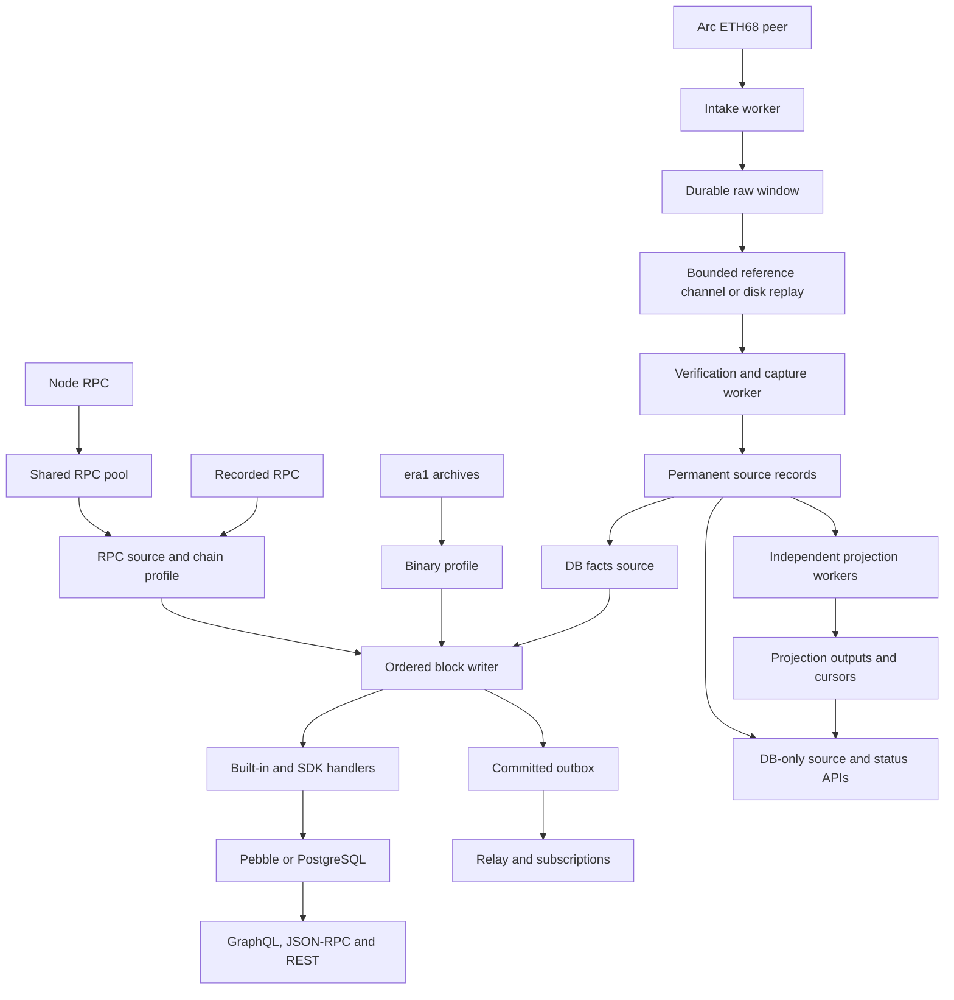

# Architecture

[문서 목차](README.md) · [빠른 시작](QUICKSTART.md) · [SDK](SDK.md)

indexer-go는 EVM 체인을 위한 프레임워크다. 공통 코어는 중립 모델·저장 포트·feature 계약을 사용하고, 체인 규칙은 별도 profile에 둔다. 현재 범위와 미검증 영역은 [남은 작업](analysis/open-items.md), 체인 구현 계약은 [커스터마이징 문서](CHAIN_CUSTOMIZATION.md)를 따른다.

24시간 원본 보관과 DB 기반 후처리로 확장하는 단계는 [윈도우 수집 설계](analysis/windowed-feed-design.md)를 따른다. 기존 앱 경로와 라이브러리로 연결한 새 window/capture 경로를 구분한다. 새 경로는 [Arc ETH/68 모듈](../modules/feeds/arc/README.md)에서 수신→fsync window→bounded 참조 channel→검증·원천 DB commit까지 구현했다. 선택적 `RunManaged`는 명시적 RPC-finalized 정책·reorg supervisor·raw ACK·GC를 연결한다. [영구 원천 저장](PERMANENT_SOURCE_STORAGE.md)은 별도 객체 경로/예산·DB 참조·orphan 복구와 기본 정규화 행을 구현했다. [DB facts 후처리](SOURCE_FACTS.md)는 기존 writer·내구성·fresh 검사·처리 receipt까지 연결했다. [앱 실행](FEED_APP.md)은 opt-in 설정과 epoch/undo/종료를 연결했다. 실제 peer/mount 정책 운영 검증은 남아 있다.

## 1. 구성과 데이터 흐름

RPC·era1·replay는 source 경계에서 profile을 거쳐 같은 모델로 바뀐다. 병렬 fetch와 순서대로 색인하는 경로는 live loop와 gap 복구가 공유한다. 선택 Arc feed는 수신 worker와 검증/원천 저장 worker를 분리하고 durable raw window를 재개 가능한 입력 큐로 사용한다. 원천 DB의 facts Source는 기존 순차 writer에 연결하며, 독립 projection은 자체 cursor·출력·undo/event를 소유한다.

한 블록의 기존 feature 데이터·진행·outbox는 같은 writer transaction에 commit된다. capture 저장과 독립 projection은 각자의 transaction/완료 경계를 가지며 하나의 분산 원자적 commit이라고 취급하지 않는다. 커밋 직전 fresh canonical과 epoch/generation 검사를 유지한다. 공유 RPC pool의 물리 요청 제한은 선택 worker와 보충 조회에도 적용된다. 처리 오류는 해당 transaction을 취소하며 완료/ACK로 바꾸지 않는다.

선택 fast 알림은 그림의 durable outbox 경로와 별개로 commit 전에 평가하므로 서로 다른 전달 계약을 가진다. reorg와 재개·queue overflow의 규칙은 [구독 설계](analysis/subscriptions-design.md)와 [설정](CONFIG.md)에 있다.

## 2. 패키지별 책임

| 경로 | 책임 |
|---|---|
| `cmd/indexer` | `cli.Main`을 호출하는 실행 명령 |
| `cmd/cli` | cobra 명령행. 설정을 읽어 검증하고 `app.Start`·`app.ResumeCheck`를 부른다. 종료 코드와 도움말 |
| `cmd/flags` | 플래그 묶음. 설정 플래그는 YAML 키와 환경 변수를 함께 밝히고, 준 것만 설정에 반영한다 |
| `pkg/app` | 엔진. 등록·저장소 선택·역할·수명 관리와 멀티체인 조립. 명령행 코드는 없다 |
| `pkg/core/model` | 블록·거래·receipt·로그와 typed extension의 중립 모델 |
| `pkg/core/port` | 모델을 읽고 쓰는 저장 인터페이스. 구현을 import하지 않음 |
| `pkg/chains` | profile·alias·회계·native coin·fee delegation 등 registry |
| `pkg/chains/evm` | 표준 EVM 디코딩, 해시·sender 검증, binary 디코딩 |
| `pkg/chains/stablenet` | WBFT·fee delegation·native 회계·시스템 기능/API |
| `pkg/chains/arc` | Arc native 이벤트·수수료 회계와 native emitter |
| `pkg/source` | RPC·era1·replay·연결된 source |
| `pkg/chainfeed`, `pkg/chainfeed/ethpeer`, `pkg/chainfeed/evmdata` | bounded feed 계약·RLPx/ETH68 history·실행 입력 commitment 검증 |
| `pkg/window`, `pkg/capture` | 외장 raw window·수신/검증 Task·원천 DB·finality/reorg supervisor·raw ACK·삭제 승인 |
| `modules/feeds/arc` | Arc testnet의 검증된3-dataset plan·peer/session 라이브러리 조립 |
| `pkg/fetch` | 병렬 fetch, 순서 보장, 단일 writer, 복구·backfill·reorg |
| `pkg/feature`, `pkg/features` | 선택적인 블록 처리기와 공통 기능 |
| `pkg/storage`, `pkg/storage/postgres` | Pebble 및 PostgreSQL 포트 구현 |
| `pkg/stream`, `pkg/events` | outbox 소비·relay·구독 엔진과 프로세스 내 버스 |
| `pkg/api` | API·미들웨어·체인별 mount |
| `pkg/notifications` | 설정·조건식·fast/durable 평가와 전달 |
| `pkg/sdk`, `pkg/sdk/sdktest` | 프로젝트 처리기·API 확장과 결정성 검증 |
| `pkg/multichain` | 체인별 App·DB·파이프라인의 관리 |
| `pkg/rpcpool`, `pkg/rpcproxy` | 노드 failover·요청 제한, 조회 cache·circuit breaker |
| `examples/` | 별도 모듈의 profile·SDK 사용 예제 |

`pkg/adapters`, `pkg/types/chain`, 예전 storage `backend.go`는 현재 구조에 없다. WBFT·체인 고유 저장/API는 공통 consensus/storage 타입으로 다시 옮기지 않는다.

## 3. 체인과 기능 확장

Profile은 노드 감지, 원시 블록·receipt 디코딩, 체인 기본 기능을 정의한다. `AccountingProfile`·`NativeCoinProfile`·`BinaryProfile`은 선택 인터페이스다. generic EVM 위에 고유 거래·헤더·회계 규칙을 조합하거나 기존 profile을 감싼다. wrapper는 선택 인터페이스를 잃지 않아야 한다.

내장 체인 또는 외부 모듈의 `pkg/chains/<chain>`에서 등록한다. 공통 fetch·storage·API는 특정 chain id 분기 대신 registry·포트·선택 인터페이스를 사용한다. YAML로 새 코드를 로드하지 않으며, 등록 패키지를 연결한 바이너리를 빌드한다. 자세한 방법은 [확장 계약](CHAIN_CUSTOMIZATION.md)과 [SDK](SDK.md)에 있다.

Feature는 블록 context에 묶인 저장소로 쓰고, 자기 설정·의존 기능·필요 포트를 선언한다. 나중에 켜면 backfill한다. 선언형 records는 표 정의로 로그를 수집하고 프로젝트 처리는 SDK로 붙인다. 기능이 모든 실행 방식에서 같은 결과를 내는지 `sdktest`와 예제로 확인한다.

## 4. 저장·복구·stream

- `pkg/fetch/writer.go`의 단일 writer가 색인·rollback·backfill 쓰기를 처리한다. 병렬 fetch 결과는 높이 순서로 전달되고 in-flight 범위는 제한된다.
- 두 저장소는 같은 포트 계약을 구현하며 블록·기능의 쓰기를 원자적으로 처리한다. schema migration은 PostgreSQL을 열 때 적용한다.
- Reorg는 fork 지점까지 되돌리고 orphan을 보존한다. 최근 128블록의 undo를 유지하며 API로 reorg/orphan 정보를 제공한다. feature rollback hook은 이벤트를 철회할 수 있다.
- PostgreSQL은 결과를 즉시 읽지 않는 쓰기를 batch로 모으고 잔액을 미리 읽는다. 삽입형 표는 `undo_height`로, 다른 변경은 trigger 기반 `undo_log`로 되돌린다. [undo 설계](analysis/postgres-undo-design.md) 참조.
- Durable 이벤트는 outbox sequence와 소비자 위치로 재개한다. 구독 엔진은 직렬화 결과를 공유하고 연결마다 bounded queue를 둔다. 과부하 연결은 재개 위치를 포함한 오류로 종료한다.
- 운영에 연결된 버스는 `pkg/events`의 프로세스 내 버스다. `pkg/eventbus`의 Redis/Kafka 구현은 현재 앱에 연결되지 않았다.

## 5. 실행 역할과 멀티체인

| 역할 | 동작 |
|---|---|
| `all` | 색인과 API를 같은 프로세스에서 수행 |
| `ingest` | 색인하며 HTTP는 health·metrics만 제공 |
| `api` | 다른 ingest가 쓴 PostgreSQL을 조회. 색인·검증기는 실행하지 않으며 알림 설정 키만 쓰기 허용 |

Pebble은 `all`/`ingest`를 사용한다. API 분리는 PostgreSQL이 필요하다. 멀티체인 모드는 현재 `all`만 지원한다.

멀티체인은 App·저장소·feature 설정·알림 서비스를 체인별로 둔다. Pebble 경로는 `<database.path>/chains/<id>`, PostgreSQL은 체인별 schema다. API는 `/chains/{id}/` 아래에 mount하고 루트 탐색 API를 두지 않는다. 기존 RPC 경로는 네 테스트넷의 제한된 구간에서 동시 실행·장애 격리·재시작을 검증했다. 혼합 Arc feed/RPC 경로도 로컬 입력으로 격리를 검사했다. 실제 peer를 사용하는 네 체인의 장기 운영·24시간 추종을 검증한 결과는 아니다.

## 6. 상태·API·검증의 한계

`balance.native`·`token.metadata`처럼 과거 상태를 읽는 기능은 시작·재시작·backfill에 필요한 높이의 상태를 검사한다. 필요한 상태가 없으면 기본 strict 정책은 시작을 거부하거나 블록 전체를 취소하며 latest나0으로 대체하지 않는다. 노드의 실제 상태 보존 범위에 맞춰 시작 높이와 기능을 선택한다. 현재 공개 테스트넷 운영 후보는 archive 없는 RPC와 체인별5 HTTP/s를 사용하지만, 이는 프레임워크가 모든 RPC/chain에서 고정 보존 기간을 보장한다는 뜻이 아니다. 실제 환경·복구/중단 허용 범위는 [남은 운영 작업](analysis/open-items.md)에 있다.

기본 Ethereum 회계는 내부 call 전송·PoW 보상까지 모두 복원하지 않는다. Arc는 native 이벤트와 자체 수수료 규칙을 쓴다. typed extension과 모델 해시는 저장/API에서 보존하지만 모든 fork 실행·합의 증명을 검증하는 노드는 아니다.

API 스키마·메서드 목록은 [API 안내](API.md)의 snapshot 링크에서 확인한다. 공개 RPC 시험은 opt-in이며, 최근 색인·식별자·API·record/replay를 검사한다. 구체적 측정 범위와 실패는 [작업 기록](analysis/work-log-2026-10.md)에 있다.

`pkg/feed` registry와 `pkg/app`의 opt-in [source.feed](FEED_APP.md)는 체인 모듈이 선택한 capture와 DB facts projection을 별도 task로 실행한다. epoch가 바뀌면 이전 후처리/online backfill/writer/relay를 join한 뒤 새 Source와 undo를 조립한다. 현재 Arc의 execution-only plan과 다른 체인의 RPC를 혼합 실행하며 상태 reader는 거부한다. 원천 DB와 projection은 같은 handle을 쓰고 외장 window의 durable binding은 누락 디스크 재생성을 막는다.

[기능별 완료](PROJECTION_PROGRESS.md)는 facts writer의 기존 block transaction/undo 안에 구간·hash·epoch를 기록한다. `execution.summary.v1` 독립 worker는 불변 block 결과와 자체 cursor/reset/output event를 별도 capture namespace transaction에 저장한다. source와 projection의 read-only snapshot을 대조하는 status/결과 HTTP API는 누락 상태를 unavailable로 표시한다. stateful 기존 feature의 전역 undo/outbox는 계속 단일 writer가 소유한다.
