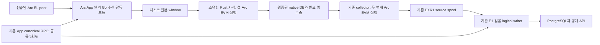

# Arc 첫 import와 native DB 갱신 설계

**N0 입력·fence와 N1 인증 native bootstrap 구현. N2~N6 구현 전. 운영 판정 HOLD.** 기존 collector는 import된 Arc DB를
읽고 두 번째 EVM 실행으로 E1 입력을 만든다. 빠져 있는 첫 실행과 지속적인
native DB 갱신을 아래 모듈이 담당하도록 한다. 전체 노드 프로세스와 upstream
코드 수정은 추가하지 않는다. 아래 N0·N1 이외의 새 모듈·타입·metadata는 제안이며 현재
실행할 수 있는 명령·설정이 아니다. [구현 순서](#구현-순서)와
[체크리스트](codemine/runs/20261029-arc-first-import/checklist.md)를 함께 따른다.

## N0 구현과 검증 경계

[native_import](../x/arc/executor/src/native_import.rs)는 라이브러리의 bounded 입력과
미완료 fence를 구현한다. CLI·App·peer·native writer는 시작하지 않는다.

| 항목 | 현재 계약 |
| --- | --- |
| 입력 | `AIN1` + metadata/block/receipts 길이3개(u32 big endian) + 해당 bytes. metadata16KiB, block10MiB, receipts10MiB 상한. 합계는20MiB+16KiB+16bytes 이하 |
| metadata | PascalCase version1, RequestID·ImportEpoch·Height의 양수 signed64 범위, 공식 testnet5042002/genesis와 고정 Arc/Reth pin, hash/parent/root. unknown/duplicate 필드·잘림·잘못된 identity 거부 |
| digest | 원래 header+metadata+block+receipts 전체의 SHA256. 입력 RLP는 이 계층에서 opaque이며 구조·실행·root/canonical 검증은 N2에서 수행 |
| pending | owned0700 absolute native directory를 descriptor로 열고 no-follow/exclusive create로 `.arc-native-import.pending`0600을 쓴 뒤 file+directory fsync. 기존 E3 fence를 존중하고 기존 파일을 덮어쓰거나 삭제하지 않음 |
| 재시작 | pending object가 symlink/directory/partial/corrupt 상태여도 차단. 나이·완료 높이·Hello로 해제하지 않음. 이 helper는 run lease/publication gate를 획득하지 않으며 N2/N4 owner가 연결해야 함 |

SDK qualification은 실제 임시 native-v2 DB에서 공식 Arc EVM 첫 실행 결과를
`save_blocks(Full)`로 저장하고, 별도 RO 프로세스의 provider 갱신·두 번째 replay·
reopen을 확인한다. 빈 블록과 합성 genesis의 transaction/storage/code/receipt를
함께 검사한다. non-genesis full checkpoint export/root/preimage coverage,
unwind/reimport와 controlled transaction 중단 전후의 fence·별도 프로세스 재시작도
검사한다. 합성 genesis 주입과 보조 프로세스는 `cfg(test)`에만 있다.

같은 PID에서 독립 RW/RO environment를 여는 방식은 로컬 MDBX에서 EAGAIN을
반환했으며 지원 경로로 채택하지 않았다. 별도 writer/reader 프로세스가 설계와
검증 대상이다. controlled transaction 중단은 전원 장애/각 store 내부 killpoint와
자동 복구를 입증하지 않는다. 그것은 N2의 managed 저장·영수증·복구 검사로 남는다.
N0의 frame/pending은 E1 공개·ACK·삭제 권한이 아니다. [N0 계획](codemine/runs/20261029-arc-native-n0/plan.md)을 따른다.

## N1 구현과 검증 경계

[인증 native bootstrap](EXECUTION_ARC_BOOTSTRAP.md)은 독립 expected anchor와
전체 NDJSON 상태의 code/storage/account root를 검증하고, 새로운 private staging에만
native-v2 상태를 쓴다. H>0에서는 genesis..H의 실제 연결된 header와 anchor block·receipt를
요구한다. native를 닫고 RO로 다시 열어 root·높이·floor를 확인한 뒤 fsync와 NOREPLACE
rename으로 공개한다. 원본 전체 상태/preimage와 immutable original anchor·floor·H+1,
입력 digest를 보존한다. 오류는 기존 자료를 보존하고 staging pending을 남긴다.

이 오프라인 도구는 SQL baseline import와 별개이며 node/RPC/App을 시작하지 않는다.
과거 body/state/feature coverage를 만들지 않는다. 실제 인증 checkpoint·외장 APFS·
peer는 여전히 HOLD이며, 계속되는 첫 실행 writer와 App/collector·ACK/GC 통합은
N2~N6으로 남는다. [N1 계획](codemine/runs/20261029-arc-native-n1/plan.md)을 따른다.

## 고정하는 구조

- Go 감독 모듈은 `x/arc`에 둔다. 기존 ETH/68 수신기와 block 검증을 재사용하고
  수신·검증·실행 전달을 고루틴과 bounded 채널로 나눈다. 오래된 legacy capture
  파이프라인과 execution을 동시에 켜는 방식은 사용하지 않는다.
- generic App에는 opt-in factory/lifecycle 계약만 추가하고 Arc 등록은 bundle이
  소유한다. 현재 `pkg/feed.Program`은 CaptureDatabase 계약이며 execution
  importer가 아니다. 새 계약은 구현 때 명시적으로 추가한다. shared core에
  chain ID 분기를 만들거나 StableNet 모듈을 import하지 않는다.
- 감독 모듈은 기존 App의 canonical reader와 Store를 빌린다. 독립 importer
  서비스·RPC dialer·별도 SQL pool은 만들지 않는다. Rust 자식은 RPC/SQL 없이
  명시적인 parent state와 입력을 실행·저장한다.
- 기존 collector와 RO Rust replay 자식은 별개로 유지한다. 정상 블록은 첫
  native 실행 한 번과 기존 replay 한 번, 총 두 번이다. 첫 실행 결과를 다시
  replay한 뒤 저장하는 세 번째 실행 경로는 만들지 않는다. 장애 재시도에는
  재실행이 생길 수 있으므로 모든 상황에서 정확히 두 번이라는 보장은 아니다.
- NodeBuilder/full node·consensus 서비스·mempool·채굴·새 RPC 서버·peer discovery는
  시작하지 않는다. P2P는 명시적인 인증 static peer만 연결한다. 최초 지원은
  감사한 Arc testnet5042002로 제한하고 synthetic chain은 테스트에서만 주입한다.

ETH/68 수신과 EVM root 대조만으로 Arc 합의를 독립 검증했다고 주장하지 않는다.
기존 canonical/finality 정책과 RPC 신뢰 경계를 유지한다. StableNet E6의 WBFT
권한을 Arc에 옮겨 적용하지 않으며 기존 call/blob/selected-proof coverage도 확대하지 않는다.

## 현재 코드와 확인한 upstream 경계

| 확인한 사실 | 설계에 주는 제약 |
| --- | --- |
| [ETH/68 peer](../pkg/chainfeed/ethpeer/peer.go)는 Subscribe/FetchRange/FetchDataset과 bounded cache를 제공하며 `New`에서 서버를 시작함 | 설정 검사에서는 생성하지 않는다. 준비·backlog gate 뒤에만 연다. 현재10MiB 메시지 상한과 명시 peer 제한을 유지한다. cache 크기를24h 보존으로 해석하지 않는다 |
| [Arc feed](../x/arc/feed/feed.go)는 header/body/receipt base plan, [등록](../pkg/feed/config.go)은 CaptureDatabase 지향 | 수신·검증을 재사용하되 state execution과 native 저장 lifecycle은 새로 구현한다. 기존 ObserveCaptured를 native 완료로 간주하지 않는다 |
| [Arc replay](../x/arc/executor/src/replay.rs)는 공식 ArcEvmConfig와 정확한 retained parent를 사용 | 두 번째 실행과 journal/root 검증을 보존한다. [collector](../x/arc/collector/run.go)는 native 공급자가 아니다 |
| [native helper](../x/arc/executor/src/native.rs)는 db/rocksdb/static_files와 RO scratch를 사용. 기존 writable helper는 offline maintenance용 exclusive open | 계속 쓰는 writer와 RO secondary의 공존을 별도 입증한다. offline helper를 그대로 live writer로 바꾸지 않는다 |
| pinned Reth의 `save_blocks(..., SaveBlocksMode::Full)`은 state/trie/receipts까지 저장. BlocksOnly는 부족 | 공식 executor outcome과 Full 저장 primitive를 좁게 사용한다. persistence handler 전체의 자동 pruner는 가져오지 않는다 |
| 정상 commit 순서는 static files finalize → RocksDB batches → MDBX. unwind는 MDBX → reader 대기 → RocksDB → static files | 다중 저장소 원자성을 가정하지 않는다. 별도 intent·read gate·완료 영수증과 중단 시험이 필요하다 |
| Reth `init_from_state_dump`는 이미 있는 최고 블록의 header/root를 기준으로 state를 초기화 | 공유 checkpoint 포맷을 native DB로 만드는 완성된 importer가 아니다. bootstrap builder와 root/preimage/history-floor 검증이 선행돼야 한다 |

공식 소스는 Cargo.lock과 일치하는 Arc
`6e764023ee6515fe70573e123ed2db912a7207b4`, Reth
`88505c7fcbfdebfd3b56d88c86b62e950043c6c4`에 고정한다. primary source:
[Reth provider](https://github.com/paradigmxyz/reth/blob/88505c7fcbfdebfd3b56d88c86b62e950043c6c4/crates/storage/provider/src/providers/database/provider.rs),
[persistence](https://github.com/paradigmxyz/reth/blob/88505c7fcbfdebfd3b56d88c86b62e950043c6c4/crates/engine/tree/src/persistence.rs),
[bootstrap](https://github.com/paradigmxyz/reth/blob/88505c7fcbfdebfd3b56d88c86b62e950043c6c4/crates/storage/db-common/src/init.rs).
[소스 감사](codemine/runs/20261029-arc-first-import/source-audit.json)는 경로·pin·blob을 기록한다.
API 존재와 저장 순서 외에 N0의 임시 DB 시험으로 Full 저장/RO 갱신/reopen과
위 SDK 범위를 검증했다. 새 운영 writer와 각 store killpoint·managed 복구는
N2/N4에서 구현·검증하며 실제 host/container·서비스는 여전히 미확인이다.

## 준비와 bootstrap

App의 기존 execution recovery와 prepared schema/socket 준비가 먼저다. 새 모듈은
현재 generation·원래 anchor·native identity·완료 영수증·보류 intent·용량을 대조하고,
retained source backlog의 기존 reconcile/drain을 마친 뒤 새 import를 허용한다.
Hello는 연결과 generation 교환이며 ACK나 bootstrap 성공의 대체가 아니다.

첫 native DB는 별도 **offline staged builder**가 만든다. genesis H0 또는 인증된
full checkpoint H의 모든 account/storage/code/preimage 및 필요한 anchor
header/body/receipt를 검증하고 전체 root를 재구성한다. 현재 native-v2 export와
pinned provider의 실제 쓰기 요구가 일치하는지는 N0/N1에서 입증한다. PostgreSQL
baseline import만으로 native 초기화가 끝난 것으로 처리하지 않는다.

빈 새 target만 허용하며 실패는 staging 안에 남긴다. 검증된 root·coverage·원래
anchor·chain/genesis/pin/layout·history floor를 fsync한 뒤 경로를 원자적으로
공개하고 H+1부터 시작한다. H 이전의 없는 history를 합성하지 않는다. retained
cutoff seed로 원래 anchor를 옮기거나 partial checkpoint를 full state로 승격하지
않는다. root/preimage가 부족하면 HOLD이며 latest/zero fallback은 없다.

## 수신·첫 실행·native 공개

1. P2P candidate를 fork/header/body/receipt 규칙으로 검증하고 순서·정확한 hash와
   parent를 붙여 raw window에 durable하게 저장한다. 디스크 ref를 채널로 넘겨
   큰 payload를 여러 worker가 복사해 보유하지 않게 한다. count와 bytes는 active
   작업까지 포함해 제한한다. out-of-order 수신은 연속 구간이 확인될 때만 진행한다.
2. 기존 App reader로 연속 candidate 묶음의 tip hash를 새로 확인한다. 초기 상한은
   최대8블록으로 설계하며 엄격한 parent 연결이 묶음 전체를 묶는다. 이는 시점별
   branch admission일 뿐 finality·SQL 공개 권한이 아니다. epoch 전환·restart에는
   버린다. 최종 E1 fresh에서 재사용하지 않는다.
3. Go→Rust는 bounded framed stdio를 사용한다. chain/genesis/pin, import epoch,
   exact parent/root, height/hash, 입력 digest·길이를 결합한다. 잘림·중복·다른
   epoch·요청 ID/응답 불일치·과대 frame은 실패한다. Go 내부 통신은 채널이며
   언어 경계에서 공유 heap을 가정하지 않는다.
4. Rust는 안정된 native read-view에서 공식 ArcEvmConfig로 한 번 실행하고
   receipts/gas/state root와 입력을 검증한다. 단일 writer만 허용한다. exclusive
   publication gate를 잡은 뒤 epoch/parent를 다시 확인하고 durable import intent를
   쓴 후 Full outcome을 저장한다. 이미 검증한 outcome을 저장할 수 있는 정확한
   pinned SDK 조합을 N0에서 확정한다.
5. 모든 저장소 commit·동기화가 끝난 뒤 exact `NativeImportReceipt`를 atomic
   rename+directory fsync로 공개한다. 영수증은 input digest·parent·tip hash/root·
   receipt root·import epoch·native identity/pin/layout을 묶는다. exact intent를
   마치고 gate를 해제한 뒤에만 Go에 성공을 반환한다. 이 이름은 새 내부 계약이며
   EXR1·E1 ACK가 아니다. 재전송은 같은 digest의 저장 완료만 idempotent 성공이다.

수신 높이 R, native 완료 N, replay sealed S, 공개 P, source ACK A를 따로 기록한다.
같은 안정된 branch/epoch의 연속 구간에서만 R≥N≥S≥P≥A를 비교한다. 전환·복구 중
서로 다른 epoch의 높이를 빼서 지연으로 보고하지 않는다. 첫 import만 완료돼도
공개 P나 ACK는 올라가지 않는다. peer에게 광고·제공할 head도 raw R이 아니라 검증된
N 이하로 제한한다. 현재 bounded serving cache를 넘어서는 응답은 원본 보존과
검증된 coverage 안에서만 제공하며 없는 history를 약속하지 않는다.

## reader·writer 경합과 crash 경계

기존 sibling native run lease는 importer와 collector 모두 SH로 보유하고 E3가 EX로
유지보수를 배제하는 계약을 유지한다. 이 lock은 live writer/reader 간 publication
lock이 아니므로 별도 private sibling RW gate와 sole-writer 소유권을 둔다.

- collector는 native 요청부터 응답 확인 또는 자식 cancel/join까지 shared read-view
  gate를 가진다. managed 모드에서는 완료 영수증의 N까지만 읽고 epoch를 전후
  대조한다. 최고 header/best_block_number만으로 완료를 판단하지 않는다.
- writer의 실행 read-view는 commit 전에 해제하고, exclusive gate는 native 저장과
  영수증 공개 동안만 보유한다. RPC 대기·queue 대기·SQL recovery·worker join 동안
  보유하지 않는다. 기다리는 writer를 계속 새 reader가 추월하지 않도록 admission
  순서도 명시하고 cancellation/기아 검사를 추가한다.
- MDBX live writer와 RocksDB secondary catch-up, static-file reader refresh를 함께
  시험한다. gate만 추가했다고 RO 가시성·일관성이 입증되는 것은 아니다.
- crash는 OS lock을 풀어도 intent를 남긴다. completed receipt·실제 parent/tip/root와
  모든 저장소 coverage가 일치해야 재개한다. 중간 저장이나 불명확한 상태는 HOLD다.
  자동 SetHead/truncate·latest 점프·TTL intent 제거를 하지 않는다. 정상 저장과
  unwind의 각 중단 지점마다 안전한 재시도/명시적 복구를 따로 입증한다.
- managed marker가 있는데 구형/unmanaged collector가 연결되면 실패한다. marker가
  없는 기존 외부 native DB의 opt-in RO 경로는 그대로 유지한다. implicit downgrade로
  관리 DB를 읽지 않는다.

## reorg와 E1 권한

import epoch, raw window epoch, E1 source generation은 서로 다른 값이다. 같은
숫자로 초기화해서 결합하지 않고 chain/hash/digest/original anchor와 coordinator
영수증으로 연결한다. peer tip·Hello·NativeImportReceipt는 E1 세대를 만들거나
공개/ACK/삭제 권한을 주지 않는다.

App에 제안하는 generic transition facade는 기존 receiver/controller의
[Rewind/recovery](../pkg/execution/receiver.go)와 기존
[canonical 검증](../pkg/fetch/execution.go)을 사용한다. 독립 reorg coordinator나
producer self-ACK를 추가하지 않는다. 새 wire frame은 현재 계약으로 해결 불가능한
경우에만 별도 리뷰한다.

1. 다른 branch를 감지하면 새 native admission과 E1 read/publication을 fence한다.
   이전 worker/read-view를 취소·join한다. 이 대기 중 native EX gate나 SQL transaction을
   보유하지 않는다. 기존 recovery가 확인한 safe prefix만 공개한다.
2. 원래 anchor/retained history와 기존 public128 rollback 범위 안의 정확한 common
   parent를 찾는다. App의 공유 uncached canonical RPC 검증을 통과한 기존 recovery만
   source generation을 전환한다. RPC lag·깊은 reorg·부족한 history는 HOLD다.
3. native transition intent를 durable하게 남기고 검증된 parent로 unwind/reimport한다.
   SQL/native를 한 트랜잭션처럼 취급하지 않는다. 각 phase의 receipt를 기록하고
   기존 receiver recovery와 양쪽 exact lineage가 일치할 때만 read/admission을 연다.
4. native tip이 이전 public/captured 높이보다 낮아진 경우도 즉시 bounded recovery에
   전달한다. 예전 높이가 다시 생길 때까지 무한 polling하지 않는다. source spool의
   rebind는 기존 새 generation/canonical 검증을 따른다. crash 어느 phase에서도
   일치 증거 없이 fence를 해제하지 않는다.

## 영구 보존과 원본 GC

입력 RLP와 native 완료, E1 part 저장, 공개 commit, exact source ACK는 다른 증거다.
현재 `exec_parts`/publication digest와 model 저장이 **원래 block/header/body/receipt
bytes의 lossless 영구 보관**을 보장한다고 확인하지 않았다. legacy Capture.Commit의
fresh/ACK를 새 native import의 완료로 바꾸어 사용하지 않는다.

N5는 기존 **blocks part**에 검증된 immutable raw input을 전달하고, 필요하면 리뷰된
새 migration의 versioned ingress payload archive를 추가한다. 예시 이름
`exec_ingress_payloads`는 아직 없는 제안이다. 기존 BlockRLP/ReceiptsRLP와 입력의
byte equality·header/body 재구성이 lossless인지 입증하고 chain/hash/lineage/digest로
묶는다. 일곱 writer 안의 기존 blocks part이며 여덟 번째 writer/pool이 아니다.
parameter binding·identifier 검증과 undo/orphan 보존·migration 계약을 함께 검사한다.
수집하지 않은 과거 bytes를 새 archive가 채웠다고 주장하지 않는다.

raw window의 새 deletion guard는 기존 App Store/pool4와 coordinator에서 영구 bytes
coverage·현재 정확한 E1 committed ACK·epoch/lineage·보호 구간/lease·보존 floor를
확인해야 한다. NativeImportReceipt나 importer 자체 ledger만으로 삭제하지 않는다.
기존 source spool GC와 native E3 GC도 각자의 권한을 유지한다. 이 연동이 끝나기
전에는 ingress 자동 GC를 **구현/활성화하지 않고**, quota에서 수신/import를 멈추며
미ACK 원본을 보존한다. 임의 MarkDone/default-allow/나이만의 삭제는 없다.

24h 목표는 가정2blocks/s에서172800블록이다. 메모리 채널 크기나 byte/native-state
용량 보장이 아니다. ingress raw·EXR1 spool·native·RO scratch·checkpoint·PGDATA·
WAL/backup을 별도 예산으로 둔다. 사용자가 지정할 외장 APFS 경로를 사용하며
실제 예산/identity가 없으면 HOLD다. full/backlog는 backpressure이고 latest 건너뛰기나
ACK 위조·보호 자료 삭제로 해소하지 않는다.

E3 COW/compact/swap 전 importer와 collector를 모두 stop/join하고 native run EX를
얻는다. 기존 full baseline·현재 DB pending permit/live lease·exact source ACK/window·
intent/completion/release를 모두 유지한다. swap 뒤 inode/bind와 original anchor를
재확인하고 필요하면 중지된 mount를 다시 만든다. 실행 중 bind가 자동으로 새 DB를
본다고 가정하지 않는다.

## 예산·비밀·운영 경계

- 체인·프로세스 Store는 기존 **pool4, part2, API 예약1, logical writer7**이다.
  감독 모듈/새 archive도 같은 pool을 사용한다. RPC/파일/EVM 대기 동안 SQL
  transaction을 잡지 않는다. 다른 체인/별도 API 프로세스의 pool은 운영 총량에 합산한다.
- 같은 체인의 App RPC **5 physical HTTP attempts/s**를 native admission과 기존
  final fresh가 공유한다. retry/failover/batch fallback도 모두 포함한다. 최종 공개
  transaction은 여전히 **NEW uncached canonical 응답 → generation fence → COMMIT**
  이며 앞선 batch/admission/cache/Hello로 대체하지 않는다. native admission에는
  backpressure를 적용하고 final publication이 기아에 빠지지 않도록 검사한다.
- Rust child는 absolute executable·명시적인 owned 경로·최소 environment allowlist만
  받는다. App이 가진 DSN/RPC/API/peer key 등 비밀을 통째로 상속하지 않는다. bounded
  stdio/error와 redaction, 같은 UID 소유권·cancel/join·부분 파일 보존을 검사한다.
- 현재 [runtime Compose 초안](../deployments/native/runtime/README.md)은 importer 없는
  RO collector 구성이다. 이 설계가 App에 native RW/ingress mount를 적용한 것은
  아니다. N5에서 managed writer 경로·권한·이미지·검사기를 함께 갱신한다. 기존
  checker PASS/HOLD도 startup interlock이 아니며 실제 mount/ABI/host 검증은 별도다.
- APFS/enode/인증 checkpoint·image/private manifest가 없으므로 운영은 HOLD다.
  포맷·노드/서비스 실행·snapshot 다운로드·실제 GC/restore·추가 성능 측정은 계속
  보류한다. 450ms/Arc 추종·용량 절감 수치는 이번 설계로 입증하지 않았다.

## 구현 순서

| 단계 | 구현 범위 | 요구사항을 먼저 RED로 증명할 기능 검사 |
| --- | --- | --- |
| N0 구현 | pinned SDK 저장/seed/별도 RO 프로세스 qualification과 bounded import 계약 | 실제 임시 native-v2 Full 저장·state/code/receipt/history·H1 checkpoint·reopen·unwind/reimport, controlled 중단 fence. 운영 writer/killpoint 복구는 N2 |
| N1 구현 | offline authenticated native bootstrap builder | 잘못된 root/coverage/anchor/pin·기존 target 거부, staged 실패 보존, exact H/H+1와 parent 재실행 |
| N2 | 첫 실행 writer·intent·publication gate·완료 receipt | 정상 첫 실행 횟수, 모든 store commit 중단점, 중복/불일치·동시 reader·cancel/join·재시작 fencing |
| N3 | Arc App 감독/등록·기존 P2P·durable raw·bounded 채널 | 시작 gate·backlog·byte/count·불연속/과대 입력·shared RPC5·pool4·비밀 미상속·stop/join |
| N4 | managed collector read-view와 E1 transition 연결 | normal/short/deep reorg·소스 세대 분리·read fence·새 final fresh·Hello/receipt의 ACK 오인 거부 |
| N5 | lossless 영구 raw archive·권한 있는 ingress GC·용량/배포 초안 연동 | blocks part/pool4·undo/orphan·bytes/hash·unACKed 보존·exact 삭제 guard·E3 양쪽 종료·known bad FAIL/unknown HOLD |
| N6 | offline end-to-end 회귀와 인계 | 같은 합성 블록의 두 EVM 실행→native reopen→collector→기존 writer7/SQL/API/ACK. 장애 행렬 전체·기존 경로 회귀. 운영 실행/성능 아님 |

각 단계는 의미 있는 RED→구현→GREEN, 현재 문서·체크리스트 갱신, 필요한 새 동시성
단일 GOMAXPROCS=1/race/count200, 정확한 최종 head의 CI5 성공, squash/main 동기화 후
다음 단계로 진행한다. SDK 불일치는 요구사항/guard 완화로 해결하지 않고 해당
adapter를 수정하거나 구현 계획을 갱신한다. N0·N1의 현재 구현·검증과 N2~N6의 남은
구현을 구분하며, 운영 값과 실제 실행은 계속 HOLD다.
