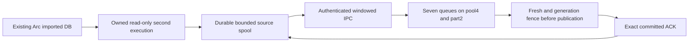

# Arc execution journals

The Arc adapter adds an offline-verified second execution and continuous durable collection (with a one-result delivery alternative) to the existing execution indexer. It uses the official Arc EVM's protocol, precompiles, fork rules and system accounting. A generic Ethereum replay cannot substitute for it. The [native module](../x/arc/executor/README.md) pins all versions and exposes both a library and a read-only native DB command; upstream node source is unchanged.

Normal node import is the first execution. The adapter replays an imported block against its exact retained parent, independently checks the journal after every phase against native intermediate roots, and checks final state/receipt/gas commitments. The continuous collector seals verified EXR1 results into its own durable source spool. Alternatively, the native command exports a private durable EXR1 file and the Go submission command sends that file to an **already running, explicitly prepared** Arc indexer and returns only an exact committed ACK. No live node, disk provisioning, native GC or performance operation is performed by this development validation.

## Data coverage

| Data | Supplied and verified boundary |
| --- | --- |
| Header, body, transactions, receipts, logs | Original RLP; body/receipt commitments and bloom, then independent Go profile decoding |
| Account and storage changes | Before/after values in pre-block, transaction and Finalize order; native and independently reconstructed intermediate roots; uint256 balances, tombstones and storage-clear markers |
| Contract/code | Hash-checked bytecode and successful outer creation evidence, including empty code and constructor-time destruction |
| Pre-block protocol changes | Optional first-only wire cause `PreBlock` = 4, index -1 and zero transaction hash; not attributed to a user transaction |
| Finalize | Last step, including Arc system accounting in empty blocks; index -1 and zero transaction hash |
| Call traces/internal calls | Bounded same-replay EVM hook trees, attempts/reverts and CallFrom completion handling; [native call guide](EXECUTION_CALL_TRACES.md). Root consistency does not independently commit to every child |
| Blobs | Pinned node policy remains unsupported for positive blob supply. The shared [execution blob module](EXECUTION_BLOBS.md) does not activate an Arc source or establish historical/network availability. Existing [Arc blob policy audit](../x/arc/blobs.go) remains separate |
| Account/storage inclusion proofs | Not exported by this adapter. Native/journal root equality is not an independent consensus/finality proof |

The native DB must retain the complete required parent state, code, headers, body and receipts. Missing data fails closed. This release does not create a checkpoint from current RPC state, download a snapshot, fill partial coverage with zero or restore pruned history.

## Indexer and transfer setup

Use `make build CHAIN=arc`. The existing [execution ingest settings](EXECUTION_INGEST.md#indexer-configuration) also apply to Arc, with its own schema and original prepared anchor. The Arc checkpoint command below binds the shared [offline bootstrap verifier/importer](EXECUTION_BOOTSTRAP.md) to the Arc header codec, with the same verify/import/inspect actions and private DSN/RPC environment injection. The expected chain/genesis/header/root and covered state must agree. The StableNet-specific node/export commands in that guide do not apply to Reth. The [native checkpoint/retention guide](EXECUTION_ARC_RETENTION.md) covers full export, raw-key coverage, native v2 history COW retention and held operator checks. Selected state is never a full baseline.

Keep one chain/process, PostgreSQL `max_conns: 4`, shared `rpc.rate_limit: 5`, state prefetch, head publication and a private `0700` directory. Seven queues share at most two part connections; the API reservation stays inside the same pool. Final publication still runs uncached fresh through the shared physical HTTP budget and checks generation after the response. Part commits do not publish height, features, outbox or ACK.

Build the one-file sender separately:

```sh
go build -o /YOUR_BUILD_DIRECTORY/arc-execution-submit ./x/arc/cmd/execution-submit
go build -o /YOUR_BUILD_DIRECTORY/arc-execution-checkpoint ./x/arc/cmd/execution-checkpoint
```

The sender's required flags are `--chain-id 5042002` (testnet) or `5042` (mainnet), `--genesis` (exact lowercase hash), `--result` (absolute owned `0600` file) and `--socket` (existing same-UID `0600` Unix socket). Parent directories must be owned and `0700`. Optional `--timeout` bounds the call; the transfer itself is capped at one minute. A result is at most 64 MiB; metadata at most 16 MiB. Both Go tools expose `--help` without connecting or starting services.

The current source file and socket inode/owner/permissions are checked; the socket peer is authenticated. Input is parsed once before connecting. Hello cannot authorize source deletion, invent a generation or promote completion. An exact ref/hash/chain/generation/digest committed ACK is required; malformed, wrong, missing or cancelled ACKs fail. The original result file remains present on both success and failure.

## Continuous collector

Build the Go owner and pinned Rust adapter; neither build starts a service:

```sh
go build -o /YOUR_BUILD_DIRECTORY/arc-execution-collector ./x/arc/cmd/execution-collector
# In x/arc/executor, using the pinned toolchain:
cargo build --locked
```

The command requires an **already imported, retained native DB** and an **already prepared, running indexer**. It starts only a read-only adapter child, not an Arc node. Native storage and source spool must be separate absolute directories; the spool parent must exist. The binary must be an absolute regular executable without group/world write permission. Its [versioned stdio protocol](../x/arc/executor/README.md#read-only-service-protocol) validates pinned producer revision, chain ID/genesis, response ID/type/length and Go block/receipt commitments. Each native request uses a fresh read view; head means the completed import stage, never just the highest header. One retained exact parent supplies replay state; unavailable history stops the owner. The owner creates an inode-checked private `.arc-native-*` workspace beside the source spool, passes it as `--scratch-dir` and removes only that workspace after its child exits. The pinned upstream secondary creates temporary LOG files; a lexical read-only primary symlink keeps those files in this workspace, away from native storage. Provider synchronization runs per request without an unjoined background watcher. An abruptly killed Go owner can leave a private workspace for explicit diagnosis; a later owner does not delete unknown siblings. Source quota excludes native storage and this secondary scratch, which need separate capacity planning.



| Flag | Contract |
| --- | --- |
| `--chain-id`, `--genesis` | Explicit 5042/mainnet or 5042002/testnet and exact expected lowercase genesis hash; child identity must match |
| `--native-executable`, `--native-datadir` | Pinned built adapter and existing MDBX/RocksDB/static-files layout; never initialized by the collector |
| `--anchor-height`, `--anchor-hash`, `--generation` | Explicit **original prepared checkpoint**, including an explicitly supplied height0. Reuse these unchanged on restart; current cursor lives in the sealed spool manifest |
| `--spool-dir` | Dedicated owned `0700` source directory, created on first explicit run; `0600` records and exclusive ownership. It may not contain native data or live within native data |
| `--socket` | Private same-UID indexer Unix socket; parent `0700`, socket `0600` and inode/peer authentication |
| `--spool-bytes`, `--spool-records` | Default4GiB and262144 retained records; include quarantine/temporary/metadata charges. These are hard source quotas, **not a promise of a 24-hour native window** |
| `--state-proofs` | Optional private bounded JSON selection; native block-end proofs and Go verification occur before spool admission. The normalized policy is fixed in the source manifest; changing/enabling/disabling it requires a new source spool. Match receiver `required_state_proofs`; see [proofs](EXECUTION_STATE_PROOFS.md#arc-native-acquisition-and-continuous-collection) |
| `--window` | Default8, range1..64, bounded in-flight results; independent of DB connection count |
| `--poll`, `--retry`, `--timeout` | Default100ms head poll, 500ms transport reconnect, one-minute individual native/transport deadline (at most one hour). These are scheduling bounds, not measured throughput |

The [shared spool/exporter](../execwire/README.md#shared-execution-producer) owns cursor, queue sealing, ACK receipt recovery, reconnect, startup backlog drainage and coordinator-assisted reorg handling. Initial indexer Hello reconciles the prepared generation before collection starts. Once started, collection can continue during transport loss until quota or a native replay error stops it. A full queue preserves unacknowledged data and stops only the owned adapter; the separately operated node continues under its operator's retention policy. A restart first drains retained backlog before new capture. Source quota does not pause or prune that node.

Hello alone never advances source completion or deletes a result. Only the exact chain/ref/generation/hash/digest ACK permits ordinary acknowledged-source cleanup. Changed native canonicality requests recovery through the existing indexer coordinator; a verified newer generation and native canonical floor are required before rebind. Old-generation files remain quarantined and count against quota. A native mid-replay failure terminates the child/owner; restart with the same original anchor to reconcile. Missing history, an older restored DB/source generation, insufficient recovery coverage or corrupt/full quarantine requires explicit diagnosis/matched recovery, not a guessed generation, latest-state fallback or automatic deletion. The [Arc native retention adapter](EXECUTION_ARC_RETENTION.md) uses the same source gates with managed native ownership; source quota alone does not activate it.

## Recovery and compatibility

On a lost ACK, retain and resend the exact file. The receiver confirms durable publication and runs fresh again without duplicating feature/outbox writes. Fresh failure leaves parts unpublished and public APIs at the old anchor. A stale generation is rejected; this sender does not rewrite files, issue rewind or decide a reorg. Resolve reorg through the existing coordinator and replay from the correct retained parent/generation.

Upgrade the indexer/API and schema before enabling an Arc execution producer. Migration **0017** adds cause 4 to all four partitioned state-history tables without deleting or rewriting their history; unknown causes remain rejected. Old wire readers reject cause 4 and older builds cannot open the newer schema. Existing StableNet payloads and ordinary Arc RPC/native-feed behavior retain their encodings. [E4 balance/history compatibility](EXECUTION_FEATURE_WRITERS.md) also applies.

## Functional evidence and remaining work

Native-library tests cover empty-block accounting, transfer/storage/revert, creation/code/constructor destruction, wrong roots/parent/gas/receipts, missing code, omitted account/slot/code and false before values. Reproducible [synthetic Arc fixtures](../testdata/execution/README.md) cross the Rust→Go wire, real fsync-on disposable PostgreSQL's seven writers, public API snapshots and fresh failure/retry checks. The Arc checkpoint command also rebuilds the full synthetic account/storage roots independently in Go, while invalid DB/RPC settings prove that verification does not open either. The continuous collector also has test-owned child/protocol/identity/cancellation/private-socket coverage and actual PG source-spool/retransmission coverage. Required new concurrency uses GOMAXPROCS1/race/single200. These are functional checks, not live-chain or throughput evidence.

The [native checkpoint/retention adapter](EXECUTION_ARC_RETENTION.md) adds independently verified full export, bounded native-v2 history/index compaction and explicit checkpoint/replay floors. Native block/transaction call pages and full-blob input retention are implemented. [Selected state-proof ingestion](EXECUTION_STATE_PROOFS.md) verifies standard-MPT evidence; Arc native proof export and collector/window admission are opt-in with immutable selection and retained-provider/root/code verification. Actual operator DB/peer conformance remains held. Further allocation/index reclamation, richer trace queries, live blob availability, actual retained DB/peer validation and E6 independent canonical/finality remain separate. Actual node services, peers, disk provisioning, GC activation and additional performance measurements remain on hold. Current [native proof plan/checklist](codemine/runs/20261026-e5-arc-native-proofs/plan.md) and [remaining work](analysis/open-items.md) record release status.
