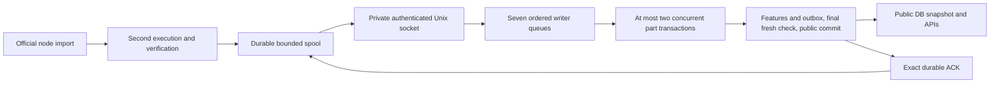

# StableNet execution ingest

Use this opt-in path to index verified transaction and Finalize state changes from an **explicitly prepared StableNet checkpoint** into PostgreSQL. The normal RPC source remains the default. This path currently supports one chain per ingest process and a four-connection PostgreSQL pool.

The separate [executor module](../x/stablenet/executor/README.md) imports the pinned official StableNet client without source patches. Normal node import executes a block once. `Replay` executes it again from its parent to export a journal and verify the original state and receipt roots. The second pass never commits node state.

## Data and completion



Seven writers cover blocks, transactions, receipts, logs, accounts, storage and contracts/code. A writer is a queue, not a permanently owned connection. Parts use at most two permits from the **existing pool of four**. The API retains its existing one-connection reservation; final publication uses the remaining capacity. No second write pool is opened.

Part commits persist unpublished data. Only the final publication transaction advances visible height, feature progress and outbox. It flushes application/undo writes, makes an uncached canonical request through the existing shared **5 physical HTTP attempts/second** budget, checks generation again, then commits. Only that success permits an ACK. Retries and failover share the same RPC budget.

Account and slot histories retain transaction order, before/after values, deletion and storage clear. Code is content-addressed. Successful outer creation receipts preserve creation evidence even for empty runtime code or constructor-time destruction; failed creations are excluded. Native balances consume the verified journal rather than repeating profile accounting or querying balances over RPC. Token metadata can still use the existing RPC client.

## Prerequisites

- Go 1.26.8; PostgreSQL with durable commits (`fsync=on`, synchronous commit).
- The StableNet indexer binary and a separate executor binary. The root module never imports the fork.
- An original anchor block/hash/root and explicitly verified covered account, slot and code baseline. The prepared node DB must match that anchor.
- A shared directory owned by the process user with mode `0700`; the indexer creates a new `0600` socket. Both processes must run as the same UID on macOS or Linux. The final socket path is published atomically after listen and permissions are ready. Existing socket paths are never replaced automatically.

Use the [offline bootstrap tools](EXECUTION_BOOTSTRAP.md) to prepare a new schema from the full official genesis allocation or an explicitly trusted full/partial checkpoint. Full coverage requires rebuilding all storage/account roots; selected proofs remain partial. Missing partial coverage returns an error; it is not a balance of zero. A checkpoint does not supply earlier history or fabricate node state. API height `0` in the existing balance port continues to mean latest.

## Indexer configuration

Add `source.execution` to the normal StableNet YAML. The hashes below must be replaced with the original prepared anchor values, including on restart; they are not the changing visible tip.

```yaml
database:
  driver: postgres
  postgres:
    dsn: "" # Inject INDEXER_DB_POSTGRES_DSN outside the file.
    schema: stablenet
    max_conns: 4
rpc:
  endpoint: https://YOUR_CANONICAL_RPC
  rate_limit: 5
indexer:
  state_prefetch: true
  finality: head
  confirmations: 0
source:
  execution:
    socket: /ABSOLUTE_PRIVATE_DIRECTORY/execution.sock
    anchor_height: 0
    anchor_hash: "0xREPLACE_WITH_64_HEX_DIGITS"
    anchor_root: "0xREPLACE_WITH_64_HEX_DIGITS"
    queue_blocks: 64
    queue_bytes: 268435456
    timeout: 1m
```

Omitted queue fields use 64 blocks and 256 MiB; active work also consumes the budget. The receiver defaults to an eight-block window, bounded by the wire assembler's 256 MiB total allowance. Invalid sizes and timeouts are rejected.

Execution mode requires single-chain `all`/`ingest`, live HTTP(S) canonical RPC, PostgreSQL `max_conns: 4` and RPC rate 5. It rejects another feed/era source, recorded RPC, declared mode, confirmations/finalized publication, and legacy clear/reindex/gap-recovery options. Startup does not run legacy feature backfill or startup preparation steps. Existing non-execution configurations keep their behavior.

An API-only process omits `source.execution` and opens the same schema normally in read-only mode. The store detects execution control and applies public snapshots automatically. Each process retains its own configured pool; four connections is a per-chain/process limit, not a database-wide limit. Treat feature additions or definition changes after the anchor as explicit migrations: resume rejects missing/incompatible feature checkpoints rather than silently backfilling execution state from RPC.

## Executor configuration and build

Build only; these commands do not start a node:

```sh
make build CHAIN=stablenet
cd x/stablenet/executor
go build -o /YOUR_BUILD_DIRECTORY/stablenet-executor ./cmd/stablenet-executor
```

`stablenet-executor --config /ABSOLUTE_PATH/executor.json` is the explicit runtime entry point. Its JSON fields are:

| Field | Required meaning |
| --- | --- |
| `start_mode` | Optional `genesis` (requires height0) or `checkpoint`; omission retains E1 prepared-checkpoint behavior |
| `data_dir`, `spool_dir` | Separate absolute directories; neither may contain the other |
| `socket` | The indexer's absolute private socket path |
| `genesis_file` | Absolute path to the official genesis JSON, including fork/WBFT configuration |
| `chain_id`, `network_id`, `genesis_hash` | Explicit identity; chain ID is a decimal string and must match genesis |
| `anchor_height`, `anchor_hash`, `anchor_root` | The original prepared checkpoint, matching the indexer |
| `peers` | Explicit execution-layer enode addresses; an empty list permits offline preparation only |
| `listen_addr` | Optional p2p address; default `127.0.0.1:0` |
| `spool_bytes`, `spool_records` | Optional durable quotas; defaults 4 GiB and 262,144 records |

The assembly uses full sync and path state storage, disables discovery and HTTP/WS/node IPC, and does not start mining. It starts peer import only after the authenticated indexer Hello and startup backlog ACK gate. It does not enable the Engine API. State and transaction history retention are set to zero (unlimited); **E1 activates no automatic node-history deletion policy**. Preimage preservation is enabled for new imports so full checkpoint export can recover addresses/slots. It does not recover preimages missing from an older DB. Node storage can grow, and retained history does not guarantee direct access to every old root. E3 supplies verified retention/deletion policy.

Keep actual node startup, peer onboarding, disk provisioning/formatting, GC activation and throughput measurements in separately approved operational validation. None is required by the offline functional checks described here.

## Restart and failure behavior

- A Hello is information, never an ACK or deletion authority. Pending startup results drain before new import/capture starts. Exact published payload retries perform fresh confirmation without repeating feature or outbox writes.
- Missing parents, identity/content conflicts, quota exhaustion and unsupported state coverage fail closed and preserve raw results. Quota failure closes only the owned node; it does not delete data or automatically restart a full spool.
- A validated reorg durably advances generation and blocks publication/read admission before old workers join. Recovery atomically restores core/state/feature data to a common public parent, checks fresh again, and reopens. The bound is 128 public blocks and the original anchor.
- Interrupted recovery leaves its durable marker for restart. A successful recovery forces a new Hello. Old-generation spool files are quarantined, retained and counted against quota; only exact ACKs authorize normal result cleanup.
- Restoring the DB behind the source generation, missing node headers/state, or deeper reorgs requires [explicit checkpoint diagnosis/recovery](EXECUTION_BOOTSTRAP.md#read-only-diagnosis-and-explicit-recovery). Restore a matched backup or verify a new checkpoint into a new schema/spool; the tool never overwrites the old data. There is no blind `SetHead`, latest-state fallback or automatic baseline inference.

## Verification and remaining work

`make test-race`, `make test-postgres` and the execution CI checks cover wire bounds, spool durability, ordered ACKs, worker cancellation, publication/read fences and recovery. Checked-in [fixtures](../testdata/execution/) are regenerated and byte-compared by the pinned executor's tests using actual EVM/WBFT first and second executions. The root integration suite consumes those same bytes through the seven writers, PostgreSQL and GraphQL, including native mint/fee delegation, revert, creation, lost ACK, reorg and restart. The fixture generator checks that replay leaves durable node state unchanged.

These are functional results. Live peers, long-running node storage, deployment recovery and throughput remain unmeasured. The current [checklist](codemine/runs/20261023-e1-execution/checklist.md), [implementation plan](codemine/runs/20261023-e1-execution/03-plan.md), [recent context](codemine/runs/20261023-e1-execution/continuity.json) and [remaining work](analysis/open-items.md) record E1 completion. The [E2 checklist](codemine/runs/20261024-e2-bootstrap/checklist.md) tracks offline bootstrap release. E3 retention, E4 feature-writer changes, E5 other chains and E6 consensus/finality remain separate work.
