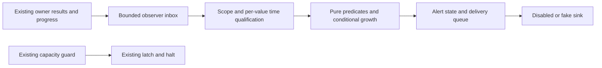

# Native 관측·경보 연동 설계

작업 [MON-01](analysis/open-items.md#mon-01)의 설계 정본이다. 현재 코드는
capacity guard, DB 통계 journal, runtime telemetry, 파일 진단과 오프라인
평가기를 각각 제공한다. MON-02-A의 순수 관측 모델·qualification·공통 수치
predicate, MON-02-B의 단일 sampler/owner tap, MON-02-C의 경보 reducer·private
checkpoint·fake/disabled sink를 구현했다. 실제 App/config/transport 통합은
**MON-02-D/03 구현 계획**이며
아직 실행 경로나 설정 키가 아니다. 운영 실행·추가 측정·알림 발송은 HOLD다.

[계획](codemine/runs/20261102-mon01-observation-design/plan.md)·[체크리스트](codemine/runs/20261102-mon01-observation-design/checklist.md)·[검증](codemine/runs/20261102-mon01-observation-design/validation.md)과
[현재 상태](SESSION_STATE.md)를 함께 따른다.

## 구현된 순수 관측 계층

[`internal/nativeobserve`](../internal/nativeobserve/types.go)는 metric/unit/
resource/measurement/budget scope·owner source/incarnation/run·chain anchor와
receiver/capture/raw/native/read domain을 타입으로 구분한다. `NewCatalog`는
resource64/key1024 상한 안에서 입력을 복사하고, 중복 key·모순된 resource·DB 전체
값의 schema 예산 바인딩을 거부한다. ID는 opaque 선언이며 DB 인증은 아니다.

`Qualify`는 각 component의 원래 획득 시각·quality·coverage를 독립 검사한다.
missing과 known0, 실패와 stale, 원본 없는 position과 알려진 충돌을 구분하며,
부분 누락이 다른 알려진 오류를 가리지 않는다. schema별 측정은 unsupported다.
startup ACK ref의 새 관측은 새 처리 event 시각이 아니다. head나 stage간 backlog를
계산하지 않으며 truncated/lower-bound received 값을 exact로 승격하지 않는다.

`CompareGrowth`는 같은 binding/연속 per-key sequence의 유효 표본 쌍만 비교한다.
현재 freshness와 과거 표본의 원래 quality/쌍 interval을 구분한다.
재시작·restore·rebind·정의/예산/정책/epoch 변경은 baseline reset, flat/shrink나
stale/missing은 예측 불가다. 기존 v1과 공통 `monitorpredicate.ProductGE`의128-bit
수치 비교를 사용한다. `Growth.Within`의 known=false는 정상 여유가 아니다.

순수 model/qualification 외에 B의 IO 없는 inbox/tap·기존 sampler 소유권을 구현했다.
새 DB/RPC/pool·파일 저장·경보/전송·App 설정 활성화는 추가하지 않았다.
CLI v1 schema/출력/설정도 그대로다. [구현 검증](codemine/runs/20261102-mon02a-observation-model/validation.md)을
따른다. 아래의 수집·supervisor·경보 lifecycle은 후속 slice의 계약이다.

## 현재 코드에서 확인한 재사용 지점

| 근거 | 확인된 사실 | 통합 시 경계 |
| --- | --- | --- |
| [opsguard Monitor](../internal/opsguard/monitor.go)·[설정](../internal/opsguard/config.go) | filesystem/PGDATA/raw 관측, warning 연속 표본, 한 번의 halt/latch. 통계 query는 별도 직렬 작업이며 기존 주기 기본1분 | 보호·중단 정책과 latch를 새 경보기가 대체하거나 해제하지 않음. 기존 hard guard는 알림 실패와 무관하게 유지 |
| [PG 통계 sampler](../internal/opsguard/stats_sampler.go) | 최신 source의 직렬 DB/WAL owner 하나. 기본 query30초, programmatic 관측 mode2초/round5초. detach는 취소·join하고 late 결과를 fence | 같은 owner/result를 공유. 실패는 unknown·비중단. API/transaction context 값·새 pool·추가 poller를 사용하지 않음 |
| [DatabaseBytes/WALBytes](../pkg/storage/postgres/capacity.go) | 기존 Store pool에 직접 질의. DB 전체 `pg_database_size`, 서버 WAL `pg_ls_waldir`; 체인 schema별 크기가 아님 | Ddb/Dwal/Dpg를 섞거나 체인마다 합산하지 않음. 권한 실패는 디스크 full/0 bytes가 아님 |
| [API 예약 reader](../pkg/storage/postgres/query_reader.go)·[SQL read](../pkg/storage/postgres/exec_read.go) | 기존 pool4 안에서 API1을 예약하며 일반 조회는 남은 pool을 사용. context로 예약 reader를 전달할 때만 그 경로를 재사용 | background 관측에는 API lease/context를 전달하지 않음. 별도 pool·API 예약·동시 stats query 없음 |
| [App operations](../pkg/app/operations.go)·[Run/Shutdown](../pkg/app/app.go) | App이 guard/attach를 소유. Run은 monitor 종료를 기다리고 Shutdown은 detach/journal 정리 후 Store를 닫음 | Monitor.Close는 sampler/run을 cancel·join하고 journal을 닫음. detach는 해당 Store read를 join. direct Shutdown/child close를 기능 검사했으며 실제 운영 IO 종료 보장은 별도 |
| [window Usage](../pkg/window/budget.go) | 실제 free-space/ledger를 읽고 volume write lock·guard/poison 경로에 진입 | 이름만 보고 순수 getter로 poll하지 않음. 이미 완료한 owner 관측을 복사 |
| [feed telemetry](../internal/feedtelemetry/recorder.go)·[raw intake](../internal/feedtelemetry/intake.go) | process-local bounded ledger, 원래 receive/completion 시각. raw received-through는 미검증이며 truncation 시 lower bound | 계열/run/coverage를 함께 보존. truncated pending 수를 exact backlog로 표시하거나 재생 데이터 시각을 현재로 갱신하지 않음 |
| [indexing pipeline](../internal/indexingstatus/pipeline.go)·[status](../internal/indexingstatus/status.go) | capture generation과 runtime 표본은 별개. 현재 pipeline의 NetworkHead는 채워지지 않음 | capture generation을 execution SQL generation으로 바꾸지 않음. head 누락을 received/latest로 채우지 않음 |
| [SQL ingress inspection](../pkg/storage/postgres/exec_inspection.go)·[계약](../pkg/execution/ingress/inspection.go) | 기존 pool의 bounded repeatable-read metadata. native/raw/source filesystem과 원자적 snapshot이 아님 | 파일 진단을 반복 호출하거나 cross-store 일치를 권한으로 쓰지 않음. owner/anchor/epoch/visible/pending을 독립 관측으로 유지 |
| [Arc round](../x/arc/ingress/round.go)·[durable source callback](../execwire/exporter/client.go) | OnCommitted는 durable source ACK 뒤 호출하며 시작 시 기존 committed ACK도 다시 전달할 수 있음 | ACK ref 관측 시각과 새 ACK 진행 시각을 분리. callback은 비차단, source ACK 순서/권한을 변경하지 않음 |
| [오프라인 평가기](../internal/nativemonitor/evaluate.go)·[두 점 추세](../internal/nativemonitor/growth.go)·[DTO](../internal/nativemonitor/types.go) | 순수 판정과 정확한128-bit horizon 비교. v1 metrics는 관측 시각 하나를 공유하고 전체 보고는 운영 권한 때문에 HOLD 가능 | predicate를 재사용하되 서로 다른 시점의 live 값을 한 v1 timestamp로 합치지 않음. overall HOLD를 곧바로 센서 실패로 해석하지 않음 |
| [기존 알림](../internal/notifications/channels.go)·[destination guard](../internal/notifications/destination.go) | 사용자 blockchain event 설정·저장/전송과 제한된 HTTP transport | capacity 경보를 block event/outbox에 위장하지 않음. 허용 목적지/redirect/timeout/signature 검증을 완화하지 않고 sender 기본 비활성 |
| [legacy Docker watcher](../deployments/testnets/preflight.py) | 기존 manifest 기반 emergency/stop 동작. Docker VM free 점검은 throwaway container를 실행 | native 통합 watcher로 자동 재사용하지 않음. 실제 Docker probe/Compose stop은 별도 허용된 운영 범위 |

이는 코드 관측이며 실제 DB 권한·APFS·peer·부하·Docker/host 동작을 검증한 결과가
아니다. 현재 query가 새 관측기 없이도 pool을 사용하는 사실과, 새로 IO를 만들지
않겠다는 설계 결정을 구분한다. 연결 수 유지가 경합/지연0의 보장은 아니다.

## 선택한 구조와 소유권

아래 구조의 model/qualification·bounded inbox/tap·stats owner와 nativealerts는
구현됐다. 실제 App/설정/transport 연결은 제안이다.

- `internal/nativeobserve`: bounded immutable DTO·qualifier와 비차단 inbox/tap 구현.
  owner-result hooks와 공유 stats sampler는 B 범위다. 실제 Store/SQL/파일/transport 구현은 App assembly가 read-only
  capability로 주입한다. 이 모듈에는 canonical reader, writer, GC/Resume나
  notification setting 변경 권한을 주지 않는다.
- `internal/nativealerts`: 순수 reducer, bounded checkpoint/delivery 상태와
  fake/disabled sink를 구현했다. 기존 `internal/nativemonitor`는 순수 evaluator/파일 CLI로
  유지하며 live Store·client를 import하지 않는다.
- App이 생명주기를 소유한다. 기존 owner의 성공 결과와 verified progress를
  비차단 tap으로 복사하고, 한 DB resource에 하나의 sampler만 둔다. legacy
  monitor의 result tap과 관측 전용 mode가 둘 다 sampler를 띄우지 않게 한다.
- 제안 config namespace는 `operations.observation`, 기본 nil/disabled이다.
  현재 parser에는 없으며 예제/실제 설정에 추가하지 않는다. 기존 capacity
  section/Resume 의미를 그대로 두고, 관측 전용 mode는 halt file을 만들지 않는다.

## 구현된 owner 결과 연결

[MON-02-B 검증](codemine/runs/20261102-mon02b-owner-taps/validation.md)을 따른다.
`Monitor.StatsSampler()`는 기존 owner를 공유하며 새 periodic `Run` 중복을 거부한다.
`WithObservationStats`/`NewObservationStatsSampler`는 programmatic opt-in이며
현재 YAML 설정이나 자동 App 활성화를 뜻하지 않는다. 수동 `Sample`은 명시적
owner 작업이며 consumer의 별도 polling 경로로 사용하지 않는다.

Inbox는 bounded channel, per-key sequence·sticky lifetime loss와 retired source
필터를 제공한다. callback/IO는 없고, 포화가 query/commit/ACK 결과를 바꾸지 않는다.
상호 독립된 owner에는 별도 tap을 사용하고, retire 후 새 registration이 필요하다.
Recorder/Arc stop과 stats detach/close는 해당 tap을 retire한다. SQL backend의
borrowed tap은 D의 App owner가 receiver join 뒤 retire해야 한다.

DB/WAL은 각 query 시각을 보존한다. Arc raw/native는 기존 durable completion을
복사하며, ACK 최초 관측/복원은 새 progress 시각이 아니다. SQL 성공은 이전 commit
확인일 수도 있어 event 시각을 만들지 않는다. ACK/SQL header에 없는 native/read
epoch와 legacy intake에 없는 capture generation은 채우지 않고 incomplete로 남긴다.
legacy received는 원래 receive 시각과 unverified/truncated coverage를 보존한다.
이 부분 자료로 exact backlog·최신 network head를 만들지 않는다. Inbox loss의
자동 복구·알림 해제·파일·sender는 아직 없고 C/D에서 별도 검증한다.

## 관측 계약

v1 외부 snapshot과 wire/diagnostic schema는 바꾸지 않는다. 새 관측 모델은
별도 내부 observation DTO이며, CLI/file format 확장은 필요한 시점에
명시적 version/admission으로 다룬다. 필드 이름은 MON-02-A 타입을 따른다.

| 필드군 | 필요한 의미 |
| --- | --- |
| metric/resource | 고정 metric enum, unit, opaque resource ID, resource kind, 정의/정책 digest, 측정 범위(database/cluster/schema/window/filesystem/chain pipeline) |
| binding | App/Store source token·incarnation, process run, 필요한 chain/genesis/original anchor. private DSN/URL/path는 출력 ID나 payload로 쓰지 않음 |
| position | 값의 종류에 맞는 receiver generation, capture generation, raw/native/read epoch, hash/ref를 별도 typed 필드로 보존. 숫자가 같아도 서로 대입하지 않음 |
| value/quality | known value 또는 unknown/error/stale/unsupported, 고정 원인 코드. 0·없음·권한 거부·용량 초과를 구분 |
| time/order | 실제 획득 시작/완료, 원래 event/progress 시각, local sequence, 관측/전송 시각 구분. consumer 수신 시각으로 표본을 freshen하지 않음 |
| delivery scope | 정책/규칙·권한 있는 operator sink 식별자. 공개 경보에는 allowlisted 코드·최소 수치만 투영; 원시 오류/identity/credential은 제외 |

### 리소스와 예산

- Ddb는 database 전체다. 여러 체인이 같은 database를 쓰면 resource 관측과
  budget·경보는 한 번만 소유한다. Dwal은 cluster 전체로 별도 resource다.
  PGDATA allocated bytes(Dpg)는 WAL/여러 DB를 포함할 수 있어 Ddb+Dwal과 합쳐
  새 총량을 만들지 않는다. 기존 guard의 Dpg 보호 정책은 유지한다.
- 현재 Ddb를 체인별 schema budget이나 `indexer` growth에 직접 연결하지 않는다.
  명시적으로 같은 database 전체를 대상으로 한 정책/series/budget만 매핑한다.
  schema별 크기는 별도 측정 정의가 구현·검증되기 전 UNKNOWN이다.
- database/cluster 전체 경보는 chain-bound v1 Evaluate에 가짜 chain/anchor를
  만들어 넣지 않는다. 현재 정확한 budget/horizon predicate를 순수 공통 helper로
  추출해 resource 판정에 재사용하고 기존 v1 동작은 그대로 검증한다.
- source token은 정확한 App Store를 식별하고 detach/rebind를 fence한다. 외부
  resource ID는 operator binding이다. 이름·해시 일치로 물리 DB 인증을 주장하지
  않는다. 동일 DB 여부/정의가 불명확하면 합산/중복 제거/예측을 보류한다.

### 시각과 추세

- DB와 WAL은 별도 query 완료 시각을 갖는다. storage/pipeline/diagnostics 전체를
  마지막 성공 시각 하나로 묶지 않는다. v1으로 투영할 때도 서로 다른 sample을
  같은 시각에 관측한 것으로 변환하지 않는다.
- 성장 비교는 동일 resource/definition/budget/series/run·필요 generation의 두
  유효 표본만 사용한다. restart·restore·rebind·측정 정의/예산/정책 변경 시
  rate history와 dwell을 reset하고 새 표본 쌍을 기다린다. 기존 critical 경보를
  정상으로 자동 해소하지 않는다.
- 현재의128-bit horizon predicate를 재사용한다. flat/shrink·missing/stale·
  간격 미달/초과는 예측 불가이며 무한 여유가 아니다. 미래·역순·모순은 data
  quality 오류다. local monotonic 간격과 UTC provenance를 구분하고 원격 clock
  skew/불명확한 시각은 재설정/HOLD로 처리한다.
- startup 시 다시 관측한 durable ACK ref는 최신 처리 event가 아니다.
  ACK lag/worker lag는 원래 pending/progress 시각이 알려질 때만 계산한다.

### 높이·backlog

native 경로는 R(raw durable receive), N(first execution), P(SQL visible),
A(durable source ACK)를 독립 ref로 관측한다. 한 receiver generation과 검증된
native/read epoch binding을 확인하기 전에는 R−N/N−P/P−A를 계산하지 않는다.
단순 정상 경로의 높이 순서와 reorg/maintenance 전환 상태를 구분한다.
catch-up 중 잘못된 순서를0으로 clamp하거나 다른 epoch 값을 대입하지 않는다.

legacy capture/projection의 factsThrough/proof/state backlog는 기존 의미대로
별도 metric으로 보존한다. 미검증 received-through와 truncated pending은 exact
backlog가 아니다. 실제 수신한 head 관측이 없으면 head−R은 UNKNOWN이고,
새 eth_blockNumber 호출·자기 API polling·head=received 대체를 하지 않는다.

## 획득 예산·취소·종료

- 기존 Store pool4/part2/API1을 유지한다. 통계는 일반 pool을 사용하는 한 번의
  직렬 작업이며 acquire 시간도 deadline에 포함한다. 새 pool/API lease·SQL
  retry loop·node RPC 호출이 없다. SQL 값은 바인딩, 동적 식별자는 검증/quote한다.
- 현재 legacy 통계 timeout은30초다. B의 programmatic opt-in 관측 mode cap은
  query별2초·한 DB/WAL sampling round5초이며 기존30초 default를 몰래 바꾸지
  않는다. timeout이면 unknown으로 넘기고 해당 주기에 즉시 retry하지 않는다.
  이는 구현된 context 상한이며 취소 무시 provider를 강제 종료하거나 실제 운영 SLO/무경합을 보장하지 않는다.
- SQL inspection/read는 필요한 기존 결과를 우선 사용한다. 추가 bounded query가
  필요하면 명시적 provider/주기·같은 일반 pool에서 한 번만 수행한다. final
  fresh/COMMIT 주변·SQL/native/file lease 안에서는 observer IO를 하지 않는다.
- attach별 source token을 부여하고 detach 시 새 admission을 막는다. late 결과는
  token 불일치로 버린다. supervisor cancel → sampler/worker join → token detach
  → Store close를 보장한다. 취소를 무시하는 callback 때문에 close가 끝났다고
  가장하지 않으며, direct Shutdown/다중 체인 재시작도 테스트한다.
- window/native FS는 기존 owner의 완료 관측을 복사한다. 블록 장치 statfs가
  영원히 block돼도 안전하게 join된다고 주장하지 않는다. 새 blocking mount
  probe를 추가하지 않고 MON-03의 자식 프로세스/운영 장애 검증과 구분한다.

## 경보 상태와 backpressure

경보의 severity와 관측 quality를 분리한다. 기존 전체 Report가 HOLD인 이유는
권한 미검증일 수도 있으므로 전체 status만으로 센서/용량 경보를 만들지 않는다.
`capacity_stop`, `backlog`, `monitor_input_invalid`, `sample_missing`,
`maintenance_pending`, `delivery_failed` 등 고정 rule 종류로 투영한다.

| 입력/전이 | 선택한 동작 |
| --- | --- |
| 유효 critical | 첫 표본에서 즉시 escalation. 기존 guard halt와 별개인 통지 상태 |
| warning | 선언된 연속 표본 수와 최소 dwell을 모두 만족해야 escalation |
| 정상 복귀 | 선언된 clear threshold·연속 표본·dwell을 모두 만족해야 resolved. warning/stop/clear 수치와 수신 순서를 검증 |
| unknown/stale/권한 실패/sequence gap | normal이나 recovered로 바꾸지 않음. dwell/clear 진행을 중단하고 별도 quality 상태 유지 |
| series/policy/scope 변경 | 새 temporal baseline 필요. 이전 경보를 새 resource로 이전하거나 scope reset을 recovered로 보내지 않음 |
| 같은 상태 반복 | 같은 transition ID로 dedupe; 재통지는 명시적 cooldown/예산에 한정 |

구현된 관측 상한은 resource64/key1024이며, 경보 state128, 총 pending delivery256
(queued128+deferred critical128), event64KiB와 private alert checkpoint1MiB를 제한한다. 운영 용량을
보장하는 값이 아니며, 초과 구성은 거부한다. payload/block/log는 큐에 넣지 않는다.

producer tap은 bounded `Tap.Offer`만 수행한다. overflow는 sticky lost-sequence/quality
신호로 남기며 이미 확인한 critical/미전송 전이를 지우지 않는다. 포화 중의 모든
짧은 peak를 포착한다고 약속하지 않는다. loss 이후 baseline/연속 관측이 다시
확보되기 전에는 정상 복귀를 내보내지 않는다. alert sink/디스크/네트워크 지연이
writer·SQL·raw owner를 block하거나 ingestion queue 크기를 바꾸지 않는다.

alert checkpoint는 bounded private 파일로 별도 소유한다. indexer SQL/outbox나
GC journal에 알림 상태를 쓰지 않는다. atomic/private persistence를 검증하고,
corrupt/missing 상태는 state-lost/unknown이며 과거 경보가 해소됐다는 뜻이 아니다.
restart는 rate history를 새로 시작하고 미확정 active alert·delivery 상태만
독립적으로 복원한다. 알림 저장이 보호 latch나 source ACK 권한을 주지 않는다.

## 구현된 경보와 private checkpoint

[MON-02-C 검증](codemine/runs/20261102-mon02c-alert-state/validation.md)을 따른다.
모듈은 caller-driven single owner이며 새 App/worker/config나 실제 sender를 시작하지
않는다. `CapacitySignal`은 resource별 A qualification과128-bit threshold를 재사용한다.
backlog/lag/health kinds는 이미 검증된 derived signal을 요구하며 producer adapter는
후속 범위다. 단순 block height나 전체 HOLD를 backlog/정상 값으로 사용하지 않는다.

Critical은 즉시, warning/clear는 각각 count+dwell과 별도 clear threshold로 전이한다.
unknown/stale·누락·gap·binding/run/policy 변경은 dwell을 재설정하고 기존 unresolved
level을 유지한다. quality는 별도다. transition ID는 유지하며 cooldown reminder는
별도 delivery ID를 사용한다. unconfirmed 전이가 있으면 reminder 중복을 억제한다.

128 states/64 resources와 총 pending256을 제한한다. queued128과 각 rule당 opening
critical 하나의 deferred128로 나누어, 포화에도 critical ID를 보존한다. 다른 포화
전이는 backpressure/unknown으로 거부하고 정상 복귀를 수락하지 않는다. 명시적
Dispatch는 attempt reservation을 먼저 저장하고 exact delivery receipt 뒤 제거한다.
저장 실패는 미확정이며 동일 ID 재전달이 가능하다. bounded retry/dead letter를
유지하고, 뒤의 resolved가 같은 key의 미확정 critical을 앞질러 발송되지 않는다.

v1 checkpoint는 incident/delivery metadata만 보유한다. sample/sequence/run/dwell과
rate history·블록/SQL/outbox/source ACK는 저장하지 않는다. 새 Engine의 초기 Load/
Restore만 허용하며 temporal baseline은 다시 수집한다. missing/corrupt 입력이나
live restore는 state-lost/unknown으로 막고 기존 in-memory critical은 보존한다.
실패 뒤 자동 apply/save/dispatch나 이전 파일 덮어쓰기를 하지 않는다.

Unix store는 descriptor 기반 no-symlink path·owner0700/0600·regular/single-link·
nonblocking writer flock을 검증한다. fixed alerts.json의 strict bounded JSON은
필드 누락/duplicate/unknown/null scalar·잘린 배열·잘못된 순서/크기를 거부한다.
owned temp→file fsync→atomic rename→directory fsync이며, rename 후 barrier 실패는
성공이 아니다. 기존 파일을 읽기 전 교체하거나 corrupt/link 입력을 자동 재구성하지
않는다. 같은 UID 임의 편집자에 대한 인증이나 실제 장치 장애 보장은 아니다.

## Sink와 실행 경계

처음에는 disabled/fake sink만 연결한다. 기존 사용자 NotificationService의
chain event 설정·block outbox를 capacity 경보에 공유하지 않는다. 향후 transport
공유가 필요하면 destination/redirect/권한·timeout·signature 검증을 그대로
재사용하고 operator sink로 명시적으로 바인딩한다. private-destination 우회나
자동 credential 전달·endpoint 탐색은 없다.

전송은 ingestion과 분리된 제한된 worker가 수행한다. sender 결과의 receipt는
source ACK와 다른 이름/타입이며 로컬 통지 상태만 바꾼다. 네트워크 전송은
exactly-once가 아니므로 stable transition ID와 bounded retry/dead-letter,
재시작 후 at-least-once 가능성을 명시한다. 실제 발송은 별도 명시된 허용 범위가
있어야 하며 MON-01에서는 수신자/secret/연결을 구성하지 않는다.

새 경보기는 haltProcess/Resume/GC/restore/COMMIT/source ACK를 호출하지 않는다.
기존 hard guard·latch가 actuator 정본이다. 포맷/운영 실행/추가 측정과
APFS/peer/checkpoint/private 입력의 HOLD는 [운영 준비](OPERATIONS_READINESS.md)를 따른다.

## 후속 구현 순서

구체적인 source 변경 후보와 RED→GREEN 표는
[MON-02/03 구현 계획](codemine/runs/20261102-mon01-observation-design/implementation.md)을 따른다.
다음 추천은 MON-02-D의 disabled opt-in App/config·transport 경계다. 실제 App/config·수집·
알림·Docker probe 활성화까지 한 번에 확대하지 않는다.
