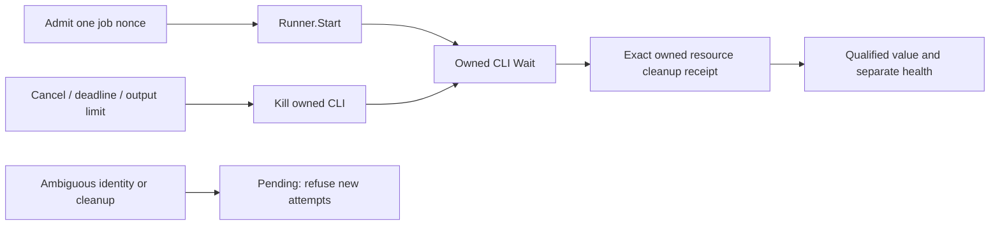

# Docker VM 관측 라이브러리와 observer health

주입 실행기로 VM probe를 소유하고 결과와 observer health를 구분하는 라이브러리다.
[`internal/vmobserve`](../internal/vmobserve/probe.go)는 주입된 Runner의 작업을
bounded single-flight로 소유하고 결과·health를 분리한다. 실제 Docker/OS 실행기,
App/config/CLI 연결, container 생성, 자동 복구/알림 발송은 추가하지 않았다.
체인을 돌리는 검사가 아니며 기존 [App DB/WAL 관측](NATIVE_MONITORING_INTEGRATION.md#구현된-opt-in-app-설정과-lifecycle)과
[legacy watcher](../deployments/testnets/preflight.py)도 바꾸지 않는다.

## 개발자가 사용하는 경계

`New(runner, Config)`는 side effect가 없고 nil runner를 거부한다. Runner는
명시적으로 주입하는 Go capability다. 설정/환경 변수에서 command나 Docker
endpoint를 구성하는 기능은 없다. 모의 실행·기능 검증은
[테스트](../internal/vmobserve/lifecycle_test.go)와
[계획/검증](codemine/runs/20261103-mon03-vm-observer/validation.md)을 따른다.

| API | 계약 |
| --- | --- |
| `Sample(ctx)` | true는 한 attempt의 admission이며 성공 판정이 아님. busy/closed/pending/이미 취소된 caller는 false. 각 attempt에 새 opaque nonce·sequence 부여 |
| `Run(ctx, interval)` | 선택적 직렬 supervisor. 주기1초~1시간, duplicate Run 거부. pending/active 작업을 재생성하지 않음. 종료는 terminal이며 같은 owner의 외부 Sample도 취소·join |
| `Close()` | never-started/concurrent 호출도 지원. 알려진 소유 작업의 실제 Start/Kill/Wait/cleanup과 Run 반환을 기다림. IO가 취소를 무시하면 완료를 가장하지 않음 |
| `Assess(at, maxAge)` | 소스 IO 없는 값 복사. maxAge>0~24시간. data 원래 획득 시각과 별도 observer health를 반환. 시각/age가 부적합하면 UNKNOWN |

기본 attempt timeout5초(허용1ms~30초), cleanup timeout2초(허용1ms~5초)다.
부모의 deadline이 더 빠르면 attempt에 적용한다. API 예약/transaction/credential
context 값은 제거한다. cleanup은 부모 취소 뒤에도 resource 정리를 시도할 수
있도록 별도 background deadline을 사용한다. 두 timeout은 context 상한이며
취소 무시 adapter의 실제 반환 시간을 강제하지 않는다.

## 작업 소유권과 종료 확인

Runner.Start는 요청 nonce와 `Launch`의 nonce를 일치시켜야 한다.
`Owned`는 non-nil Process capability, `NoResources`는 nil Process와 **아무 작업도
남지 않았다는 긍정적 증거**를 요구한다. daemon/permission 오류 문자열만으로
NoResources를 추정하지 않는다. 모순·미확인·다른 nonce는 pending이며 검증되지
않은 capability의 Kill/Wait/cleanup을 호출하지 않는다.

Owned의 부분 시작 오류도 process를 무시하지 않는다. 필요하면 Kill하고 실제
Wait를 join한 뒤 Cleanup을 별도로 호출한다. CLI exit/kill은 container 제거의
증거가 아니다. `Receipt{Job: exactNonce, Released: true}`·오류 없음·cleanup
context의 기한 내 반환이 모두 필요하다. 하나라도 빠지면 pending, data UNKNOWN,
후속 Start 금지다. cleanup의 늦은 성공을 정상 복귀로 바꾸거나 TTL/reset으로
pending을 풀지 않는다. 명시적 NoResources 실패만 다음 별도 호출/주기에서 다시
시도할 수 있으며 같은 attempt 안의 retry loop는 없다.

이 receipt는 주입 adapter의 협력적 계약이며 Docker 인증/물리 삭제 증거를
라이브러리 자체가 검증한다는 뜻이 아니다. pending은 이 owner의 메모리에 보존한다.
**새 Probe/프로세스를 만드는 것은 이전 resource가 없어졌다는 증거가 아니다.**
실제 adapter를 활성화하기 전에는 crash/restart를 포함한 durable admission과
아래 소유권 검증이 별도로 준비돼야 한다. 이 단계에 실제 실행기는 없다.

## 출력과 데이터 판정

[파서](../internal/vmobserve/parse.go)는 ASCII의 df `-P -k /` 형식만 받는다.
인식하는 KiB header(`1024-blocks` 또는 `1K-blocks`) 한 줄과 root mount(`/`)의
6필드 행 하나만 허용한다. unsigned decimal total/used/available, total>0,
used+available<=total, percent0~100 및 available×1024의 uint64 overflow를
검사한다. 추가 행/출력·음수·소수·단위 불일치·잘린 필드·control/non-ASCII 문자는
UNKNOWN이며 반환 오류는 고정 문자열이다. 인식 형식은 parser 계약이며 실제
Docker image/환경의 출력 호환성을 검증했다는 뜻이 아니다.

Runner에는 stdout/stderr Writer를 주입한다. 각각 최대4096/1024바이트를 받고,
초과는 cancellation과 OutputLimit이다. stderr는 **내용을 저장하지 않고** 크기만
센다. stdout도 한 번 seal한 뒤 정수 판정에만 쓰며 status에 담지 않는다. actual
Wait 뒤 writer를 seal하므로 늦은 Write는 고정 오류로 거부한다. future adapter는
전체 출력을 먼저 buffer하지 말고 이 Writer로 직접 stream해야 한다.
이 상한은 Go 수신 buffer의 계약이며 외부 process 전체 RSS 상한이 아니다.

Sample은 nonce/sequence/시작·획득 시각/known 여부와 정수 free bytes/allowlisted
cause만 보존한다. filesystem 이름·stderr·driver 오류·DSN·endpoint·key·container
payload는 반환하지 않는다. arbitrary driver 오류는 ProbeFailed, 명시적인
permission/daemon/timeout/cancel은 별도 code다. source 결함이 known0/full로
바뀌지 않는다. 부모 취소 callback의 전달이 늦어도 최종 공개 시 parent.Err를
직접 확인하여 늦은 정상 결과를 차단한다.

## 측정 값과 별도 health

`View.Sample.FreeBytes.Present`를 먼저 확인한다. 유효한 0바이트는 known이며
실제 용량 경보의 입력이 될 수 있다. 이때 observer 자체는 Healthy일 수 있다.
반대로 권한/daemon/parse/timeout/출력 초과·정리 pending은 관측 실패이지 디스크가
가득 찼다는 뜻이 아니다. capacity severity는 이 라이브러리에서 결정하지 않는다.

Observer health는 `Unknown / Healthy / Degraded`와 원인·평가 시각·마지막 attempt
완료 heartbeat를 별도로 제공한다. 시작 후 한 번도 관측하지 못한 경우,
heartbeat/원래 획득 시각이 maxAge를 넘긴 경우와 active attempt의 deadline 경과를
건강한 상태로 내보내지 않는다. health 평가·dequeue·cleanup 완료 시각으로 원래
데이터를 freshen하지 않는다. missing heartbeat가 capacity 정상/복구가 되는 경로는
없다. 별도 경보의 입력으로 사용할 수 있는 값이며 자동 sender/latch를 만들지 않는다.

VM 논리 여유는 호스트 APFS identity/PGDATA/WAL/체인 schema 예산과 다른 값이다.
이 값 하나로 실제 mount나 DB 사용 공간·backlog·canonical을 확정하지 않는다.

## 실제 활성화 전 남은 조건

[OPS-03/05/06](analysis/open-items.md#ops-03)의 기존 HOLD를 유지한다. 실제 실행기는
검토된 context/image digest/권한과 별도 승인된 probe 범위가 필요하다. container
방식은 owned nonce label·private cidfile·정확한 ID/소유권 확인·durable restart
fence 뒤 그 job만 정리해야 한다. pull/provision/daemon stop/Compose actuation,
다른 container/volume prune이나 기존 watcher lock 공유를 자동화하지 않는다.
실제 macOS/Docker mount 분리·daemon 장애·OS 취소/정리 보장은 이 모의 검증 밖이다.

모듈은 DB/RPC/native SDK를 import하거나 block/COMMIT/source ACK/GC/Resume를
호출하지 않는다. pool4/part2/API1·일곱 writer·RPC5·두 EVM·커밋 직전 fresh/fence와
다른 프로젝트/프로세스/container/volume/cache를 그대로 둔다.
