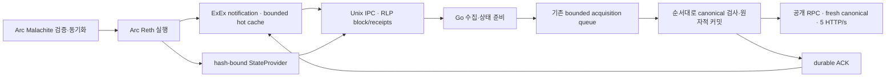

# Node-feed 연결

현재 개발 방향은 [24시간 윈도우 수집과 원천 DB 설계](analysis/windowed-feed-design.md)다. 이 문서는 기존 Arc ExEx/IPC 비교 구현과 측정 기록을 보존한다. 해당 구현의 존재가 별도 Arc full node 설치·실행을 요구하는 현재 계획을 뜻하지 않는다.

Arc full node의 실행 결과를 indexer에 전달한다. Arc 실행 노드에 붙이는 독립 Rust crate는 `x/arc/nodefeed`, Go wire 계약은 `pkg/nodefeed`, Source/state 어댑터는 `pkg/source/nodefeed`다. 기존 RPC 수집 경로와 비교할 수 있도록 기본은 비활성화다.

## 지원 확인과 구조

확인한 Arc commit은 `6e764023ee6515fe70573e123ed2db912a7207b4`다. 이 코드는 별도 Reth repository fork가 아니라 upstream Reth **v2.2.0 / 88505c7fcbfdebfd3b56d88c86b62e950043c6c4**를 SDK로 사용한다. `ArcNode::Primitives = EthPrimitives`이고 NodeBuilder에 `install_exex_if`를 적용할 수 있다. stock 실행 바이너리는 ExEx를 등록하지 않으므로 선택적 hook이 필요하다. tag/rev가 같은 commit이어도 Cargo source identity가 다르면 타입이 중복되므로 Arc와 동일한 `git + tag=v2.2.0`를 사용하고 Cargo.lock으로 commit을 고정한다.



ExEx는 실행/reorg notification을 받아 최근 block/receipt snapshot을 공유 메모리에 둔다. Go 수집 worker는 Unix socket으로 해당 높이를 읽으며, 캐시에 없으면 같은 노드의 provider가 canonical block/receipt를 읽는다. 이는 외부 노드 RPC로 재수집하는 fallback이 아니다. head도 로컬 실행 노드를 기준으로 하므로 아직 실행하지 않은 외부 head를 선행 조회하지 않는다.

native 초기 잔액·잔액 보정·lazy genesis 조회는 로컬 `state_by_block_hash`를 사용한다. 초기 입력은 기존 `PrepareBlock`에서 읽고 큐에 넘기기 전에 보관한다. 상태를 열지 못하면 오류를 반환한다. 열린 상태에서 존재하지 않는 계정의 0과 pruned/missing state 오류를 구분한다. 토큰 code/contract-call 메타데이터는 이번 구현에서도 기존 공개 RPC를 사용하며 strict hash 기반 준비와 오류 정책을 유지한다.

## 실행 노드에 hook 적용

공식 Arc checkout의 검증한 commit에서 실행한다. 설치 도우미는 revision을 검사하고 해당 checkout의 `crates/node/Cargo.toml`과 `crates/node/src/main.rs` 두 파일에만 선택적 의존성과 hook을 삽입한다. node를 시작하거나 네트워크 설정·체인 DB를 수정하지 않는다. 다른 revision은 자동 패치하지 않는다.

```sh
python3 x/arc/nodefeed/install_arc.py --arc-checkout /absolute/path/to/arc-node
cargo check --manifest-path /absolute/path/to/arc-node/Cargo.toml -p arc-node-execution --bin arc-node-execution
# 실제 실행 파일 빌드와 CL/EL 운영은 Arc 공식 운영 절차를 따른다.
```

patched 실행 노드에서 `INDEXER_ARC_FEED_SOCKET=/run/indexer/arc-feed.sock`를 지정하면 ExEx가 켜진다. 변수는 **Arc 실행 노드용**이며 Go indexer의 YAML 설정을 대신하지 않는다. 변수를 설정하지 않으면 기존 Arc 실행 동작이다. 별도 `--unsafe-follow`를 켜거나 공개 RPC로 node sync를 시작하지 않는다. Full node의 검증/동기화/실행은 Arc CL/EL이 담당한다.

Unix socket은 producer와 consumer가 **같은 OS kernel**에 있어야 한다. Docker Desktop에서 Linux container의 socket을 macOS native indexer에 파일 mount만으로 연결할 수 있다고 가정하지 않는다. 두 프로세스를 native로 실행하거나, Docker 내부에서 같은 volume/UID를 사용하는 두 container로 실행한다. socket 권한은 0600이며 기존 경로를 지우고 덮어쓰지 않는다.

## Indexer 설정

단일 체인:

```yaml
rpc:
  endpoint: https://rpc.testnet.arc.io
  rate_limit: 5
  coalesce_reads: true
source:
  node_feed_socket: /run/indexer/arc-feed.sock
indexer:
  workers: 2
  state_prefetch: true
  state_workers: 4
  state_batch_size: 16
  acquisition_queue: true
  queue_blocks: 256
  queue_max_bytes: 268435456
```

4체인 실행에서는 Arc 항목에만 `node_feed_socket`을 둔다. 전역 `source`는 다른 체인에 상속되지 않는다. 다른 endpoint·DB·시작 높이는 운영 설정을 그대로 사용한다.

```yaml
rpc:
  rate_limit: 5
multichain:
  chains:
    - id: arc-testnet
      chain_id: 5042002
      rpc_endpoint: https://rpc.testnet.arc.io
      node_feed_socket: /run/indexer/arc-feed.sock
      state_prefetch: true
      acquisition_queue: true
      workers: 2
      state_batch_size: 16
```

로컬 Arc 노드가 설정 시작 높이와 그 부모의 필수 상태를 제공할 수 있도록 동기화한 뒤 indexer를 시작한다. 노드 동기화를 자동으로 기다리거나 pruned 상태를 복원하는 기능은 포함하지 않는다.

실제 사용할 socket이 없는 기존 config.yaml은 수정해 활성화하지 않았다. RPC의 rate_limit=5와 현재 Arc RPC batching 설정은 보존한다. 한도는 canonical/메타데이터/기타 기존 **공개 HTTP 시도 전체**에 적용되며 failover도 포함한다. 로컬 IPC 요청은 공개 RPC 요청이 아니다.

## 정확성과 복구 계약

- 시작 전 상태 검사는 provider별로 나눈다. native 잔액은 local feed, token metadata 및 기타 state reader는 기존 공개 RPC에서 각각 필요한 첫 높이를 검사한다. local state만 있다는 이유로 public metadata 상태 검사를 건너뛰지 않는다.
- handshake에서 protocol v1, chain ID, 공개 RPC에서 읽은 genesis hash를 확인한다.
- writer는 기존 `SetStateSource(publicRPCSource)`를 유지한다. 준비 상태를 사용할 때 canonical hash를 다시 조회하며 feed snapshot/cache로 대신하지 않는다. `Source.HashAt` 자체도 같은 fresh RPC로 위임한다.
- RLP header/body를 profile로 검증하고 높이/hash/parent, transaction trie root와 receipt trie root를 확인한다. consensus receipt에서 파생 필드를 계산하므로 다른 블록의 입력을 라벨만 바꿔 받아들이지 않는다.
- 수집·준비·queue 입장에서는 ACK하지 않는다. DB block transaction과 cursor/outbox commit이 끝난 뒤 ACK한다. 실패한 상태/블록은 ACK하지 않는다.
- ACK hash가 발행한 입력·현재 local canonical hash와 맞아야 한다. `FinishedHeight`는 **ACK 높이 -1/그 부모 hash**로 알린다. 다음 블록의 부모 상태를 아직 소비하기 전에 풀어 주지 않는다. genesis ACK는 pruning 진행을 알리지 않는다.
- ACK 응답을 잃어도 DB commit은 되돌리지 않는다. live loop는 저장 cursor 다음 높이에서 재시작하고 이후 ACK로 pending prefix를 해제한다. 이미 커밋한 블록의 ACK를 재요청할 때 producer가 재시작해 발행 기록이 없으면 해당 입력을 다시 검증하고 같은 hash에만 ACK한다.
- provider 재시작으로 session이 사라지면 다시 handshake한다. consumer identity는 chain ID + node ID/DB 경로/schema에서 안정적으로 파생한다. 같은 DB 프로세스 재시작을 지원하며 다른 DB가 retention owner를 빼앗지 못한다. 한 ExEx ID/socket은 한 논리 DB용이다. 이 식별자는 인증 비밀이 아니며 socket 접근은 OS 권한으로 제한한다.
- reorg notification은 hot cache의 fork 이후 입력을 폐기한다. provider의 hash 재확인과 writer의 fresh canonical 비교·기존 rollback도 남긴다. 과거에 이미 pruned된 상태나 snapshot 이전 상태를 복원하지 않는다. 기존 cursor/설정 시작 높이의 필수 상태가 없으면 시작/블록 처리가 실패한다.

## 자원과 범위

- 요청 frame 64KiB, 응답 frame 32MiB. big-endian u32 길이 + JSON, RLP 필드는 base64다. native balance batch는1..64주소다.
- 최근 ExEx cache는8블록/32MiB payload, 발행 후 미ACK 입력은 기본256블록/256MiB payload다. 전체 node/indexer heap/RSS 상한은 아니다.
- IPC 처리 최대16개, native provider I/O·응답 인코딩은 최대4개의 blocking worker, ExEx hot-cache 인코딩은 별도의 최대1개 작업으로 분리한다. hot-cache 작업이 바쁘면 priming을 건너뛰고 retained provider 경로로 읽는다. 새 notification/reorg 이후 끝난 오래된 priming은 게시하지 않는다. Node의 async executor에서 DB 읽기를 기다리지 않는다. timeout 후에도 실행 중인 동기 I/O는 permit을 반납하지 않아 blocking 작업 수가 무한히 늘지 않는다.
- pending 상한에 도달하면 backpressure 응답을 보내고 Go 수집 worker는 같은 높이에서 context 취소가 가능한 짧은 대기를 반복한다. ACK는 capacity permit을 요구하지 않는다. RPC 한도 증가·블록 건너뛰기·최신 상태 대체는 하지 않는다.
- consumer 장애 동안 ExEx pruning 진행이 멈춘다. 노드 WAL/state/disk 증가를 감시해야 한다. 자동 만료로 미소비 상태를 버리지 않는다. 오래 중단되거나 deep reorg된 입력을 원래 노드가 제공할 수 있다는 무제한 보장은 없다.
- IPC byte stream에는 별도 kernel shared-memory segment를 도입하지 않았다. ExEx와 Reth가 같은 프로세스에서 snapshot을 공유하고, Go 프로세스 경계에서는 framed IPC로 전달한다.

## 검증

```sh
make test-node-feed
make check-node-feed-arc ARC_NODE_CHECKOUT=/absolute/path/to/arc-node
```

`test-node-feed`는 Rust ACK/pruning/fork/consumer 계약과 실제 Rust fixture 생산자→Go App 저장·잔액 검증을 실행한다. fixture는 고정된 독립 oracle을 읽는 시험 생산자이며 chain sync나 Arc 노드 실행이 아니다. 보통 Go suite에는 Go protocol double 기반 keyspace/잔액/RPC 비사용, 커밋 후 ACK, 상태 실패 rollback, 큐 fork 검사, 취소/종료·재연결·frame 상한 시험이 포함된다. 실제 Arc testnet node sync/장시간 운영/처리량 비교는 이 기능의 compile·fixture 검증과 구분한다.

## 동일 Arc 기록의 전송 경로 비교 (10/15)

실제 Arc testnet **67019625..67019656의32블록/174거래**를 동결해 RPC 경로와 최적화 Rust `fixture` IPC 경로를3회씩 번갈아 실행했다. 아래는 각 경로3회 중앙값이다. 실제 Arc CL/EL은 실행하지 않았다. HTTP source는 불변 RPC 재생이며 production limiter5 HTTP/s·coalescing을 적용한다. canonical은 매 블록 새 HTTP 요청으로 검사하지만 이 시험의 canonical 응답은 동결되어 있다. 실제 public node의 live canonical/reorg 검증을 대체하지 않는다.

| 지표 | RPC 재생+배치 | Rust IPC fixture |
| --- | ---: | ---: |
| 32블록 처리 시간 | 7.583s | 6.802s |
| 커밋 처리량 | 4.220blk/s | 4.704blk/s |
| 블록 수집 단계 p95 | 799.8ms | 395.4ms |
| HTTP 시도 | 38 | 34 |
| 논리 RPC 멤버 | 309 | 44 |
| public 경로 native 잔액 멤버 | 202 | 0 |
| queue 최대 블록 | 4 | 28 |

처리량은11.5% 증가하고 처리 시간은10.3% 감소했다. 논리 요청은85.8% 줄었지만 이미 HTTP 배치를 사용한 baseline이어서 envelope 감소는10.5%다. IPC 경로의 남은32 canonical 헤더·4 code·8 call은34 HTTP에 들어갔고, 이 경로가5 HTTP/s 예산을 계속 사용한다. 더 빠른 수집이 큐를 채우는 효과와 writer/public 요청 예산이 전체 처리량에 주는 제약을 분리해서 본다. 이32블록의 p95가450ms 이내였다는 사실을 장기450ms SLO 통과로 확대하지 않는다.

양쪽 모두 workers2/state_workers4/state_batch_size16/queue256블록·256MiB, production 기본 feature와 새 durable Pebble DB를 사용한다. DB/App 시작·RLP fixture 변환·입력 확보·종료·정확성 대조는 시간에서 제외한다. 동일 호스트에서 성능 시험은 순서대로 실행했다. 모든6회 저장 keyspace(기존 volatile 항목 정규화)와 동결된 end-state 잔액이 일치했고, 필요한 조회를 포함해 미기록 RPC 요청은0건이다. native fixture의 `strict_state=true`는 알려지지 않은 계정 값을0으로 만들지 않고 오류를 반환한다.

이전 순차 저장용 기록에는 빠른 speculative 준비가 조회하는 parent-state 일부가 없었다. Arc NativeDeltas로 해당32블록의 잠재적 조회를 먼저 계산하고, 빠진77개 정확한 hash/계정 잔액을 공개 RPC에서 추가로 동결했다. context3회·개별 상태3회·4멤버 이하 배치19회로 총25 HTTP/80논리 공개 요청을 사용했으며, bulk 상태 확보는 HTTP1회/초·최대4멤버였다. 값 대체/최신 상태 fallback은 없다. 이 준비 비용은 양쪽 측정에 포함하지 않는다. 원본의 EIP-1898 인코딩 별칭과 입력 누락을 확인한 초기 실패 로그도 보존했다.

재실행에는 `measurement-input.json`(chain_id/from/to, 불변 replay_archive 경로, JSON blocks, hash→address→hex 잔액의 strict_state)과 완전한 기록이 필요하다. 준비 도우미·입력·요청 원문·summary는 `/private/tmp/indexer-node-feed-measure-20261015/`에 있다.

```sh
cargo build --release --locked --manifest-path x/arc/nodefeed/Cargo.toml --bin fixture
INDEXER_NODE_FEED_MEASURE_DIR=/private/tmp/indexer-node-feed-measure-20261015 \
INDEXER_NODE_FEED_FIXTURE_BINARY="$PWD/x/arc/nodefeed/target/release/fixture" \
go test -v -count=1 -timeout=12m ./pkg/app -run '^TestNodeFeedRecordedMeasurement$'
```

실제 Reth state DB 읽기, ExEx notification 인코딩의 실행 부하, CL 동기화, pruning/WAL/disk 증가, 전체 node RSS,4체인 동시 운영·live head 격차·SLO는 포함하지 않는다. 이전 공개4체인 표본1.977blk/s와 본4.704blk/s는 조건이 달라 직접 상승률로 비교하지 않는다.

실제 노드 실측은 저장 공간이 필요하다. 조회한 최신 snapshot67243540의 [manifest](https://snapshots.arc.network/api/download/testnet/storage-v2/archive/67243540-20261015T0020Z/execution/manifest.json)에서 state116.0GiB+headers33.4GiB만149.4GiB다. 현재 내부 disk 여유약152GiB에는 CL 데이터·추출 중 임시 파일·진행 중 WAL 여유까지 확보할 수 없어 snapshot 다운로드를 시작하지 않았다. 동기화된 Arc 노드 또는 충분한 별도 저장 경로가 정해지면 실제 node-feed와 RPC의 같은 조건 운영 창을 비교해야 한다.

지원 근거: [Arc pinned Cargo.lock](https://github.com/circlefin/arc-node/blob/6e764023ee6515fe70573e123ed2db912a7207b4/Cargo.lock), [ArcNode types](https://github.com/circlefin/arc-node/blob/6e764023ee6515fe70573e123ed2db912a7207b4/crates/evm-node/src/node.rs), [Reth install_exex](https://github.com/paradigmxyz/reth/blob/88505c7fcbfdebfd3b56d88c86b62e950043c6c4/crates/node/builder/src/builder/mod.rs), [Reth FinishedHeight contract](https://github.com/paradigmxyz/reth/blob/88505c7fcbfdebfd3b56d88c86b62e950043c6c4/crates/exex/exex/src/context.rs).

10/15 사용자 요청으로 검증용 Rust target 및 임시 Arc/Reth checkout을 제거해 실제 여유약5.6GiB를 확보했다. 구현 소스와 측정 기록은 보존했다. 현재 실행 중인 노드는 없으며 재실행 시 fixture 재빌드와 필요한 Arc checkout 확보가 필요하다. 실제 노드 구축·추가 운영 측정은 보류한다.
