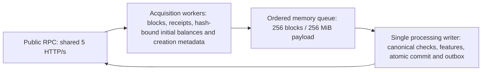

# Continuous acquisition and ordered processing

Arc's target is about two blocks/s. The acquisition cadence target is 450 ms between consecutive, height-ordered preparation completions, with all public-node calls still sharing the existing five HTTP requests/s pool. A parallel job's duration is not that cadence. A queue absorbs processing pauses; it cannot compensate indefinitely for insufficient RPC throughput.

`acquisition_queue` is opt-in and requires `state_prefetch`. It can be set in `indexer` or overridden on one entry of `multichain.chains`. `queue_blocks` and `queue_max_bytes` use the same override rules; zero selects the defaults. Other chains retain their existing path when it is disabled. Sparse range ingest retains its specialized pipeline even when the queue option is present. `chunk_size` no longer forms a barrier between live acquisition and new heads in this mode. No chain ID branches, additional RPC client, independent quota or lower data accuracy are introduced.

The acquisition window has at most `2*workers` jobs, independently of processing. It returns a permit after transferring ownership through the queue, instead of waiting for the DB commit. Completed jobs are reordered before admission. The processing count and byte bounds include the active writer block; bytes are admitted in height order so an out-of-order block cannot consume the budget needed by an earlier block. A single payload over the byte budget fails explicitly. The byte measurement is the serialized block/receipt models plus the prepared state accounting. Decoded models, geth views, maps, goroutine stacks and temporary encodings make heap usage larger; the acquisition window retains additional decoded inputs. This is not an RSS limit.

Initial account state and creation metadata are prepared before handoff, bound to block hashes. Preparation can retain speculative state errors that become unnecessary when an earlier block initializes an account; the writer still decides whether those inputs are required. A preparation completion does not assert that every speculative read succeeded. Canonical state checks stay fresh on the processing side. Required state errors abort the whole transaction without advancing its cursor/outbox; there is no substitution with latest state or a zero balance. Exceptional negative-balance resync and custom handlers without preparation retain their existing ordered RPC reads; if their state has since disappeared they fail strictly. This stage split does not claim those calls can always be served by a full node.

On cancellation, acquisition/preparation failure or a writer-detected fork, producers are cancelled and joined, and the speculative queue is discarded. Successful lower blocks remain committed. A live retry starts at the committed cursor; reorg recovery starts at the returned fork height + 1, even below the configured initial start. The queue is volatile: process restart loses uncommitted captured state, so a long interruption can still require reindexing if the node has pruned the required inputs.

Every 10s, the chain logs `Acquisition queue` with `target_height` and its pipeline snapshot. `acquired_height` is the contiguous preparation-complete height; `committed_height` is the committed cursor, initialized from storage and advanced on successful writes (null on an empty database). `queue_blocks` includes the writer and excludes the separate acquisition window. Compare target minus acquired to measure acquisition lag, and acquired minus committed to measure downstream backlog. The in-flight and prepared-state totals include both bounds. Inspect `acquisition_interval`, `acquisition`, `handoff_wait`, `processing_queue_wait`, `ordered_write` and `database_commit` separately. Quantiles use a bounded recent 256-sample window. Queue mode's background head polling respects `max(1s, poll_interval)` and shares observations with acquisition; explicit API fresh checks remain unchanged. An explicit new-head notification refreshes the node head immediately instead of reusing an older cached observation.

Tests cover advancing live heads while commit is blocked, block/byte backpressure, cancellation and worker joining, ordered failures, retry and fork rejection, full stored keyspace parity, pruning after acquisition, and queued-fork rollback. The production queue is not a durable journal, an archive node or a proof of days-long operation. The five HTTP/s cap counts batch envelopes; provider quotas may count individual members and are still enforced through normal failures/retries.
