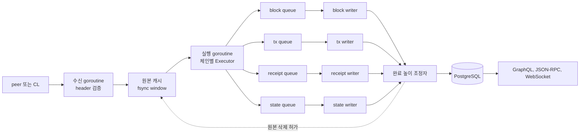

# 블록 실행 기반 수집 설계

**상태: 설계 초안 (2026-10-22). 구현, 외부 peer 접속, 상태 내려받기, 성능 측정은 하지 않았다.** 이 작업 전의 코드는 tag `v0.3.0`(`675d616`)으로 남겼다.

## 1. 배경과 목표

지금 indexer는 블록, receipt, 상태를 공개 RPC에 묻는다. 2026-10-22에 공개 RPC 네 곳을 재 보니, Sepolia와 BSC testnet은 최근 128블록과 120블록의 상태만 보관했다([백업 초안](../OPERATIONS_BACKUP_DRAFT.md) 1장). 색인이 그보다 뒤처지면 엄격 모드는 멈추고 다시 이어 갈 수 없다. 체인마다 공식 노드를 옆에 두면 이 문제는 풀린다. 하지만 블록, 거래, receipt를 노드와 우리 DB가 각각 저장해서 같은 자료가 두 벌이 된다.

이 설계의 목표는 다음과 같다.

1. 체인의 peer에 연결해 블록을 받는다. 블록과 거래는 받은 블록에 들어 있다.
2. 받은 블록을 체인의 실행 규칙으로 직접 실행해 receipt와 상태 변화를 만든다. 원격 노드가 상태를 얼마나 보관하는지와 상관이 없어진다.
3. 블록, 거래, receipt, 상태를 PostgreSQL 같은 관계형 DB의 테이블에 쓴다. 테이블마다 queue와 담당 goroutine을 둔다.
4. 처리를 마친 원본 블록은 바로 지운다. 노드 DB를 따로 두지 않으므로 저장소를 두 벌 쓰지 않는다.
5. 시작 모드를 두 가지 둔다. 동기화 없이 최신 블록부터 처리하는 모드와, DB의 마지막 높이 다음부터 따라잡은 뒤 새 블록을 하나씩 처리하는 모드다.

체인을 붙이는 원칙은 이렇다. 실행 규칙을 import로 가져올 수 있으면 import한다. 우리 구조에 맞게 로직을 바꿔야 하면 새로 구현한다. 붙일 순서는 StableNet, Sepolia, Hoodi, Ephemery, Arbitrum Sepolia, OP Sepolia, Starknet Sepolia, Arc다(10/22 결정). Arc는 Go에서 import할 수 없어 마지막에 둔다. Starknet은 EVM이 아니어서 코어 모델을 넓혀야 한다(8.2).

---

## 2. 현재 코드

### 2.1 어떻게 읽었나

`tools/astgraph`로 main `675d616`의 운영 코드(시험 제외)를 그래프로 만들었다. 패키지 102개, 노드 7,416개, 간선 35,753개다. 그래프로 호출 경로를 찾고, 각 주장은 코드를 읽어 확인했다. 그래프는 [코드 그래프](graph/README.md)의 도구로 다시 만들 수 있다. 이 설계의 원본 그래프는 저장소에 넣지 않았다.

### 2.2 수집 경로는 세 가지다

| 경로 | 입구 | 블록과 receipt를 얻는 곳 | 상태를 얻는 곳 |
|---|---|---|---|
| RPC 수집 (기본) | `pkg/app` `initFetcher` → `fetch.NewFetcher` | `sourcerpc`의 `eth_getBlockByNumber` + `eth_getBlockReceipts` | RPC `BalanceAt`, `CodeAt`, `eth_call` |
| peer feed (Arc, 선택) | `initManagedFeed` (`pkg/app/managed_feed.go`) | `pkg/chainfeed/ethpeer`가 ETH/68로 header, body, receipt를 받는다 | 없음. 상태 기능을 끈다 (`facts.Source.BindFeatures`) |
| node feed (ExEx, 비교용) | `internal/source/nodefeed` | 외부 Reth 노드가 IPC로 보낸다 | 외부 노드 |

세 경로 모두 마지막에는 같은 writer(`pkg/fetch/writer.go`)가 블록을 커밋한다. peer feed는 받은 자료를 capture DB에 저장한 뒤 `pkg/source/facts`를 `source.Source`로 감싸 이 writer에 넘긴다.

### 2.3 블록 하나가 커밋되기까지 (RPC 수집)

1. `Fetcher.Run`이 head를 읽고 높이 범위를 정한다 (`pkg/fetch/fetcher.go`).
2. `indexRange`가 worker N개로 블록을 병렬로 받는다. 한 번에 2×N 높이까지만 받고, 높이 순서로 다시 줄 세운다 (`pkg/fetch/scheduler.go`).
3. 선택 기능 `state_prefetch`와 `acquisition_queue`는 RPC 상태 조회를 writer 밖에서 미리 한다 (`pkg/fetch/prepare.go`, `acquisition.go`).
4. writer goroutine 하나가 블록마다 이 순서로 처리한다 (`writer.go` `writeBlock`).
   - 저장된 hash와 부모 hash를 확인한다.
   - `BeginBlock`으로 DB 트랜잭션을 연다.
   - 블록, receipt, 로그를 쓰고 기능 handler를 돌린다.
   - 기능 진행, cursor(`meta.latest_height`), outbox 이벤트를 기록한다.
   - 커밋 직전에 RPC `HashAt`으로 이 블록이 아직 canonical인지 확인한다.
   - 커밋한다.

`TestOnlyWriterOpensBlockTransactions`(`pkg/fetch/writer_test.go`)가 `writer.go` 밖에서 `BeginBlock`을 부르지 못하게 막는다. 블록의 모든 행이 한 트랜잭션으로 커밋되므로, 읽는 쪽은 반쯤 쓰인 블록을 볼 수 없다.

### 2.4 상태를 읽는 곳

| 읽기 | 위치 | 높이 | 실행 상태로 대체 |
|---|---|---|---|
| 처음 보는 계정의 잔액 | `internal/features/balance` `ensureInitialized` | 부모 블록 | 된다 |
| 잔액이 음수가 되면 노드 값으로 맞추기 | 같은 파일 `resync` | 그 블록 | 필요 없어진다. 실행 결과가 곧 잔액이다 |
| genesis 잔액 | `initGenesisMiner`, genesis resolver | 0 | genesis alloc으로 대체 |
| 토큰 판별과 이름·기호·자릿수 | `internal/features/token`, `internal/token` | 계약을 만든 블록 | 로컬 `eth_call`로 대체 |
| 시작 전 상태 확인 | `pkg/app/node_state.go` `checkNodeState` | 첫 블록의 부모 | 로컬 상태가 있는지 확인으로 바뀐다 |
| canonical 확인 | `HashAt`, `HandleReorg`, finality | 그 블록, head | 상태가 아니다. fork 선택으로 바뀐다 (7장) |

StableNet의 WBFT와 수수료 분배는 상태가 아니라 이전 header를 읽는다. 실행 엔진이 header를 공급하면 된다.

### 2.5 없는 것

- **로컬 실행**: 운영 코드에 go-ethereum `core/vm`, `core/state`를 쓰는 곳이 없다. `ApplyTransaction`도 부르지 않는다. trie는 root 계산(`DeriveSha`)과 proof 검증에만 쓴다.
- **상태 테이블**: PostgreSQL에 상태 관련 표는 `balances`와 `balance_history`뿐이다. 계정 목록(nonce, code hash), 계약 code, storage 슬롯 표는 없다. `contract_creations`에는 code 크기만 있다.
- **peer만으로 정하는 canonical**: peer feed도 블록마다 RPC `HashAt`으로 canonical을 확인한다. WBFT seal이나 beacon 서명을 검증하는 코드는 없다.
- **push 방식 head**: `ethpeer`는 새 블록 알림(`NewBlock` 등)을 버리고 높이를 하나씩 묻는다. 한 peer에 요청 하나씩, 블록마다 세 번 왕복한다.

go-ethereum은 75개 패키지가 import한다. 대부분 `common`(536곳), `core/types`(148곳), `rlp`, `crypto` 같은 기본 타입이다.

---

## 3. 목표 구조



### 3.1 수신

수신 goroutine은 블록을 받고, header를 검증하고, 원본 캐시에 쓰는 일만 한다. 지금 `pkg/capture` `PipelineTasks`의 receive 작업이 이 자리에 있다. 다만 지금은 검증 없이 쓰기만 하고, 검증은 뒤의 process 작업이 한다. 이 설계에서는 header 검증(hash, 부모 연결, 체인 규칙)을 수신 단계로 옮긴다. 검증하지 않은 블록은 캐시에 넣지 않는다.

블록을 받는 방법은 체인마다 다르다 (8장).

- StableNet, BSC 계열은 execution peer가 새 블록을 전파한다. `ethpeer`가 지금 버리는 알림 메시지를 받도록 바꾼다.
- Ethereum 계열(Sepolia, Hoodi, Ephemery)은 The Merge 이후 execution peer가 새 블록을 전파하지 않는다. consensus 쪽(beacon)에서 head와 블록을 받아야 한다.
- L2(OP, Arbitrum)는 sequencer가 내보내는 블록을 받고, L1에 올라간 자료로 확정 여부를 판단한다.

따라잡기(모드 2)에는 범위 요청이 필요하다. `ethpeer`는 지금 한 번에 한 높이씩 받는다. 여러 높이를 한 요청으로 받고, 여러 peer에 나눠 보내도록 바꾼다.

### 3.2 원본 캐시와 삭제

원본 캐시는 `pkg/window`를 그대로 쓴다. fsync, 디스크 색인, lease, 용량 한도, 외장 볼륨 검사가 이미 있다. 바꿀 것은 삭제 규칙이다.

| 지금 | 바꿀 것 |
|---|---|
| `Retention`이 24시간 미만이면 거부한다 (`window/options.go`) | 체인별로 정한다. 실행과 커밋이 끝나고 reorg 깊이를 지난 블록은 지울 수 있게 한다 |
| 256MiB 또는 4,096개 단위 segment로 지운다 | segment를 작게 잡아 블록 단위에 가깝게 지운다 |
| finalized 높이 이하이고 capture DB에 사본이 있어야 지운다 | "완료 높이 이하이고 reorg 깊이를 지났다"를 삭제 조건으로 쓴다 |
| capture가 원본 바이트를 DB에 영구 복사한다 | 복사하지 않는다. 원본을 계속 두는 것은 목표와 맞지 않는다 |

원본을 지운 뒤 다시 필요해지면 peer에서 다시 받는다. reorg 깊이(기본 128블록) 안의 원본은 남겨, reorg 때 다시 실행할 수 있게 한다.

### 3.3 실행

체인별 실행 모듈이 `Executor` 하나를 제공한다.

```go
// Executor runs one verified block on the state after its parent.
type Executor interface {
	// Execute returns the block's receipts and the state changes it made.
	// It fails when the parent state is unavailable or when the computed
	// receipt root differs from the header.
	Execute(ctx context.Context, b *model.Block, parent StateView) (*Result, error)
}
```

`Result`에는 receipt, 상태 변화(계정, code, storage), 내부 호출 기록(trace)을 담는다. 계산한 receipt root가 header와 다르면 실패한다. 이렇게 하면 실행 규칙이 체인과 어긋났을 때 그 블록에서 바로 멈춘다.

go-ethereum v1.16.5에는 `state.NewWithReader(root, db, reader)`가 있다. `reader`는 `Account`, `Storage`, `Code`를 읽는 interface다 (`core/state/reader.go`). 이 interface를 PostgreSQL 위의 상태 캐시로 구현하면, go-ethereum의 실행 코드를 import해서 쓸 수 있다. state root를 계산하는 경로(`IntermediateRoot`, `Commit`)는 trie DB를 연다. 5.2에서 trie를 저장하기로 했으므로, 이 trie DB를 PostgreSQL의 `trie_nodes` 위에 구현한다.

실행 중 상태 읽기는 PostgreSQL에 바로 보내지 않는다. 거래 하나가 계정과 storage를 수천 번 읽을 수 있어서다. 프로세스 안의 상태 캐시에서 읽고, 캐시에 없을 때만 DB에서 읽는다. 블록 하나가 끝나면 바뀐 상태만 state queue로 보낸다.

### 3.4 테이블과 writer

새로 만드는 표는 다음과 같다.

| 표 | 키 | 내용 |
|---|---|---|
| `accounts` | address | 현재 nonce, 잔액, code hash, storage root |
| `account_changes` | block, tx index, address | 블록·거래별 잔액과 nonce 변화 |
| `contract_code` | code hash | code 바이트. 같은 code는 한 번만 저장한다 |
| `storage_slots` | address, slot | 현재 값 |
| `storage_changes` | block, tx index, address, slot | 변화 이력. 이전 값과 새 값. 높이 범위로 partition한다 (5.3) |
| `trie_nodes` | node hash | state root 계산용 trie 중간 노드 (5.2) |

블록, 거래, receipt, 로그는 기존 표(`blocks`, `transactions`, `receipts`, `logs`)를 쓴다.

테이블마다 queue와 writer goroutine을 둔다. 이때 지금의 "블록 하나 = 트랜잭션 하나"가 깨진다. 그래서 **완료 높이**를 새로 둔다.

- writer는 각자 자기 표에 블록 N의 행을 쓰고 커밋한 뒤, 조정자에게 "N 완료"를 알린다.
- 조정자는 네 writer가 모두 N을 마치면 `visible_height`를 N으로 올린다. 이 값도 DB에 커밋한다.
- 읽기는 `visible_height` 이하만 본다. writer가 먼저 써 둔 N+1 행은 보이지 않는다.
- 원본 삭제와 outbox 이벤트 발행도 `visible_height`를 기준으로 한다.

이 방식을 쓰면 기존 코드에서 바꿔야 할 곳이 있다.

| 지금의 전제 | 바꿀 것 |
|---|---|
| writer goroutine 하나만 `BeginBlock`을 연다 (`TestOnlyWriterOpensBlockTransactions`) | 실행 수집 모드에서는 테이블 writer가 각자 트랜잭션을 연다. 시험의 범위를 기존 모드로 좁힌다 |
| undo는 트랜잭션마다 `indexer.height`를 걸고 `undo_blocks` 한 행이 블록 하나를 뜻한다 | writer마다 높이를 걸고, `undo_blocks`는 조정자가 `visible_height`와 함께 쓴다 |
| outbox 번호는 블록 트랜잭션 안에서 연속으로 매긴다 | 조정자가 `visible_height`를 올릴 때 매긴다 |
| `address_transactions`, `balance_history`의 순서는 `bigserial` 삽입 순서다 | 블록 높이와 거래 위치를 키로 정렬한다 |
| 잔액은 블록마다 읽고 고쳐 쓴다 (`FOR UPDATE`) | 실행 결과의 잔액을 그대로 쓴다. 읽고 고칠 필요가 없다 |
| 읽는 쪽은 원자적 커밋에 기대고 높이를 따로 확인하지 않는다 | 읽기를 `visible_height` 이하로 제한한다 |

테이블 writer를 나누는 이유는 쓰기를 병렬로 하기 위해서다. 그런데 지금 PostgreSQL 쓰기가 병목인지는 재 보지 않았다. 그래서 진행 순서를 둘로 나눈다. 먼저 기존 단일 writer에 실행 결과와 상태 표를 붙여 동작을 맞춘다. 그다음 쓰기가 실제로 병목으로 확인되면 테이블 writer로 나눈다 (9장).

### 3.5 읽기

읽기 goroutine 하나로 줄 세우고 mutex로 쓰기와 막는 방식은 쓰지 않는다. API 요청이 많으면 그 goroutine 하나가 병목이 되고, mutex 때문에 쓰기와 읽기가 서로를 기다린다. PostgreSQL은 트랜잭션마다 일관된 시점을 보여 준다. 그래서 읽기는 여러 개를 동시에 돌리고, 범위만 `visible_height`로 제한한다. 여러 문장을 같은 시점으로 읽어야 하는 API는 지금처럼 `RepeatableRead` 읽기 트랜잭션을 쓴다.

### 3.6 외부 요청

HTTP 서버는 이미 요청마다 goroutine을 쓴다. GraphQL 구독은 구독 엔진(`stream.Engine`)이 따로 처리한다. 이 구조를 그대로 둔다. GraphQL, JSON-RPC, WebSocket 요청 처리를 지금보다 더 나눌 필요는 없다고 본다.

---

## 4. 두 시작 모드

블록 N을 실행하려면 블록 N−1 시점의 상태가 필요하다. 거래가 건드리는 계정의 잔액, nonce, code, storage다. 두 모드는 이 상태를 어디서 얻느냐가 다르다.

### 4.1 모드 1: 최신 블록부터 바로 처리

동기화 없이 지금 head부터 처리한다. 이때 우리 DB에는 상태가 하나도 없다. 상태를 얻는 방법은 두 가지다.

| 방법 | 동작 | 장점 | 단점 |
|---|---|---|---|
| 필요한 상태만 그때그때 받기 | 블록이 건드리는 계정과 슬롯을 부모 블록 기준으로 `eth_getProof`나 snap 요청으로 받아 proof를 검증한 뒤 쓴다 | 시작이 빠르다. 저장량이 건드린 계정만큼이다 | 처음 몇 블록은 요청이 많다. 멈춘 뒤에는 4.2의 문제가 생긴다 |
| 전체 상태를 한 번 받기 | 시작 블록의 전체 상태를 snap 프로토콜로 받는다 | 그 뒤로는 원격에 묻지 않는다 | 받는 데 시간이 걸린다. 저장량이 full node 상태만큼이다 |

`pkg/chainfeed/evmstate`가 이미 `eth_getProof`로 받은 계정과 storage를 블록의 state root로 검증한다. 첫 번째 방법은 이 코드를 쓸 수 있다.

### 4.2 모드 2: DB의 마지막 높이 다음부터 따라잡기

DB의 마지막 높이 다음 블록부터 받아서 실행하고, head를 따라잡은 뒤에는 새 블록을 하나씩 처리한다. 지금의 `GetNextHeight`와 `Recover`가 이 동작이다.

이 모드가 항상 성립하려면 마지막 높이의 상태를 **전부** 갖고 있어야 한다. 모드 1에서 "필요한 상태만" 받아 왔다면, 멈춘 사이에 처음 등장한 계정의 상태는 우리에게 없다. 그 상태를 원격에서 받아야 하는데, 원격이 그 높이의 상태를 이미 지웠으면 이어 갈 수 없다. 오늘 문제가 된 것과 같은 상황이다.

그래서 모드와 상태 범위를 이렇게 묶는다.

| 상태 범위 | 모드 1 | 모드 2 (원격 보관 범위 안에서 재시작) | 모드 2 (오래 멈춘 뒤) |
|---|---|---|---|
| 필요한 것만 | 된다 | 된다 | 안 된다. 원격 보관 범위를 넘으면 모드 1로 다시 시작해야 한다 |
| 전체 | 된다 (시작이 느리다) | 된다 | 된다. 원격에 묻지 않는다 |

10/22에 모든 체인에서 전체 상태를 두기로 정했다(5.1). 그래서 모드 1은 "시작 블록의 전체 상태를 만든 뒤 head부터 처리"가 되고, 모드 2는 원격 보관 범위와 상관없이 이어 간다.

### 4.3 시작 높이 규칙

- 모드 1은 `GetNextHeight`에 "head부터 시작" 선택을 추가한다. 지금은 설정의 `StartHeight`나 DB 높이 다음만 있다.
- `checkNodeState`는 "노드가 상태를 보관하나"에서 "로컬 상태가 시작 높이에 있나, 없으면 받을 수 있나"로 바꾼다.
- 모드 1로 시작한 DB에는 시작 높이 이전 이력이 없다. API는 이 범위를 표시해야 한다.

---

## 5. 상태를 어디까지 저장할지

10/22에 세 가지를 정했다. 모든 체인에서 전체 상태를 둔다. state root를 블록마다 계산해 header와 비교한다. storage 변화 이력을 전부 남긴다. 이 결정으로 정확성과 이력은 full node, archive node 수준이 된다. 대신 용량은 노드를 따로 두는 방식보다 작다고 말할 수 없다. 줄어드는 것은 노드가 따로 들고 있던 블록, 거래, receipt와 원본 블록 보관분이다.

### 5.1 전체 상태

모든 체인에서 시작 블록의 전체 상태를 우리 DB에 둔다. 원격이 상태를 얼마나 보관하든, 오래 멈췄다가 다시 시작해도 원격에 묻지 않고 이어 간다.

필요한 상태만 그때그때 받는 방식(4.1의 첫 번째 방법)은 쓰지 않는다. 원격이 상태를 보관하는 범위를 넘게 멈추면 이어 갈 수 없기 때문이다. 이 방식은 시작 상태를 만드는 동안의 보조 수단으로만 남긴다.

시작 상태를 만드는 방법은 체인마다 다르다. 최근에 시작한 체인(Hoodi, Ephemery)은 genesis부터 실행하고, 오래된 체인(StableNet, Sepolia)은 snap 프로토콜로 받는다. 8.1의 표를 따른다.

PostgreSQL은 행마다 고정 비용이 붙고 기본으로 압축하지 않는다. 같은 상태가 노드의 LSM DB보다 커질 수 있다. 재 보지 않았다.

### 5.2 블록마다 state root 계산

header의 state root는 블록을 실행한 뒤 전체 상태를 Merkle trie로 묶은 요약값이다. 비교 자체는 값 하나를 견주는 일이지만, 우리 쪽 값을 계산하려면 바뀐 계정과 슬롯에서 root까지의 경로 hash를 다시 구해야 한다. 그래서 trie의 중간 노드를 저장한다. 전체 상태(trie의 잎)는 5.1에서 이미 갖고 있으므로, 더해지는 것은 중간 노드다.

- 블록을 실행한 뒤 state root와 receipt root를 모두 계산해 header와 비교한다. 하나라도 다르면 그 블록에서 멈추고, DB에는 쓰지 않는다.
- 중간 노드를 hash로 찾는 표(`trie_nodes`)를 둔다. 계산할 때 노드를 PostgreSQL에서 하나씩 읽으면 느리므로 프로세스 안에 노드 캐시를 둔다.
- 상태와 trie가 있으므로 `eth_getProof`를 우리가 직접 응답할 수 있다.
- go-stablenet은 `state.NewWithReader`가 없고 `state.Database`(`OpenTrie`, `ContractCode`)를 구현해야 한다(8.2). trie를 저장하면 이 경로에 그대로 맞는다.

대가는 중간 노드의 용량과 블록마다 hash를 계산하는 CPU다. 둘 다 재 보지 않았다. E0에서 잰다.

### 5.3 상태 변화 이력

- **현재 상태**: 전부 둔다 (`accounts`, `storage_slots`, `contract_code`, `trie_nodes`).
- **잔액과 nonce 변화**: 영구히 둔다 (`account_changes`).
- **storage 변화**: 영구히 둔다 (`storage_changes`). 한 줄은 높이, 거래 위치, 주소, 슬롯, 이전 값, 새 값으로 고정한다.
- **되돌리기 정보**: 이력 표 자체가 이전 값을 갖고 있으므로, reorg는 최근 128블록의 이력을 거꾸로 적용해 되돌린다(6장).

이력은 archive node처럼 계속 커진다. 나중에 압축 방법을 연구할 수 있도록 저장 형식을 이렇게 둔다.

- 이력 표는 블록 높이 범위로 나눈다(PostgreSQL partition). 오래된 범위는 바뀌지 않으므로 그 partition만 떼어 압축하거나 다른 저장소로 옮길 수 있다. 전체를 다시 쓰지 않아도 된다.
- 행 형식을 고정해, 열 단위 압축처럼 다른 저장 방식을 시험하기 쉽게 한다.

오래된 이력을 어떻게 압축해 보관하고, 압축된 자료에서 어떻게 조회할지는 별도 연구로 둔다. 그 연구가 끝날 때까지 용량은 계속 늘어난다. 지금 운영 초안의 DB 계획 예산(160GiB)에 체인 여덟 개의 전체 상태, trie, 전체 이력이 들어갈 가능성은 낮다고 본다. 수치는 재 보지 않았다. E0의 블록당 증가량으로 용량 계획을 다시 세운다. 용량 감시(`opsguard`)는 바닥에 닿으면 멈추므로 조용히 넘치지는 않는다.

---

## 6. reorg와 되돌리기

지금은 블록을 커밋할 때 undo를 기록하고, reorg가 나면 128블록까지 되돌린다 (`pkg/storage/undo.go` `UndoWindow`). 실행 수집에서는 상태도 같이 되돌려야 한다.

- 현재 상태 표(`accounts`, `storage_slots`)는 이력 표(`account_changes`, `storage_changes`)의 이전 값으로 되돌린다. 이력을 전부 남기기로 했으므로(5.3) trigger 방식(`undo_log`)을 따로 둘 필요가 없다. 되돌린 블록의 이력 행은 지우고, orphan으로 옮길지는 지금의 orphan 규칙을 따른다.
- `trie_nodes`는 hash로 찾는 표라서 되돌릴 필요가 없다. 되돌린 블록이 만든 노드는 쓰이지 않는 노드로 남는다. 정리 방법은 압축 연구(5.3)와 함께 정한다.
- 프로세스 안의 상태 캐시도 되돌려야 한다. 가장 단순한 방법은 reorg 때 캐시를 비우고 DB에서 다시 읽는 것이다.
- 되돌린 블록의 원본이 캐시에 남아 있어야 새 fork의 블록을 다시 실행할 수 있다. 그래서 3.2에서 reorg 깊이 안의 원본은 지우지 않는다.

---

## 7. canonical과 finality를 정하는 방법

지금은 peer feed도 블록마다 RPC `HashAt`으로 canonical을 확인한다 (`pkg/capture` `Store.Commit`, `pkg/source/facts` `ValidateCommit`). finality도 RPC의 finalized 값을 믿는다.

peer만으로 처리하려면 체인의 합의를 우리가 검증해야 한다.

| 체인 | 필요한 검증 |
|---|---|
| StableNet | WBFT seal과 validator 집합 |
| Sepolia, Hoodi, Ephemery | beacon light client (sync committee 서명) |
| Arc | Malachite 인증서 |
| OP Sepolia, Arbitrum Sepolia | L1에 올라간 자료로 L2 블록을 도출해 비교 |

이 검증을 처음부터 다 만들기는 어렵다. 그래서 단계를 둔다.

1. 처음에는 지금처럼 RPC `HashAt`으로 canonical을 확인한다. 요청은 블록당 1개라 5 HTTP/s 안에 들어간다. 상태 조회는 하지 않으므로 상태 보관 범위 문제는 생기지 않는다.
2. 체인별 합의 검증을 붙이면 RPC 확인을 끌 수 있게 한다. `HashAt`을 부르는 곳을 `CanonicalVerifier` 같은 interface로 바꾼다.

---

## 8. 체인별 모듈

### 8.1 체인별 실행부

| 순서 | 체인 | 실행 규칙 | import 여부 | 블록 수신 | 시작 상태 |
|---|---|---|---|---|---|
| 1 | StableNet | go-stablenet (go-ethereum v1.13.14 fork, Go) | import. fee delegation(0x16), Anzeon 수수료가 fork 안에 있다 | execution peer 전파 | 공개 RPC가 전체 상태를 내준다. 4.1의 두 방법 모두 쓸 수 있다 |
| 2 | Sepolia | go-ethereum | import | beacon | 오래된 체인이라 snap 또는 proof 방식 |
| 3 | Hoodi | go-ethereum | import | beacon | genesis부터 실행할 수 있는지 확인이 필요하다 |
| 4 | Ephemery | go-ethereum | import | beacon | 주기적으로 genesis부터 다시 시작한다. 주기는 확인하지 않았다 |
| 5 | Arbitrum Sepolia | Nitro (ArbOS, go-ethereum fork) | import. ArbOS 상태 전이가 크다 | sequencer feed + L1 inbox | 미정 |
| 6 | OP Sepolia | op-geth (go-ethereum fork) | import. deposit 거래, L1 수수료 | op-node 방식 도출 + sequencer gossip | 미정 |
| 7 | Starknet Sepolia | Cairo VM (Starknet 전용 실행기) | Go 실행기를 import할 수 있는지 확인이 필요하다 | Starknet 전용 | 미정 |
| 8 | Arc | Reth 기반 (Rust) | 불가. Go로 다시 구현하거나 Rust 실행부를 별도 프로세스로 붙인다 | ETH/68 (전파 없음, 지금처럼 polling) | 공개 RPC가 전체 상태를 내준다 |

### 8.2 함께 정해야 할 것

**Arc를 마지막에 두는 이유.** Arc는 Rust이고 native USDC 같은 고유 규칙이 있다. Go에서 import할 수 없어서 "import로 되면 import" 원칙을 적용할 수 없다. 실행부를 새로 구현하거나 Rust 실행부를 따로 붙여야 하므로, 다른 체인으로 구조를 굳힌 뒤에 한다.

**Starknet을 넣을 때 바뀌는 것.** Starknet은 EVM이 아니다. 주소(252비트 field element), 거래 형식, 상태 구조, 실행기(Cairo VM)가 모두 다르다. 이 프로젝트는 10/13에 EVM 체인에 집중하기로 했고, 코어 모델(`pkg/core/model`), storage port, 기능(`balance.native`, `token.*`), API 스키마도 EVM 기준이다. 그래서 Starknet 앞에 두 가지를 먼저 한다.

- 10/13의 EVM 집중 결정을 "실행 수집에서는 EVM이 아닌 체인도 받는다"로 고친다.
- 코어 모델과 port에서 EVM에 묶인 부분(주소 20바이트, 거래 type, receipt 구조)을 체인별 확장으로 뺄지, Starknet 전용 모델과 표를 따로 둘지 정한다. 이 설계는 후자를 기본안으로 둔다. EVM 체인의 코드 경로를 흔들지 않기 위해서다.

**fork를 함께 쓰는 문제.** go-stablenet, op-geth, Nitro는 모두 `github.com/ethereum/go-ethereum`을 고친 fork다. Go 모듈 하나에는 한 module path의 버전을 하나만 둘 수 있다. 그래서 체인별 바이너리(`x/<chain>/cmd/...`)마다 Go 모듈을 따로 두고, 각자 자기 fork로 `replace`해야 한다.

이렇게 하면 코어(`pkg/`)도 그 fork 위에서 컴파일된다. go-stablenet(`4d17eea01`)을 확인한 결과는 다음과 같다.

- module path가 `github.com/ethereum/go-ethereum`이고, go-ethereum v1.13.14를 기반으로 한다(`go 1.23.0`). 이 프로젝트는 v1.16.5와 Go 1.26.8을 쓴다.
- EIP-7702의 `SetCodeTx`와 `triedb`는 들어와 있다. Prague의 `RequestsHash`는 없다.
- `state.New(root, db, snaps)`만 있고 `state.NewWithReader`는 없다. 3.3에서 쓰려던 reader 교체 경계가 없으므로, go-stablenet에서는 `state.Database`(`OpenTrie`, `ContractCode` 등)를 구현해 상태를 넣어야 한다.
- 이 프로젝트를 go-stablenet으로 `replace`해 오프라인으로 빌드해 보려 했으나, go-stablenet의 의존성(`go-verkle`, `gnark-crypto` 등)이 module cache에 없어 컴파일 단계까지 가지 못했다. 코어가 v1.13.14 API로 컴파일되는지는 아직 모른다.

그래서 코어를 fork 위에서 컴파일하는 대신, 실행부만 별도 모듈에 두고 코어와는 `pkg/core/model` 값으로만 주고받는 방식도 함께 검토한다(8.3). 이 경우 StableNet 실행부는 별도 프로세스가 되거나, 코어가 go-ethereum 타입을 쓰지 않도록 경계를 다시 그어야 한다. E0에서 정한다.

### 8.3 모듈 구조

```
pkg/execution/                 Executor, StateView, Result 계약과 상태 캐시 (chain-neutral)
pkg/execution/statepg/         PostgreSQL 상태 표 읽기·쓰기
pkg/execution/gethexec/        go-ethereum core를 import한 기본 Executor (Ethereum 계열)
x/stablenet/execution/         go-stablenet core를 import한 Executor (별도 go.mod)
x/op/execution/                op-geth (별도 go.mod)
x/arbitrum/execution/          Nitro (별도 go.mod)
x/starknet/                    Starknet 전용 모델·표·실행기 연결 (8.2)
x/<chain>/consensus/           체인별 canonical 검증 (7장)
```

`pkg/execution`의 계약은 go-ethereum 타입을 쓰지 않고 `pkg/core/model`만 쓴다. fork마다 다른 타입이 코어로 새어 들어오지 않게 하기 위해서다.

---

## 9. 기존 코드에 대한 변경

| 구분 | 대상 |
|---|---|
| 그대로 쓴다 | `pkg/core/model`, storage port, `BeginBlock` 트랜잭션, 기능 계약과 handler, `Recover`와 backfill, `HandleReorg`와 `RollbackTo`, PostgreSQL 일괄 쓰기, `pkg/window`, `ethpeer`의 RLPx 연결, `evmdata.Decode`의 root 검증, `chains.BinaryProfile`의 `DecodeBlockRLP`와 `DeriveReceipts`(receipt 파생 필드의 기준), `pkg/feed` 모듈 등록, `RunSession`의 시작·종료 순서, `evmstate`의 proof 검증 |
| 바꾼다 | 수신 작업에 header 검증을 넣는다. `ethpeer`가 새 블록 알림과 범위 요청을 받게 한다. `window` 삭제 규칙(24시간 하한, segment 단위, finalized 조건)을 바꾼다. capture의 원본 영구 복사를 끈다. `GetNextHeight`에 head 시작을 추가한다. `checkNodeState`를 로컬 상태 확인으로 바꾼다. RPC `HashAt` 호출을 interface 뒤로 옮긴다. `facts.BindFeatures`처럼 기능 Deps를 로컬 상태 reader로 바꾸는 연결을 만든다 |
| 이 모드에서 쓰지 않는다 | `sourcerpc`의 JSON 블록·receipt 경로, RPC `BalanceAt`·`CodeAt`·`eth_call` reader, `state_prefetch`와 `acquisition_queue`(RPC 상태 지연을 숨기려고 만든 것이다), `NativeDeltas` 잔액 계산과 resync(실행 결과가 잔액이다), `rpc.coalesce_reads` |
| 새로 만든다 | `Executor`와 상태 캐시, 상태 표와 그 undo, 테이블 writer와 완료 높이 조정자, 체인별 합의 검증, 상태 bootstrap(4.1) |

RPC 수집과 기존 peer feed는 지우지 않는다. 실행 수집은 세 번째 모드가 아니라 peer feed(`initManagedFeed`)를 넓히는 방향으로 넣는다. 기존 모드를 쓰는 설정과 DB는 그대로 동작해야 한다.

---

## 10. 진행 순서

| 단계 | 내용 | 끝났다고 보는 기준 |
|---|---|---|
| E0 | StableNet 실행 검증. go-stablenet core를 별도 모듈로 import하고, RPC에서 받은 상태 위에서 블록 몇백 개를 실행한다 | 모든 블록의 state root와 receipt root가 header와 같다. 블록당 실행 시간, hash 계산 시간, 상태·trie·이력의 블록당 증가량을 기록하고, 이 값으로 용량 계획을 다시 세운다 |
| E1 | 상태 표와 `Executor` 계약. 기존 단일 writer에 실행 결과를 붙인다 | 같은 블록 범위에서 RPC 수집과 실행 수집의 블록, 거래, receipt, 로그, 잔액이 같다 |
| E2 | 모드 1과 모드 2. 상태 bootstrap(4.1)과 head 시작 | 두 모드로 시작해 head를 따라간다. 재시작 뒤 이어 간다 |
| E3 | 원본 즉시 삭제. window 삭제 규칙 변경 | 완료 높이와 reorg 깊이를 지난 원본이 지워진다. reorg 시험에서 다시 실행한다 |
| E4 | 테이블 writer와 완료 높이. 쓰기가 병목으로 확인된 경우만 | 같은 입력에서 단일 writer와 결과가 같다. 반쯤 쓰인 블록이 API에 보이지 않는다 |
| E5 | 체인 추가: Sepolia, Hoodi, Ephemery, Arbitrum, OP, Starknet, Arc 순. Starknet 앞에 8.2의 모델 결정을 한다 | 체인마다 E0의 기준을 통과한다 |
| E6 | 체인별 합의 검증으로 RPC 확인 대체 | RPC 없이 canonical과 finality를 정한다 |

E0은 외부 RPC에 접속하고 go-stablenet 소스를 받아야 한다. 진행 전에 승인을 받는다.

---

## 11. 정한 것과 정해야 할 것

| 항목 | 결정 |
|---|---|
| 상태 범위 | 모든 체인에서 전체 상태 (10/22) |
| state root | 블록마다 계산해 header와 비교. trie 중간 노드를 저장한다 (10/22) |
| storage 이력 | 전부 남긴다. 높이 범위 partition으로 저장하고, 압축과 압축된 자료의 조회는 별도 연구로 둔다 (10/22) |
| 체인 순서 | StableNet, Sepolia, Hoodi, Ephemery, Arbitrum Sepolia, OP Sepolia, Starknet Sepolia, Arc (10/22) |
| Starknet | Arc 앞에 넣는다 (10/22). 모델을 따로 둘지 넓힐지는 착수 전에 정한다 |

| 정해야 할 것 | 선택지 | 제안 |
|---|---|---|
| 테이블 writer 분리 시점 | 처음부터 / 병목 확인 후 | 병목 확인 후 (E4) |
| 기존 RPC 수집 | 유지 / 실행 수집으로 대체 | 유지한다. 실행 수집이 체인별로 검증되면 다시 정한다 |
| 용량 계획 | E0 측정 후 | DB 계획 예산(160GiB)을 E0의 증가량으로 다시 정한다 |
| 오래된 이력의 압축과 조회 | 별도 연구 | E0 뒤에 연구 계획을 따로 세운다 |

---

## 12. 확인하지 않은 것

- op-geth, Nitro의 go-ethereum 기반 버전. go-stablenet은 v1.13.14 기반임을 확인했지만, 코어가 그 위에서 컴파일되는지는 의존성이 없어 확인하지 못했다.
- Starknet 실행기를 Go에서 쓸 수 있는지.
- go-ethereum `StateDB`를 trie 없이 `NewWithReader`로 실행하고 상태 변화만 꺼낼 수 있는지. state root 계산 경로가 trie DB를 여는 것은 확인했지만, 피하는 방법은 시험하지 않았다.
- 체인별 상태 크기와, 그 상태·trie·이력을 PostgreSQL에 넣었을 때의 크기와 블록당 증가량.
- 블록마다 state root를 계산하는 시간과, trie 노드를 PostgreSQL에서 읽을 때 필요한 캐시 크기.
- 블록당 실행 시간. BSC처럼 블록이 빠른 체인에서 따라갈 수 있는지.
- 각 체인의 peer가 새 블록을 전파하는지, 과거 블록을 얼마나 내주는지. 8.1 표의 수신 방식은 프로토콜 문서와 지금 코드를 근거로 쓴 것이고, 실제 peer에 접속해 보지 않았다.
- Hoodi를 genesis부터 실행할 수 있을 만큼 peer가 이력을 내주는지, Ephemery의 재시작 주기.
- 테이블 writer로 나눴을 때 실제로 쓰기가 빨라지는지.
