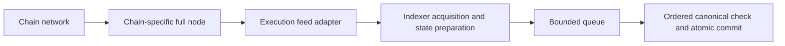

# Node-backed acquisition options (2026-10-15)

10/15 사용자 의도 확인 후 현재 설계는 [24시간 윈도우와 원천 DB](windowed-feed-design.md)로 변경했다. 아래 full node/ExEx 권장은 그 이전 검토 기록이다. 별도 full node 설치는 현재 개발 목표에 포함하지 않는다.

The indexer currently acquires verified block/receipt models through `pkg/source.Source`, prepares hash-bound state before handing work to the bounded acquisition queue, and makes a fresh canonical lookup before the ordered writer consumes prepared state. Public HTTP remains capped at 5 envelopes/s per chain. This note evaluates an alternative source; it does not add a node, deploy infrastructure, or change that cap.

## Recommended boundary

Use a separately maintained, chain-compatible full node and a narrow acquisition adapter. First establish a local RPC baseline; then evaluate IPC or an execution-extension stream carrying blocks, receipts, required state and chain updates. The performance gain would come from avoiding remote network/provider waits, receiving execution outputs once, and reducing repeated JSON encoding/query work. These are architectural expectations, not a measured speedup of this repository.

An RPC server module alone does not acquire blocks or execute the chain. Direct synchronization also requires chain networking, signature/finality verification, the chain's fork-choice rules, execution/state management and recovery. EVM compatibility does not make these layers identical across supported chains. A full node can verify the chain without becoming a validator.

Arc's official operator documentation describes a Malachite-based consensus layer that retrieves and verifies blocks and a Reth-based execution layer that executes transactions, maintains state and serves RPC. A plain embedded Go Ethereum RPC API is consequently not an Arc node. The current Go indexer and Arc's Rust execution client also have different runtimes. Keep this integration behind the source/state boundary rather than importing an entire client into the indexer.

Reth Execution Extensions (ExEx) are a close match to the proposed design: they run with the node and use shared memory, triggered by execution and reorg notifications. A remote ExEx can forward those notifications to another process. Whether Arc's pinned Reth fork exposes the necessary extension APIs and state outputs must be checked against that fork; generic Reth support is not evidence that an Arc extension already works.

## Required feed contract

- Identify chain, height, parent/hash and canonical/finality updates; retain the existing profile verification and receipt identity checks.
- Supply execution receipts and the exact state inputs needed by enabled features at their pinned block hashes. Block bodies alone do not replace balance/code/contract-call inputs.
- Capture required state before the node prunes it, or retain it until the consumer has durably acknowledged the corresponding cursor. A full node without archive history still needs this retention/acknowledgment contract.
- Bound bytes and work in flight, support backpressure, cancellation, disconnect/replay from a durable cursor and fork rollback. A best-effort live subscription alone is insufficient.
- Preserve a current canonical reader/check in the writer path. Merely receiving a previously canonical block does not prove it remains canonical when processed.
- Measure full acquisition and durable-processing rates plus p50/p95/p99 lag under execution, node storage and indexer storage load. Local execution has CPU/disk/sync costs and may compete with indexing on the same machine.

The existing `Source` abstraction already provides `Head`, `BlockWithReceipts` and `HashAt`. Native-state/code/call readers also need a compatible node-backed implementation if the objective is to remove HTTP state queries. Switching only the block source cannot eliminate those calls.

## Primary sources checked

- [Arc: Running a node](https://docs.arc.io/arc/concepts/running-a-node): node responsibilities, Malachite/Reth split, local endpoint and latency.
- [Reth: Execution Extensions](https://reth.rs/exex/overview/): execution/reorg notifications, shared-memory extensions and remote forwarding.
- [Geth: Batch requests](https://geth.ethereum.org/docs/interacting-with-geth/rpc/batch): independent requests can share an HTTP envelope; dependent requests still require stages.

## Implementation follow-up

The audited Arc source uses upstream Reth v2.2.0 via its SDK, not a separately hosted Reth fork. The optional ExEx module and Go adapter are now implemented; see [NODE_FEED](../NODE_FEED.md). No testnet node was started by the installer.
