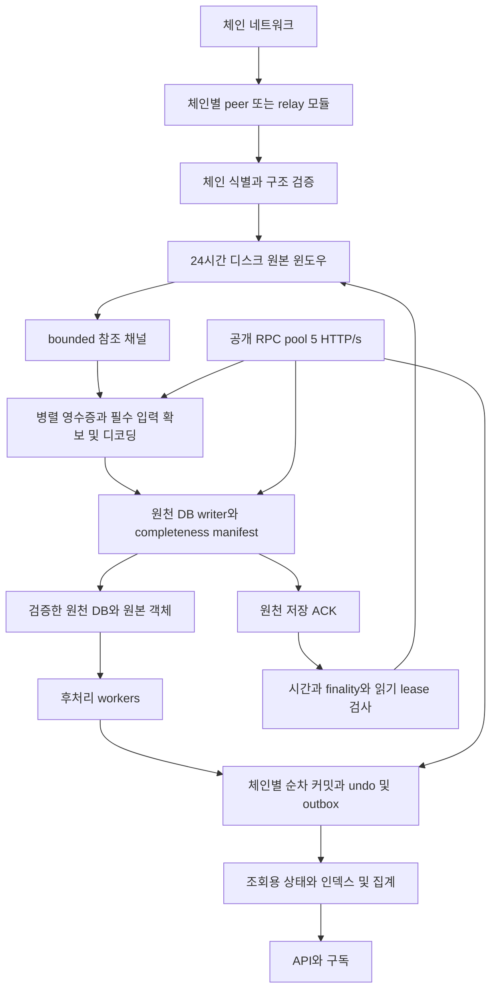

# 24시간 블록 윈도우와 원천 데이터 저장 설계

## 1 설계 결정

체인별 네트워크 모듈로 블록과 필요한 실행 자료를 받아 **최근 24시간의 원본을 디스크에 보관**한다. 원천 정보를 검증해 DB에 저장하고, 후처리 worker는 이 DB를 읽어 계정·계약·토큰·거래·통계 API용 데이터를 만든다. 원본 삭제는 데이터별 저장 완료와 finality 조건을 확인한 뒤 수행한다.

공통 계약과 `pkg/window`의 디스크 저장소 코어를 구현했다. capture identity/plan/manifest 검증, adapter/capability 계약, 별도 CanonicalReader와 원본 append/fsync·디스크 색인·재시작·lease·GC 승인 경계까지 포함한다. [현재 저장소 API와 한계](../WINDOW_STORAGE.md)를 따른다. [capture DB transaction/guard](../CAPTURE_STORAGE.md)는 bounded encoded dataset을 두 DB에 저장하는 공통 코어까지 구현했다. 삭제 실패/중단 시 durable fence와 참조를 유지한다. 정확한 DB token/참조와 윈도우 완료 기록을 대조하는 fence 복구 및 RunSession의 worker lifecycle을 구현했다. 공유 volume durable 예약·80/95% 압력 보고·엄격한 window_storage 설정→RunConfiguredSession 연결을 구현했다. 용량 부족에는 수신을 대기하고 후처리를 계속한다. 기존 앱의 미구현 활성화는 명시적으로 거부한다. [영구 객체와 기본 정규화 행](../PERMANENT_SOURCE_STORAGE.md)을 구현했다. 계정/storage/trace/blob 공급·전용 관계형 테이블·전역 검색·새 네트워크 adapter와 운영 앱 연결은 남아 있다. 현재 RPC 수집 설정과 기존 DB는 유지한다. 기존 [ExEx 구현](../NODE_FEED.md)은 비교 경로로 보존하며, 이 설계는 별도 full node 실행이나 대용량 체인 snapshot 설치를 요구하는 구조를 기본으로 삼지 않는다.

| 항목 | 결정 |
| --- | --- |
| 기본 원본 보관 시간 | 블록을 최초로 내구성 있게 수신한 시점부터 최소 24시간 |
| 정상 유입 1블록/초 | 24시간에 86,400블록 |
| 정상 유입 2블록/초 | 24시간에 172,800블록 |
| 메모리 | 기존 bounded queue와 작은 디코딩 창을 유지한다. 24시간 데이터는 디스크에 둔다 |
| 저장 위치 | 체인별 원본 디렉터리를 설정으로 지정한다. 외장 볼륨 사용 시 mount와 저장소 identity를 검증하며 내부 디스크로 자동 전환하지 않는다 |
| 네트워크 | 체인별 연결·동기화·검증 모듈. 원본 저장·DB·worker 실행은 공통 코어 |
| 원본 삭제 | 보관 시간 경과 + 필수 입력의 DB 저장 완료 + finality 또는 reorg 보존 조건 + 사용 중인 읽기 없음 |
| 후처리 | DB에서 재실행 가능한 해석·집계는 별도 cursor로 진행 |
| 정확성 | chain/hash 검증, fresh canonical 검사, 순서와 원자적 커밋, undo/outbox 계약 유지 |
| 공개 RPC | 체인별 기존 5 HTTP/s 유지. 재시도·failover·배치도 같은 pool 사용 |
| 구현 순서 | 데이터 계약과 체인별 공급 가능성 확인 → 디스크 윈도우와 원천 DB → 기존 writer 연결 → 독립 후처리 |

24시간은 원본의 정상 보관 목표이자 최소 보관 시간이다. 미저장 입력은 24시간이 지나도 삭제하지 않는다. 바이트 한도 때문에 목표를 유지할 수 없으면 수집을 제한하고 상태를 보고한다. 오래된 미처리 데이터를 몰래 버리는 TTL로 사용하지 않는다.

## 2 데이터 흐름과 역할



수신 goroutine은 연결 관리, 제한된 메시지 검증과 원본 append에 집중한다. ABI 해석·계약 분류·통계 집계를 기다리지 않는다. 재시작 가능한 읽기 위치를 먼저 기록하고 channel에는 원본 위치와 block identity를 전달한다. 큰 payload를 86,400개짜리 RAM 채널에 넣지 않는다.

Capture worker는 원격 노드에서 소실될 입력을 우선 확보한다. body·receipt·blob·state 입력은 독립적으로 받을 수 있으므로 블록별 manifest에 도착 상태를 기록한다. 소스가 제공하지 않는 trace나 state diff를 블록 데이터에서 자동 생성할 수 있다고 가정하지 않는다.

원천 DB writer는 완전한 입력과 그 검증 결과를 저장한다. 후처리 worker는 DB의 원천 자료를 사용한다. ABI 해석·DEX 집계가 늦어져도 필요한 자료가 DB에 있으면 원본 윈도우를 계속 보유할 필요가 없다. DB만으로 작업할 수 없는 legacy worker는 전환 기간 동안 별도의 삭제 차단 ACK를 유지한다.

## 3 24시간 용량과 메모리 예산

보관 개수는 고정 86,400개로 제한하지 않는다. 생성률이 바뀌어도 시간 기준을 유지한다. retention 시각은 `first_durable_received_at`이며 재수신·중복·재시작으로 갱신하지 않는다. 오래된 블록을 backfill해도 블록 timestamp 때문에 수신 즉시 삭제되지 않는다. 큰 시계 보정이 감지되면 삭제를 멈추고 시간 기준을 재확인한다.

```text
24시간 예상 블록 수 = 초당 블록 수 × 86,400
원본 보관 예산 = 실측 원본 바이트 유입률 × 86,400초
                + 열린 segment와 쓰기 중인 입력 및 metadata 여유
장애 후 backlog = 장애 동안의 수신량 - 그동안 원천 DB에 저장한 양
복구 시간 근사 = backlog / (복구 처리율 - 계속 들어오는 유입률)
```

복구 처리율이 유입률보다 클 때 backlog를 줄일 수 있다. 예를 들어 2블록/초에서 원천 저장이 30분 중단되면 3,600블록이 쌓이고, 복구 후 4블록/초로 저장하면 약 30분에 따라잡는다. 실제 worker 수는 블록 수뿐 아니라 transaction·receipt·state·trace·blob 바이트와 처리 비용으로 조정한다.

다음은 **원본 한 블록당 총 payload를 가정한 예산 예시**다. 현재 체인의 실측 크기가 아니며 metadata·파일시스템·DB 중복 저장·compaction은 제외한다.

| 가정한 평균 payload | 1블록/초의 24시간 | 2블록/초의 24시간 |
| --- | ---: | ---: |
| 64KiB | 5.27GiB | 10.55GiB |
| 256KiB | 21.09GiB | 42.19GiB |
| 1MiB | 84.38GiB | 168.75GiB |

`window.max_bytes`와 volume 전체의 `total_window_max_bytes`는 별도 필수 설정으로 둔다. 여러 체인의 예산 합계, staging/object 저장, 원천 DB 증가, compaction과 최소 disk 여유를 함께 확인한다. 24시간 목표를 기본값으로 확정하되 적절한 GiB 예산은 최초 관측에서 결정한다. 한도의 80%에서 남은 시간 예측을 경고하고, 95%에서 새 다운로드를 제한하며, 실제 admission은 설정한 절대 바이트 한도를 넘지 않도록 한다. 활성 쓰기와 최대 허용 record를 위한 예약 공간도 한도에 포함한다.

현재 `indexer.queue_blocks`는 메모리 큐이고 검증 상한이 65,536이다. 이 값을 86,400이나 172,800으로 올리는 방식은 채택하지 않는다. 디스크 윈도우 수량은 그 상한과 독립적이다. 기존 메모리 큐의 256블록·256MiB와 `2*workers` 준비 창은 출발점으로 보존하고 실제 payload 상주량을 측정한다.

## 4 원천 데이터와 저장 구조

원천 DB의 공통 identity는 `(chain identity, block_hash)`다. chain identity는 chain ID와 genesis hash를 포함한다. 같은 transaction이 다른 fork에 포함될 수 있어 transaction 본체와 inclusion을 분리한다. canonical 여부는 immutable 원천 행과 별도인 높이별 포인터와 generation으로 관리한다.

| 논리 저장 영역 | 식별자와 주요 필드 | 보존할 원천 정보 |
| --- | --- | --- |
| `block_headers` | chain, hash, number, parent, roots, timestamp, fork/codec version | 정확한 header bytes와 검증한 모델 필드, 합의 확장 |
| `block_bodies` | chain, block_hash, 정렬된 tx/ommer/withdrawal 참조 | 순서와 모든 body 부가 필드 및 해석하지 못한 원본 확장 |
| `transactions` | chain, tx_hash, type, 서명, from/to, nonce, value, input, fee/access/auth/blob 필드 | 원본 typed transaction bytes |
| `transaction_inclusions` | chain, block_hash, tx_index → tx_hash | fork별 거래 포함 관계 |
| `receipts` | chain, block_hash, tx_index, 실행 결과와 gas 필드 | consensus receipt bytes, profile별 파생 필드와 버전 |
| `logs` | chain, block_hash, block_log_index, tx_index | address, topics, data, 거래 내 순서 |
| `account_changes` | chain, block_hash, 실행 위치, address, field | balance/nonce/codeHash/storageRoot의 제공된 변경과 provenance |
| `account_current` | chain, address, 기준 block_hash와 generation | canonical 최신 상태와 확인 범위 |
| `contract_code` | code digest, chain/address의 유효 block 및 실행 위치 | runtime code 원본, 생성·delegation 정보와 code version |
| `storage_changes` | chain, block_hash, 실행 위치, address, slot | before/after, 알고 있는 값의 범위, 변경 근거 |
| `storage_current` | chain, address, slot, 기준 hash/generation | canonical slot 값. 알려지지 않은 값과 확인한 0을 구분 |
| `trace_frames` | chain, block_hash, tx_index, trace_path, tracer version | 호출 유형, from/to, input/output/value/gas/error, ancestor revert 여부 |
| `blob_refs` | chain, block_hash, tx_index, blob_index | versioned hash, commitment, proof, 데이터 위치와 완전성 |
| `payload_objects` | content digest, codec, length, durable location | 큰 blob·trace·witness와 그 검증 정보 |
| `state_inputs` | chain, state_hash, method, argument digest, scope | 초기 잔액·code·call·proof·witness의 정확한 hash-bound 입력 |
| `capture_manifests` | chain, block_hash, capture plan version | 필수 자료, 수량, digest, 수집·검증·저장 상태 |
| `capture_cursors` | chain, canonical generation | 구멍 없이 원천 저장을 끝낸 height와 hash |
| `projection_cursors` | chain, consumer, definition version, generation | 기능별 완료 height/hash와 필요한 입력 범위 |

실행 위치는 block 시작·transaction index·transaction 종료·block 종료를 구분한다. block 전후 값만 제공하는 source를 transaction별 변경을 제공하는 것으로 기록하지 않는다. `before`를 알 수 없으면 `before_known=false`로 저장한다. 중간 높이 시작에서는 checkpoint의 계정·slot 범위와 유효 hash를 기록하고, 그 이전이나 범위 밖 값을 0으로 만들지 않는다.

slot 원본과 ABI/storage layout 기반 해석은 별도 version으로 저장한다. ABI·소스 코드·검증 정보는 출처가 있는 메타데이터다. 이벤트만으로 모든 storage 변경을 채웠다고 표시하지 않는다. 호출 trace의 시도된 value 이동과 최종 적용된 상태 변경도 구분한다.

바이너리 digest·address·slot은 문자열보다 고정 길이 binary를 우선하고, uint256 금액은 손실 없는 32바이트/동등한 정수 표현을 사용한다. JSON 숫자의 부동소수점 변환은 금지한다. 기존 중립 모델의 `Raw`와 typed extensions를 재사용하되 원천 정보가 모델에 없는 경우 bytes를 보존한다. 동일 입력을 같은 schema/decoder version으로 재생하면 같은 결과가 나와야 한다.

전체 block/RPC JSON을 영구 중복 저장하는 대신 header bytes, transaction bytes, receipt bytes와 body 순서·확장을 분해해 저장한다. 이들로 원래 commitment를 재구성할 수 있음을 확인한 뒤 윈도우 원본을 지운다. 큰 객체를 외부 저장소에 둘 경우 객체 내구성·digest 확인 후 참조를 DB에 commit한다. DB 참조가 살아 있는 영구 객체는 윈도우 GC 대상이 아니다. 모든 정보를 보존하는 장기 DB/객체 저장 용량은 계속 증가한다.

## 5 데이터별 완료 상태와 제공 능력

Manifest는 각 dataset을 다음 상태로 관리한다.

| 상태 | 의미 |
| --- | --- |
| `missing` / `fetching` | 아직 원천 자료를 확보하지 못함 |
| `captured` | 원본 윈도우에 내구성 있게 저장함 |
| `verified` | 해당 데이터에 필요한 검증을 통과함 |
| `persisted` | DB/영구 객체와 참조를 내구성 있게 commit함 |
| `verified_empty` | 해당 블록의 정상적인 빈 결과를 확인하고 저장함 |
| `not_applicable` | 체인·fork 규칙상 해당 데이터가 존재하지 않음을 확인함 |
| `unsupported` / `failed` / `pruned` | 제공 불가·실패·소실. 완료로 취급하지 않음 |

Header/body/tx/receipt/log를 기본 필수 자료로 두고 활성 기능에 필요한 상태 입력도 필수로 선언한다. 포괄 수집 목표에서는 account/storage 변경·code·trace·blob까지 plan에 추가한다. 필수 자료를 제공할 source가 없으면 시작 시 capability 오류를 내며, 실행 중 소실되면 해당 manifest의 완료와 cursor 진행을 막는다. partial 포괄 수집을 사용하려면 필수 목록을 명시적으로 바꿔 coverage를 API에 표시해야 한다.

`account_changes`와 `storage_changes`는 `full_block_changes`, `tracked_scope` 등 완전성 범위를 함께 가진다. Arc native 이벤트로 얻은 이동 기록을 모든 계정/계약 storage 변경으로 승격하지 않는다. `blob`은 full payload·재구성 가능한 cells·일부 sample을 구분한다. 일부 sample만 있는 경우 full blob 완료가 아니다.

자료 무결성 검증과 원천 제공자의 신뢰도도 분리한다. transaction/receipt root, blob proof 등 검증 결과와 별개로 RPC balance의 hash binding은 전체 EVM 실행 검증을 뜻하지 않는다. `verification_kind`, `source_id`, `state_hash`, `proof_ref`, `scope`, `codec_version`을 남긴다. state root만 저장해서 실제 상태값이나 실행 witness를 확보한 것으로 표시하지 않는다.

Capture plan은 활성 handler가 요구할 수 있는 부모 잔액·생성 높이 code/call·현재 높이 보정·초기 checkpoint 입력을 선언한다. 후처리 DB에 이미 기록된 계정만 보고 입력 확보를 생략하면 worker가 늦을 때 필요한 상태를 놓칠 수 있다. canonical facts의 확인된 범위를 사용하거나 보수적으로 잠재 입력을 수집한다. 입력을 선언할 수 없는 custom handler는 DB-only worker로 표시하지 않고 raw-only 삭제 차단을 유지한다. 필요한 입력이 외부 source에서 더 먼저 사라질 수 있으므로 로컬 24시간 윈도우가 그 원격 보존 시간을 늘려 준다고 가정하지 않는다.

새 feature/정의가 기존 plan보다 많은 trace/state 입력을 요구하면 해당 과거 coverage를 검사한다. DB의 보존 자료로 재실행 가능한 해석과 외부 입력을 새로 확보해야 하는 backfill을 구분하고, 이미 소실된 자료에는 명시적 gap을 표시한다. 일부 wire 버전의 receipt 표현은 consensus receipt와 다를 수 있으므로 profile이 정규화한 encoding과 root를 검증하고 사용한 protocol/decoder version을 보존한다.

## 6 디스크 윈도우와 내구성

### SQL 입력과 식별자

원천 DB의 값은 바이너리 payload·JSON·주소·계약명·ABI·trace 필드를 포함해 모두 파라미터로 바인딩한다. 수집 데이터의 dataset/table 이름으로 SQL 테이블을 동적으로 만들거나 선택하지 않는다. dataset은 `core/model.DatasetKind`의 고정 목록으로 검증하고 실제 table/column은 저장소 내부의 고정 매핑만 사용한다. 필요 식별자는 허용 목록과 드라이버의 식별자 처리를 거치며, 값의 수동 escape는 주 방어로 사용하지 않는다.

기존 PostgreSQL의 값 바인딩을 유지하고 LIMIT/OFFSET도 바인딩하도록 정리했다. 재색인의 수동 table 따옴표 처리는 `pgx.Identifier`로 교체했다. 새 capture transaction 구현에서도 이 규칙을 계약 시험에 포함한다. prepared statement cache 여부와 SQL/값 분리는 구분한다. 수동 `Prepare` 호출이나 ORM 도입 자체가 바인딩보다 추가적인 방어를 보장하지 않는다. [설정과 현재 동작](../CONFIG.md#postgresql), [OWASP](https://cheatsheetseries.owasp.org/cheatsheets/SQL_Injection_Prevention_Cheat_Sheet.html)

### 외장 디스크와 저장 경로

`window.path`로 체인별 원본 저장 디렉터리를 지정한다. 외장 디스크를 사용할 때는 `feed_storage.volume_root` 아래에 체인별 `window/arc`, `window/sepolia` 등을 분리한다. 대용량 영구 원천 객체도 `feed_storage.objects_path`로 외장 디스크에 배치할 수 있다. 원본 윈도우와 영구 객체는 보존 정책이 다르므로 디렉터리와 GC를 분리한다. 조회용 DB 경로는 기존 database 설정으로 별도 지정하며, 원본을 외장 디스크로 옮겨도 DB 자체의 용량 증가는 계속 계산한다.

외장 볼륨 모드에서는 실제 mount와 초기 설정 때 등록한 저장소 marker의 `volume_id`를 모두 확인한다. mount가 없는 `/Volumes/...` 디렉터리를 내부 디스크에 자동 생성하지 않는다. 경로를 정규화한 뒤 symlink를 포함해 지정 볼륨 밖으로 벗어나지 않는지 검사한다. segment·임시 파일·compaction은 같은 지정 저장소 안에서 수행하고, 쓰기 권한·fsync/rename 지원·여유 공간·독점 writer lock을 시작 전에 확인한다. marker 생성과 새 볼륨 등록은 명시적인 초기 설정에서만 허용한다.

실행 중 분리·I/O 오류·볼륨 identity 변경을 발견하면 해당 저장소의 수신·쓰기·GC를 멈추고 원인을 보고한다. 실패한 원본에는 durable ACK나 완료 cursor를 기록하지 않는다. 이미 완료된 DB-only 작업은 필요한 영구 객체에 접근할 수 있을 때만 계속한다. 재연결 뒤 mount·identity·segment/manifest를 다시 검사해 durable cursor부터 재개한다. 감지 주기 사이의 분리에도 대비해 파일 연산의 오류와 열린 파일/디렉터리의 filesystem identity를 확인하며, 다른 디스크나 내부 경로로 자동 fallback하지 않는다.

Docker에서는 호스트의 외장 디렉터리를 컨테이너 `/data/feed`에 bind mount하고 설정 경로는 컨테이너 기준으로 지정한다. mount source가 없으면 실패하는 `--mount type=bind` 방식을 사용하고, 호스트 mount 검사와 컨테이너 내부 marker 검사를 함께 수행한다. Docker named volume에 대용량 원본이 기본 저장되지 않도록 한다. 경로 변경이나 데이터 이동은 writer를 정지하고 복사 무결성과 identity를 확인한 뒤 진행하며, 실행 중 hot switch는 지원하지 않는다.

### 원본 쓰기와 복구

현재 저장소 구현은 활성 segment의 제한된 참조만 RAM에 두고 닫힌 segment는 정렬된 디스크 색인으로 찾는다. 원본 fsync 뒤의 참조를 전달하며 crash 시 유효 frame에서 참조를 복구한다. `Page`의 append 위치는 canonical 연속 높이가 아니다. capture 완료 cursor/manifest와 내부 이벤트의 DB transaction은 `pkg/capture`에 구현했다. 단일 bootstrap checkpoint 이후 parent 연결이 맞는 연속 높이만 전진한다. 여러 store의 공유 바이트 예약과 재시작/프로세스 간 장부를 구현했고 부분 segment compaction은 남아 있으며, 현재 한도와 검증 범위는 [저장소 문서](../WINDOW_STORAGE.md)에 구분했다.

원본은 append-only segment와 작은 검색 metadata로 구성한다. record에는 format version, chain/genesis, dataset kind, block hash/height, payload length, checksum/content digest와 codec을 둔다. segment 목표 크기는 초기 설계값 256MiB로 하고 큰 단일 payload는 명시적으로 제한한 별도 객체로 쓴다. 총 한도는 segment·index·staging을 포함한다.

쓰기 순서는 `record append → segment fsync → metadata와 수신 cursor commit`이다. segment 쓰기 후 metadata commit 전에 죽으면 재시작 scan으로 유효 record를 다시 연결한다. metadata만 있고 유효 원본이 없으면 수신 완료로 인정하지 않고 누락 구간을 복구한다. 같은 identity에 다른 bytes/digest가 들어오면 덮어쓰지 않고 충돌로 보고한다.

채널은 `(chain, hash, generation, segment/object reference, manifest version)`을 전달한다. 수신 후 소유권이 넘어간 payload는 수정하지 않는다. segment 읽기는 lease를 획득하고 반환한다. lease와 작업 token은 취소·timeout·오류에서도 반환되어야 한다. 디코딩된 블록·상태·temporary encoding은 별도 메모리 예산으로 제한한다.

원천 DB 커밋은 검증된 rows·객체 참조·manifest·관련 cursor·내부 capture outbox를 하나의 transaction에 넣는다. fork 원천 자체는 보존할 수 있지만 canonical FactsReady cursor를 게시하기 직전에는 기존 pool로 fresh hash를 조회하고, transaction 안에서 generation/fork 조건을 재확인한다. 이후 projection 커밋의 fresh canonical 검사도 유지한다. 외부 객체와 DB 사이에 분산 transaction이 있다고 가정하지 않는다. 참조되지 않은 durable 객체는 재시도/유예 기간 뒤 회수하고, live 참조가 있는 객체는 보존한다.

## 7 ACK와 삭제 규칙

| 완료 지점 | 의미 | 원본 삭제 권한 |
| --- | --- | --- |
| 수신 완료 | 원본 record와 위치가 durable | 없음 |
| `FactsReady` | plan의 필수 데이터가 DB/객체에 완전하게 저장됨 | 다른 삭제 조건도 충족해야 함 |
| `ProjectionApplied` | 특정 기능의 결과·cursor·outbox가 durable | 그 기능이 raw-only consumer일 때만 추가 삭제 차단을 해제 |

```text
canDelete(block) =
    now >= first_durable_received_at + 24h
    AND required_plan_is_persisted(block_hash, plan_version)
    AND finality_or_reorg_policy_allows(block_hash, generation)
    AND all_raw_only_consumers_have_durable_ack(block_hash)
    AND active_read_leases == 0
    AND referenced_permanent_objects_are_durable
```

ACK는 height뿐 아니라 hash·generation·manifest version을 검증한다. out-of-order 완료는 완료 집합에 기록하되 cursor는 연속된 prefix만 진행한다. 재전송 ACK는 멱등적이고 유실 ACK는 DB manifest를 읽어 복구한다. 디코딩 완료·RAM 큐 입장·transaction 시작을 ACK로 취급하지 않는다.

삭제는 후보 표시 후 같은 generation과 lease 상태를 다시 확인하고, segment의 모든 live record가 삭제 가능할 때만 파일 단위로 수행한다. 부분 segment에 미완료 record가 있으면 그대로 두거나 여유 공간 안에서 살아 있는 record를 새 segment에 fsync한 뒤 위치를 원자적으로 교체한다. GC와 compaction이 같은 공간을 중복 예약하지 않는다.

finality를 신뢰할 수 없고 reorg 보존 기준도 없는 경우 자동 삭제를 진행하지 않는다. 높이가 finalized 높이 아래라는 이유만으로 미확인 fork를 final로 취급하지 않는다. orphan 원본도 분기 판정과 그 원천 정보의 저장 완료를 확인한다. 24시간 raw 보관과 기존 128블록 undo는 서로 다른 계약이다. undo 범위를 넘는 reorg는 원천 DB와 checkpoint에서 재구축하며 그동안 영향받은 projection의 최신 제공을 중단한다.

공간 부족 시 우선 안전하게 삭제 가능한 segment만 회수한다. 새 요청을 줄이거나 peer 수신을 중단해 durable resume 위치를 지킨다. 네트워크의 블록 생성 자체를 멈출 수는 없으므로 공급자의 과거 제공 범위를 벗어난 gap은 명시적 복구 실패로 표시한다. 큰 윈도우로 감당할 수 없는 장기 처리량 부족을 숨기지 않는다.

## 8 체인별 연결 모듈

공통 코어는 adapter registry와 capability를 사용한다. chain ID 분기로 protocol 동작을 넣지 않는다. 네트워크 모듈은 peer discovery/연결·프로토콜 협상·누락 범위 요청·합의 입력 검증을 제공하고, 원천 저장소와 API는 체인별 node 구현에 의존하지 않는다.

| 대상 | 연결 설계 | 구현 전 확인할 사항 |
| --- | --- | --- |
| Ethereum/Sepolia | consensus head를 확인하는 경로 + execution peer의 header/body/receipt 수집 | checkpoint 신뢰, 지원 ETH 버전, peer history 범위, blob/BAL 활성화 |
| BSC | BSC 프로토콜을 사용하는 별도 adapter | 실제 peer handshake와 전파/영수증 메시지, finality·validator 변경 검증 |
| StableNet | 프로젝트 P2P/코덱·WBFT 검증을 분리한 adapter | 현재 네트워크에서의 접속 가능성, 인증·epoch·영수증 제공 범위 |
| Arc | 공개된 signed finalized block relay 경로용 adapter | 서명 대상·validator set의 신뢰와 갱신, 본문/receipt/state/trace 제공 API |

Ethereum PoS의 head는 execution ETH 프로토콜만으로 결정하지 않는다. 보관 범위를 알리는 protocol 기능과 상대 peer의 헤더 제공 요구를 함께 맞춘다. 수신을 했다는 이유로 전체 상태를 실행 검증한 node처럼 광고하지 않으며, 재구성 가능한 범위만 제공한다. [ETH 프로토콜](https://github.com/ethereum/devp2p/blob/master/caps/eth.md)

Arc의 공개 full node는 consensus gossip에 참여하지 않고 relay에서 finalized block을 가져온다. 현재 공개 구조에 없는 P2P 참여를 지원한다고 가정하지 않는다. relay가 같은 공개 RPC endpoint를 사용하면 그 호출도 기존 5 HTTP/s 예산에 포함한다. Arc adapter의 protocol 감사가 첫 적용 여부를 결정한다. [Arc 노드 구조](https://docs.arc.io/arc/concepts/running-a-node)

Trace의 call tree와 state diff는 별도 데이터다. chain별 실행 결과 공급, 검증된 witness 또는 외부 hash-bound 상태 공급이 필요한 경우 capability에 드러낸다. BAL은 체인의 실제 fork 활성화와 peer 지원이 확인된 경우만 사용한다. 블록만으로 없는 초기 상태나 trace를 만들어내지 않는다. [Geth tracers](https://geth.ethereum.org/docs/developers/evm-tracing/built-in-tracers), [EIP-7928](https://eips.ethereum.org/EIPS/eip-7928)

Blob 원본과 transaction의 참조는 별도로 확보한다. 체인별 제공 방식·검증·재구성 규칙에 맞춰 저장하며 원본을 보존하지 않는 plan을 full blob 보존으로 표현하지 않는다. [EIP-4844](https://eips.ethereum.org/EIPS/eip-4844)

## 9 인터페이스와 프로젝트 경계

다음은 책임 경계다. `pkg/chainfeed`의 기본 adapter/capability·범위 제한, `core/model`의 capture 값/검증과 `pkg/window` 저장소 코어를 추가했다. `port.CaptureDatabase`와 `pkg/capture`의 독립 transaction/내부 이벤트/generation·DB guard를 구현했다. 현재 encoded dataset·영구 객체 참조·기본 정규화 행을 보관한다. 아래 schema 전체의 관계형 테이블/전역 검색·state 공급·실행 조립은 후속 구현이다. 기존 full-ingest writer는 [facts Source](../SOURCE_FACTS.md)로 연결했다.

```text
pkg/chainfeed/                chain identity, envelope, capabilities, adapter registry
pkg/window/                   segment, index, leases, retention, recovery, byte admission
pkg/capture/                  required plan, collection jobs, verification, FactsReady
pkg/core/port/                capture transaction과 facts reader 및 cursor 저장 계약 추가
pkg/source/facts/             원천 DB를 기존 source.Source로 읽는 adapter
internal/projection/               DB 기반 후처리 실행과 generation 및 consumer cursor
modules/feeds/<chain>/        체인별 독립 모듈과 protocol 시험
examples/windowed-indexer/    framework와 선택한 module을 연결하는 별도 실행 프로젝트
```

체인 모듈은 좁은 `pkg/chainfeed` 계약과 필요한 profile/crypto 타입에 의존한다. core는 외부 모듈을 import하지 않고, composition 실행 프로젝트가 registry에 등록한다. YAML은 이미 연결한 adapter를 선택한다. YAML만으로 새 코드를 불러오지 않는다. Rust가 필요한 검증기는 별도 작은 모듈과 versioned IPC로 연결할 수 있으나 Reth 전체 실행 컴포넌트를 기본 의존성으로 넣지 않는다.

| 계약 | 책임 |
| --- | --- |
| `FeedAdapter` | Capabilities, Subscribe, FetchRange, FetchDataset, VerifyChainUpdate, Close |
| `WindowStore` | AppendDurable, AcquireReadLease, Resume, MarkFactsReady, CollectEligible |
| `CaptureStore` | immutable 원천 쓰기와 manifest/cursor/outbox의 원자적 commit |
| `FactsReader` | hash별 block/receipt/state/trace/blob와 coverage 읽기 |
| `CanonicalReader` | commit 시점 fresh hash 조회, generation·finality 상태 |
| `ProjectionRunner` | consumer definition별 DB 입력, 순서 보장과 결과/cursor/outbox commit |

Feed wire는 새 namespace와 version을 사용한다. 기존 ExEx `nodefeed` v1과 의미를 혼용하지 않는다. 특히 기존 `source.CommitAcknowledger`는 처리 DB 커밋 후 ACK 계약이다. 이를 원천 DB 저장 ACK로 바꾸거나 ExEx pruning 이벤트를 이 설계의 GC 신호로 재사용하지 않는다.

현재 `CapturePlan.ValidateComplete`는 plan digest·generation의 존재·chain/genesis/block identity·필수 dataset별 범위/저장 상태/출처/검증 종류를 검사한다. tracked 범위는 선택 정의의 hash까지 구분하며 다른 주소/slot 집합의 결과로 충족하지 않는다. 이 메서드의 성공은 commit/ACK/GC 권한이 아니다. 실제 capture transaction은 객체 내구성·현재 generation 비교·fresh canonical·원자적 commit을 수행한다. 해당 객체의 내용/상태를 검증하는 공급 모듈은 별도 책임이다. `VerificationHashBound` 표시는 EVM 실행/상태 증명과 구분한다.

## 10 현재 writer와 API 연결

첫 연결은 `pkg/source/facts`가 기존 `Source`와 선택적 상태 reader를 제공하는 방식이다. `BlockWithReceipts`는 DB에서 검증된 입력을 재구성하고, `HashAt` 및 `SetStateSource`의 fresh canonical 경로는 기존 공개 RPC reader를 유지한다. native 초기 상태·code/call은 저장된 hash-bound 입력에서 읽도록 feature Deps를 연결한다. 필요한 입력이 없으면 원격 latest/0 fallback 없이 해당 작업이 실패한다.

기존 Feature Handler는 한 block transaction에서 결과·cursor·outbox를 커밋하므로 우선 그대로 사용한다. 별도 capture transaction은 immutable facts 영역을 쓰고 기존 projection undo와 분리한다. 같은 Pebble 인스턴스에서 context/쓰기 순서를 분리하고, PostgreSQL은 각 원자적 transaction으로 대응한다. 기존 height별 undo를 쓰는 여러 독립 projection writer를 바로 병렬 실행하지 않는다.

독립 후처리는 consumer별 transaction·undo/재구축 checkpoint·cursor·outbox contract를 추가한 뒤 켠다. worker의 준비는 병렬로 수행해도 잔액 등 순서 의존 결과는 consumer별 canonical 높이 순으로 commit한다. 같은 저장소의 실제 쓰기 충돌은 체인별 commit coordinator가 조정한다.

API는 chain head, 원천 준비 높이, 기능별 준비 높이와 coverage를 구분한다. 여러 projection을 조합한 응답은 같은 hash 기준으로 읽거나 공통 완료 높이까지 내려서 제공한다. 원천 `FactsReady`가 됐다는 이유로 기존의 사용자용 indexed event를 먼저 내보내지 않는다. 내부 capture 알림과 기존 durable outbox의 알림 계약을 분리한다.

## 11 재시작과 reorg

| 상황 | 처리 |
| --- | --- |
| segment append 중 종료 | 마지막 불완전 frame을 제외하고 재요청. 유효 frame만 metadata 복구 |
| segment fsync 후 metadata 전 종료 | scan 후 같은 digest로 멱등 연결 |
| 객체 저장 후 DB commit 전 종료 | 객체 재사용 또는 참조 없는 객체를 유예 뒤 회수 |
| DB commit 후 ACK 유실 | manifest/version/hash를 확인해 ACK 재전송 |
| worker 재시작 | 메모리 큐와 무관하게 durable cursor 다음 높이를 DB에서 읽음 |
| out-of-order 완료와 gap | 완료 상태만 기록하고 연속 prefix cursor를 유지 |
| fork 발견 | generation 변경, 진행 중 old job의 publish/commit 차단, 새 canonical 분기 확인 |
| 준비 뒤 reorg | 상태 입력은 hash로 격리하고 fresh 검사에서 거부. 기존 writer rollback 유지 |
| undo 범위 밖 reorg | 영향을 받은 projection 중지, 이전 checkpoint와 facts로 재구축 |
| 필수 remote state 소실 | pruned를 기록, cursor/GC 차단, 다른 검증 가능한 source 또는 명시적 재초기화 필요 |
| 처리 중 24시간 경과 | 필수 입력/lease 조건 때문에 원본을 보존. 여유 공간이 끝나면 수집 제한 |

새 generation은 canonical 포인터와 capture event에 원자적으로 반영한다. 늦게 끝난 옛 generation job이 최신 포인터나 cursor를 갱신할 수 없게 compare-and-swap 조건을 둔다. fork 원천은 immutable facts로 남기고 canonical projection만 rollback한다. canonical pointer/generation 갱신과 projection commit 사이의 동시성 검사는 같은 DB transaction의 fencing 조건으로 연결한다.

## 12 설계용 설정

아래 키는 **새 모드에 제안하는 설정이며 현재 config loader에서 동작하지 않는다**. 별도로 구현한 `window_storage` layout/세션 API는 [현재 설정 문서](../CONFIG.md#원본-윈도우-저장-설정)를 따른다. 실제 config.yaml이나 기존 queue 설정은 이번 설계에서 바꾸지 않는다.

```yaml
source:
  feed:
    enabled: false
    adapter: arc-relay
    window:
      retention: 24h
      path: /Volumes/IndexerData/indexer/window/arc
      max_bytes: 32GiB  # 한 체인의 예시. 실제 입력 바이트 관측 후 결정
      segment_target_bytes: 256MiB
    capture:
      workers: 4
      required_datasets:
        - headers
        - bodies
        - transactions
        - receipts
        - logs
        - account_changes
        - contract_code
        - storage_changes
        - traces
        - blobs
      state_scope: full_block_changes
feed_storage:
  volume_root: /Volumes/IndexerData  # 외장 디스크의 실제 mount 경로 예시
  require_mounted_volume: true
  volume_id: indexer-external-01    # 초기 설정 때 등록한 저장소 marker와 일치해야 함
  objects_path: /Volumes/IndexerData/indexer/objects
  total_window_max_bytes: 64GiB  # 공유 volume의 모든 체인 합계에 대한 예시
  min_free_bytes: 20GiB          # 원천 DB/객체/compaction 예산도 별도로 필요
rpc:
  rate_limit: 5
  coalesce_reads: true
indexer:
  acquisition_queue: true
  queue_blocks: 256
  queue_max_bytes: 268435456
```

예시의 포괄 required plan은 Arc가 모든 자료를 제공한다는 선언이 아니다. adapter와 보완 source가 해당 범위를 실제로 제공할 때만 켤 수 있다. fork상 적용되지 않는 blob 등은 검증된 `not_applicable`로 표현한다. 32GiB/64GiB 예산은 24시간 보장을 의미하지 않으며, 예를 들어 2블록/초·평균 256KiB에는 원본만 약42.19GiB가 필요하다. 사전 관측에서 한도 안에 목표가 들어오지 않으면 활성화 전 예산이나 수집 plan을 명시적으로 조정한다.

멀티체인에서는 adapter·window·capture plan을 각 chain 항목에서 지정하고 전역 socket/adapter를 모든 체인에 복제하지 않는다. 느린 체인이 다른 체인의 메모리 permit·disk 예약·공개 RPC quota를 가져가지 못하도록 체인별 제한과 volume 전체 한도를 함께 적용한다.

위 외장 디스크 이름과 identity는 예시다. 실제 외장 디스크 경로는 아직 지정하지 않았다. Docker에서는 `volume_root: /data/feed`, `objects_path: /data/feed/indexer/objects`, 체인별 `window.path: /data/feed/indexer/window/<chain>`로 바꾸고 호스트 디렉터리를 해당 root에 연결한다. native 실행과 컨테이너 실행 모두 같은 외장 저장소 marker를 검증한다.

## 13 구현 순서와 완료 기준

남은 코드 수정은 [현재 작업 목록](open-items.md)에 따라 R03 상태 보존·시작/복구, R04 수집·처리량, R07 저장 지연 계측을 함께 반영한다. 아래 W 단계가 구조적 의존성이고, 기존 작업 ID는 해결할 문제와 검증 범위를 추적한다. 각 단계에서 계측과 회귀 검증을 함께 추가하고 장기 운영은 마지막에 확인한다.

| 순서 | 구현 범위 | 완료 증거 |
| --- | --- | --- |
| W0 | 각 체인의 wire/relay·합의 검증·모든 dataset 공급 가능성 감사, capture 계약·schema 고정 | 실제 메시지 표본과 검증 fixture, required/unsupported 목록, RPC 물리 예산 |
| W1 | 디스크 윈도우·지정 경로/외장 mount·manifest·lease·바이트 예약·재시작·GC | 논리 시간으로 24시간·86,400/172,800높이·partial frame·full disk·동시 읽기/삭제·미연결/분리/다른 볼륨/권한 오류·Docker bind 경로 검증 |
| W2 | immutable 원천 DB와 객체 참조·capture transaction·정확성 검사 | 원본 재구성 commitment, 원자적 cursor/manifest/outbox, crash 지점별 재개 |
| W3 | 첫 가능한 체인 adapter와 hash-bound 필수 입력 수집 | 실제 네트워크 수신/누락 복구·수집 범위/peer 유지·5 HTTP/s 증거 |
| W4 | FactsSource와 기존 feature writer 연결 | 원천 입력의 DB-only 재생, 별도 fresh canonical reader, 저장 결과·잔액·outbox/reorg 동등성 |
| W5 | trace/state diff/blob·code version 전체 dataset 확장 | 명세별 원본과 검증 결과, required 실패 차단, coverage별 API 시험 |
| W6 | 독립 후처리와 기능별 cursor/API 준비 높이 | 중복 처리·재시작·definition 변경·fork·undo 밖 재구축 검증 |
| W7 | 24시간 이상 동시 운영과 장애 복구·용량 관측 | 4체인 head/원천/기능별 lag, 바이트·RSS·DB 증가, 고정 장애 구간 포함 전체 결과 |

W0에서 Arc relay의 필요한 범위를 먼저 확인한다. 해당 경로가 포괄 입력을 제공하지 못하면 이를 미지원으로 기록하고, 지원을 입증할 수 있는 BSC/StableNet 등 adapter를 비교해 첫 적용 체인을 정한다. protocol 확인 없이 full node를 설치하거나 snapshot을 내려받지 않는다.

검증은 빈 블록뿐 아니라 큰 block/많은 receipt·새 계정·contract 생성/위임·storage 변경·실패/revert·blob·fork를 포함한다. phase별 기능 시험에 Pebble/PostgreSQL 동일-input 재생을 사용한다. 새 동시성 코드는 race와 CPU1 반복을 수행하고, 문서만 바꾸는 단계에서는 런타임 시험을 실행하지 않는다.

## 14 운영 지표와 성능 판정

`observed_head`, `verified_head`, `received_contiguous`, `facts_ready`, `projection_ready{consumer}`를 각각 height/hash/generation과 함께 노출한다. 빈 DB는 null로 표시한다. window의 첫/마지막 수신 시각·보유 바이트·미완료 자료별 개수·고정된 lease/ACK·GC 지연 이유·free disk·추정 남은 보관 시간을 측정한다.

수신/자료 확보/DB 커밋/worker 대기·처리/publish의 p50/p95/p99를 분리한다. RPC는 물리 HTTP와 논리 멤버·한도 대기·provider quota 오류를 구분한다. 모든 재시도·연결 중단 시간을 throughput 분모에 포함하고, 수신 누락을 제외해 숫자를 좋게 만들지 않는다. 검증 범위를 고정한 같은 입력으로 비교하고 이후 실제 네트워크 운영 창으로 확인한다.

현재 Arc의 약2블록/초를 계속 수신하고 상태를 소실 전에 확보하는 것이 목표다. 450ms는 수신/필수 입력 확보 cadence 목표로 유지한다. P2P/relay 수신과 5 HTTP/s fresh canonical·추가 상태 조회·DB writer 중 무엇이 제한하는지 별도로 판정한다. trace/blob 등 필수 dataset을 제외한 측정을 포괄 수집 성능으로 발표하지 않는다.

이전 [RPC 큐 측정](work-log-2026-10.md#326-독립-rpc-http-배치-통합과-arc-재측정-1015)과 [Rust fixture 비교](work-log-2026-10.md#328-arc-node-feed-기록-기반-처리량-비교-1015)는 이 설계의 네트워크 수신·24시간 보관·포괄 상태 처리 성능을 입증하지 않는다. 새 모드의 완료는 W0부터 W7의 증거로 판단한다.
