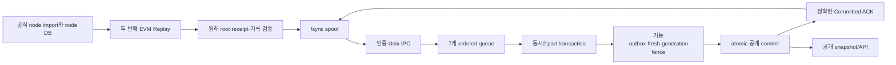

# E1 실행 수집 설계

현재 구현 계약이다. 계획과 완료 판정은 [03-plan](03-plan.md), [checklist](checklist.md), 현재와 직전 두 기능은 [continuity](continuity.json)를 따른다. 사용법은 [실행 수집 가이드](../../../EXECUTION_INGEST.md)에 있다. 과거 선택지·추정 성능·중간 상태는 Git history에서 확인한다.

## 1. 목적과 범위

StableNet 노드가 검증·import한 블록을 같은 공식 클라이언트 규칙으로 한 번 더 실행해 거래별·Finalize 상태 이력을 PostgreSQL에 저장한다. 첫 실행은 정상 node import, 두 번째 실행은 recorder Replay다. 공식 노드 소스를 고치지 않고 두 번째 node state commit을 금지한다.

E1은 명시적인 anchor·covered baseline·준비된 노드 DB를 전제로 하는 opt-in 기능이다. 초기 상태가 없는 DB에서 head에 바로 붙는 운영 bootstrap은 E2다. E1의 부분 coverage를 전체 archive나 임의 eth_call 실행 능력으로 확대하지 않는다. token metadata는 기존 RPC에 남긴다.

실제 node.Start·peer·성능 측정·포맷·GC 활성화는 보류다. EVM/WBFT 라이브러리, deterministic fake backend와 전용 fsync-on PostgreSQL로 기능을 검증한다.

## 2. 모듈과 흐름

| 모듈 | 위치와 책임 |
| --- | --- |
| wire | `execwire/`, 별도 go.mod·stdlib-only. version1, frame/parts/result 상한, 취소 가능한 I/O |
| recorder | `x/stablenet/executor/`, 별도 공식 fork 모듈. 실제 parent에서 거래/Finalize를 기록하고 두 번째 durable commit을 금지 |
| spool/exporter | 같은 실행부 모듈. canonical 전 높이 걷기, fsync 결과, 송신 window, exact ACK, reconnect·generation quarantine |
| node assembly | `nodebackend`, `cmd/stablenet-executor`. 공식 node/eth, explicit genesis/identity/paths, Hello/backlog 뒤 Start, 소유 node 종료 |
| IPC 수신·queue | `pkg/execution`. Unix listener/동일 UID, bounded assembler, verified profile decode, seven writers·publication·reorg controller |
| 저장/공개 | `pkg/storage/postgres/exec_*.go`, migration0014. core/state history·cursor·part·public proof·baseline·rewind |
| 기능과 앱 | `pkg/fetch/execution.go`, `pkg/app/execution*.go`. native journal feature, 기존 RPC canonical, 복구/시작/종료 |

root 모듈은 기존 geth1.16.5를 유지하며 공식 fork를 import하지 않는다. 실행부만 공식 `github.com/stable-net/go-stablenet` commit `4d17eea018c8dd579409db30bfd27de79c4f4121`을 고정한다. wire가 두 모듈의 의존 경계다.

## 3. 데이터 모델

| 자료 | 저장·의미 |
| --- | --- |
| header/body/transaction/receipt/log | 원래 raw RLP와 profile-verified model. core writer마다 자기 표와 exact part proof를 함께 commit |
| account | existence, nonce, uint256 balance, code hash, storage root, Extra의 before/after. anchor baseline과 삭제/tombstone 구분 |
| storage | address/slot before/after와 account clear. clear 전 슬롯이 현재 값으로 되살아나지 않음 |
| contract/code | immutable content-addressed code, activation/destruction history, verified successful outer creation 증거 |
| 실행 순서 | height/ordinal. tx index/hash와 Finalize cause를 따로 보존하며 Finalize의 tx_index=-1로 정렬하지 않음 |
| 작업 완료 | writer/generation/height/hash/digest part와 cursor. 최고 높이만으로 완료를 추정하지 않음 |
| 공개 | all-seven 이후 기능 checkpoint/outbox/visible hash·root/publication proof 원자 commit |
| 복구 | durable rewind marker와 새 generation. 첫 공개 부모·상태 root·최대128 public blocks·anchor 제한 |

알 수 없는 초기 상태는 0/없음이 아니라 coverage 오류다. 일반 Before를 묵시 baseline으로 쓰지 않는다. 성공한 생성자 소멸의 전후가 모두 부재라도 실제 account witness와 receipt를 보존한다. 실패 receipt와 zero 주소는 생성 색인에서 제외한다. internal transaction/call trace의 완전한 추출과 eth_call 재실행은 이 계정/slot 변화 모델이 보증하는 범위가 아니다.

SQL 값은 파라미터 바인딩한다. partition identifier는 고정 table allowlist와 검증된 정수로 만들고 quote한다. 일반 사용자 문자열을 SQL 구문으로 합치지 않는다.

## 4. 연결4개와 writer7개

writer는 queue/goroutine의 수이며 연결을 상시 소유하는 수가 아니다. 기존 pool `max_conns=4`를 늘리거나 다른 write pool을 만들지 않는다.

- API 예약1을 유지한다. 기존 유휴 예약 연결 차용 계약도 유지한다.
- seven part queue는 공정한 permit2로 DB transaction을 짧게 사용한다.
- 나머지 여유는 공개 transaction과 관리 조회에 쓴다.
- part permit을 가진 채 queue·다른 writer·RPC를 기다리지 않는다.
- final publication만 fresh를 기다릴 수 있다. 취소·오류는 transaction/permit을 반환하고 소유 worker를 join한다.

같은 writer의 높이는 연속이며 공개는 입력 순서다. count/bytes budget은 active 작업과 미공개 결과를 포함해 최종 공개까지 유지한다. 기본 queue는64블록/공유256MiB다. [scheduler 계약](07-scheduler-contract.md)이 검사 기준이다.

## 5. 공개와 fresh

part commit은 미공개 durable 저장이다. final transaction은 일치하는 seven proof를 확인하고 core 중복 쓰기 없이 기존 기능 표를 갱신한다. native balance는 profile accounting/RPC가 아닌 고정된 실행 journal을 쓴다.

기능 checkpoint·outbox·visible height/hash/root와 undo를 준비/flush한 뒤 기존 공유 RPC pool로 uncached canonical을 읽는다. physical HTTP attempts5/s, retry·failover도 같은 예산이다. 응답 뒤 generation/hash/root를 다시 검사하고 raw commit한다. 이후에만 API/event 공개와 source ACK가 가능하다. 이전 canonical 응답이나 Hello는 fresh/ACK가 아니다.

exact duplicate는 feature/outbox를 반복하지 않는다. ACK 유실 뒤의 확인은 저장된 full payload digest와 fresh를 다시 검사한다. rewind 후 살아남은 이전 generation의 canonical prefix도 정규화한 exact proof로 확인한다. [publication](08-publication-contract.md), [IPC](11-ipc-contract.md)를 따른다.

## 6. 조회

불변 core 조회는 static public views로 visible 높이를 제한한다. 작업용 latest row의 last_height만 필터링하지 않고 immutable history에서 공개 높이의 account/slot/code를 읽는다.

API는 기존 예약/차용 연결의 repeatable-read snapshot과 rewind shared advisory fence를 사용한다. 중첩 읽기는 같은 연결을 재사용한다. rows 종료/취소가 끝난 뒤 rollback/release하고 retained context가 새 pool로 빠지지 않는다. rewind 중이거나 fence try-lock 실패면 명시적 재시도 오류다.

E4 이후 PG native balance 조회는 account journal을 단일 권위로 사용하며 중복 feature projection은 쓰지 않는다. 기존 E1 projection 우선 규약은 [E4 계약](../../../EXECUTION_FEATURE_WRITERS.md)으로 대체됐다. 공개 밖/coverage 누락을 genesis RPC나 0으로 보정하지 않는다. GraphQL 표준 검증·깊이/복잡도·취소, JSON 오류 의미와 Playground를 유지한다. [읽기 계약](09-read-contract.md)을 따른다.

## 7. 시작·재연결·복구

indexer는 설정/profile/chain·genesis/원래 anchor·baseline·기능 definition/checkpoint를 확인한다. legacy clear/reindex/gap 경로는 IO 전에 거절한다. durable rewind를 API 생성 전, 다시 relay/listener 전에 복구한다. legacy backfill·Fetcher.Run·startup preparation을 함께 실행하지 않는다.

indexer가 새 private Unix listener를 만들고 실행부가 연결한다. 같은 UID, 디렉터리0700/socket0600을 양쪽에서 확인한다. 기존 경로를 대체하지 않고 종료 시 자신이 만든 같은 inode만 제거한다.

source Hello의 durable ACK와 DB Hello의 visible 높이는 정보다. 저장/삭제/rewind 권한이 아니다. startup backlog를 기존 tail까지 ACK받은 뒤 node.Start와 새 capture를 연다. node header가 backlog/anchor를 덮지 않거나 parent state가 없으면 명시적 checkpoint 복구 오류로 멈춘다. blind SetHead·latest-state 대체는 없다.

명시적 source Rewind는 현재 RPC canonical과 먼저 일치해야 한다. RPC가 뒤처졌으면 generation을 올리지 않는다. fresh가 감지한 reorg와 validated Rewind는 durable marker/새 generation으로 admission을 막고 old queue를 join한다. core/state/feature undo와 cursor를 최대128 public blocks의 같은 복구 transaction에서 복원하고 final fresh/fence 뒤 공개를 재개한다. 중간 오류는 marker를 남기고 전체 Resume를 rollback한다. 재시작에서 원자 Resume를 다시 수행한다.

복구 성공은 새 Hello를 받는 retryable 상태다. old-generation raw는 quarantine해 보존하고 quota에 포함한다. DB restore가 source generation보다 과거면 자동 진행하지 않는다. [rewind](10-rewind-contract.md), [runtime](12-runtime-contract.md)을 따른다.

## 8. 자원과 실패

| 자원 | 현재 계약 |
| --- | --- |
| wire | frame8MiB, header64KiB, block64MiB, parts4096·JSON 구조 상한 |
| assembler | 기본8/최대64블록,256MiB, bounded TTL |
| spool | 기본4GiB/262144 records, temp/meta/quarantine 포함; fsync/rename/dir-fsync 이후 전송 |
| quota/parent/semantic 오류 | 원본을 버리지 않고 exporter owner를 중단, 소유 node/spool 종료. 자동 삭제/자동 재시작 없음 |
| node DB | path scheme, StateHistory=0/TransactionHistory=0. E3 전 history 자동 삭제 없음. 모든 과거 root의 직접 접근을 보증하지 않음 |
| node 서비스 | explicit static peers·discovery off·HTTP/WS/node IPC off·mining/Engine API 시작 없음 |
| 실제 운영 | disk identity/APFS, Docker VM/용량 감시, backup/WAL·복원, peer·지속 운전은 별도 검증 |

## 9. 기능 검증과 다음 단계

recorder는 원래 state/receipt root·gas를 대조하고 독립 양방향 trie oracle과 record-only omission fault를 검사한다. frozen fixture는 실제 EVM/WBFT 첫 실행의 parent/final 상태를 expected로 저장하고 Replay의 durable write 부재를 검사한다. 같은 bytes가 root의 실제 PG/7-writer/feature/GraphQL 및 native Unix IPC·lost ACK·reorg/restart를 통과한다.

최종 whole-suite/race·단일200회·필수 CI4·squash/main 결과는 [checklist](checklist.md)에 기록한다. 운영/성능은 기능 GREEN과 구분한다. [통합 계약](13-integration-contract.md)과 [남은 전체 작업](../../../analysis/open-items.md)을 따른다.

E2는 전체 상태 bootstrap·검증된 checkpoint/parent 복구, E3는 ACK/reorg 기반 node/raw 보존·삭제, E4는 기존 feature writer 분리, E5는 체인 확대, E6는 합의/finality와 RPC 의존 축소다. 실제 노드·peer·성능·GC 보류는 E1 완료 후에도 유지한다.
